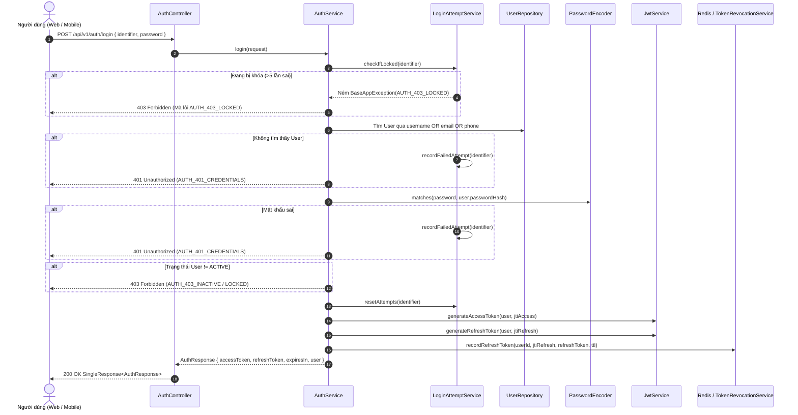
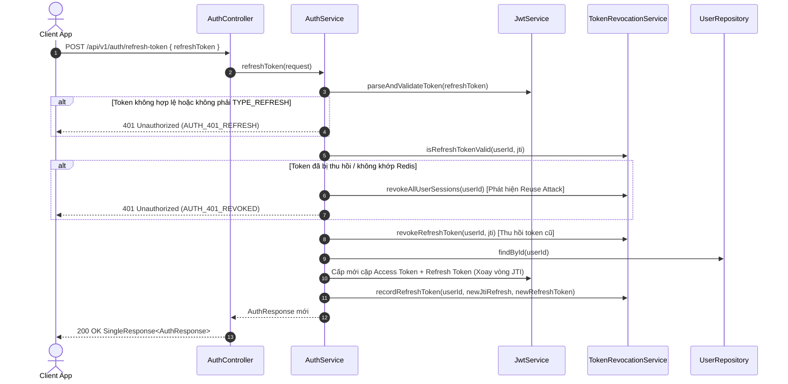
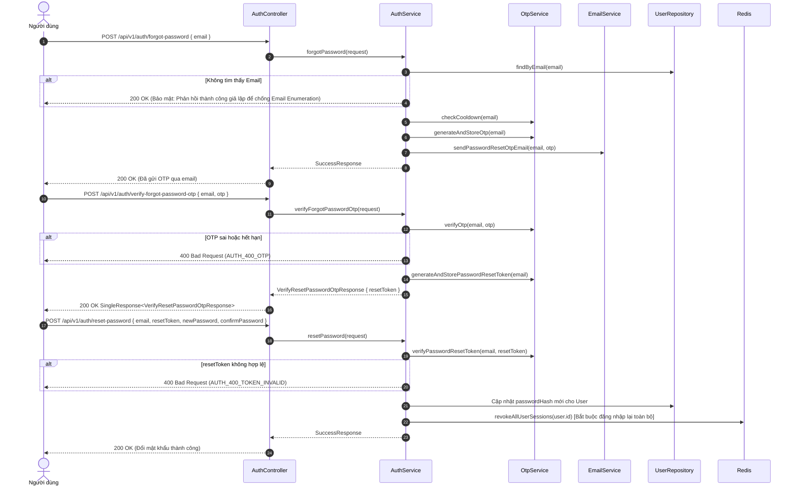

# Kiến trúc & Quy trình Xác thực Hệ thống (Authentication Workflow)

Tài liệu thiết kế chi tiết phân hệ Xác thực & Phân quyền (**Authentication & Authorization**) cho dự án **KTX Hub / PDMS** (`dormitory-management`), tuân thủ nghiêm ngặt các quy tắc nghiệp vụ trong `docs/SRS.md` (FR-21 đến FR-24, BR-09, BR-11) và `AGENT.md`.

---

## 1. Mục tiêu & Phạm vi (Scope & Objectives)

### 1.1. Mục tiêu chức năng
1. **FR-21: Đăng nhập an toàn & Cấp quyền phiên làm việc**
   - Đăng nhập linh hoạt bằng `username`, `email` hoặc số điện thoại (`phone`) kết hợp `password`.
   - Mật khẩu mã hóa băm một chiều an toàn bằng **BCrypt** (strength 12).
   - Cơ chế chống tấn công Brute-force: Tự động khóa tạm thời tài khoản **15 phút** nếu đăng nhập sai liên tiếp **5 lần**.
   - Cấp phát cặp JWT Token: **Access Token** (ngắn hạn) và **Refresh Token** (dài hạn).
2. **FR-22: Đăng xuất an toàn & Hủy phiên**
   - Đưa `jti` (JWT ID) của Access Token vào Blacklist trên Redis theo thời gian hết hạn còn lại.
   - Thu hồi Refresh Token trong Redis; hỗ trợ đăng xuất khỏi tất cả các thiết bị (`logout-all`).
3. **Cấp phát lại phiên làm việc (Token Refresh)**
   - Sử dụng Refresh Token hợp lệ để cấp mới Access Token và xoay vòng Refresh Token (Refresh Token Rotation - RTR).
4. **FR-24: Đổi mật khẩu & Khôi phục mật khẩu qua OTP**
   - Đổi mật khẩu chủ động khi đã đăng nhập (yêu cầu mật khẩu cũ + kiểm tra độ mạnh mật khẩu mới).
   - Quên mật khẩu: Gửi mã OTP 6 chữ số qua email, thời gian sống (TTL) **5 phút**, thời gian chờ gửi lại (cooldown) **60 giây**, giới hạn tối đa 3 lần/giờ.
   - Xác thực OTP thành công cấp một `resetToken` sử dụng 1 lần để đổi mật khẩu mới.
5. **Thông tin định danh & Hồ sơ cá nhân (`GET /api/v1/users/me`)**
   - Tách biệt trách nhiệm sang `UserController`: Trả về thông tin cơ bản của tài khoản đang đăng nhập kèm Role (`MANAGER`, `TECHNICIAN`, `TENANT`) và chi tiết hồ sơ nhân sự (`staff_profiles`) hoặc hồ sơ khách thuê (`tenants`).

### 1.2. Ranh giới loại trừ (Out-of-Scope)
- **TUYỆT ĐỐI KHÔNG làm OAuth2 / Social Login** (Google, Facebook...) theo yêu cầu trực tiếp của dự án.
- **TUYỆT ĐỐI KHÔNG hỗ trợ tự đăng ký tài khoản từ bên ngoài** (theo `BR-09`: Khách thuê và nhân sự do Ban Quản lý cấp tài khoản trực tiếp trong hệ thống khi tạo hợp đồng hoặc tiếp nhận nhân sự).

---

## 2. Kiến trúc Bảo mật & Mô hình Dữ liệu (Security Architecture)

### 2.1. Phân tầng Phân quyền (RBAC & Roles)
Hệ thống sử dụng mô hình phân quyền tinh giản 3 vai trò:
- `ROLE_MANAGER`: Ban Quản lý / Chủ KTX (Desktop Web Dashboard).
- `ROLE_TECHNICIAN`: Kỹ thuật viên bảo trì (Mobile App).
- `ROLE_TENANT`: Khách thuê (Mobile-First Web/App).

### 2.2. Cơ chế Lưu trữ & Quản lý Trạng thái Phiên trên Redis
Mặc dù API là Stateless, hệ thống kết hợp **Redis** để quản trị vòng đời Token, bảo vệ brute-force và xử lý OTP:

| Tiền tố Redis Key | Cấu trúc Key | Kiểu dữ liệu | TTL | Mục đích |
| :--- | :--- | :---: | :---: | :--- |
| `auth:blacklist:` | `auth:blacklist:{jti}` | String (`REVOKED`) | Thời gian sống còn lại của Access Token | Chặn các Access Token đã logout trước khi hết hạn. |
| `auth:refresh:` | `auth:refresh:{userId}:{jti}` | String (`refreshToken`) | 7 ngày (`refresh-token-expiration`) | Lưu vết và đối soát Refresh Token hợp lệ của user. |
| `auth:sessions:` | `auth:sessions:{userId}` | Set (`{jti1, jti2...}`) | 7 ngày | Danh sách các session đang hoạt động của user (dùng cho `logout-all`). |
| `auth:login:attempts:` | `auth:login:attempts:{identifier}` | String (`int count`) | 15 phút | Đếm số lần đăng nhập sai liên tiếp. |
| `auth:login:locked:` | `auth:login:locked:{identifier}` | String (`LOCKED`) | 15 phút | Đánh dấu tài khoản đang bị tạm khóa do brute-force. |
| `auth:otp:forgot_pwd:` | `auth:otp:forgot_pwd:{email}` | String (`otp`) | 5 phút (`ttl-minutes`) | Mã OTP 6 số xác thực quên mật khẩu. |
| `auth:otp:cooldown:` | `auth:otp:cooldown:{email}` | String (`SENT`) | 60 giây | Ngăn chặn spam gửi lại OTP liên tục. |
| `auth:pwd_reset_token:` | `auth:pwd_reset_token:{email}` | String (`resetToken`) | 10 phút | Token dùng 1 lần để thực hiện đổi mật khẩu sau khi OTP pass. |

---

## 3. Quy trình Tuần tự (Sequence Diagrams)

### 3.1. Luồng Đăng nhập Hệ thống (FR-21)


### 3.2. Luồng Cấp lại Token (Refresh Token Rotation)


### 3.3. Luồng Quên & Khôi phục Mật khẩu qua OTP (FR-24)


---

## 4. Chi tiết Các API Endpoints

Mọi Endpoint bọc trong chuẩn Envelope (`SingleResponse`, `SuccessResponse`, `ErrorResponse`) qua `ResponseFactory`.

| Phương thức | Đường dẫn API | Xác thực | Quyền | Mô tả |
| :---: | :--- | :---: | :---: | :--- |
| `POST` | `/api/v1/auth/login` | Public | None | Đăng nhập tài khoản, trả về JWT Access & Refresh Token. |
| `POST` | `/api/v1/auth/refresh-token` | Public | None | Cấp lại Access Token mới bằng Refresh Token hợp lệ. |
| `POST` | `/api/v1/auth/logout` | Bearer Token | Authenticated | Đăng xuất, vô hiệu hóa Access Token và Refresh Token hiện tại. |
| `POST` | `/api/v1/auth/logout-all` | Bearer Token | Authenticated | Đăng xuất toàn bộ các phiên làm việc của user trên mọi thiết bị. |
| `POST` | `/api/v1/auth/change-password` | Bearer Token | Authenticated | Đổi mật khẩu cho người dùng hiện tại (cần mật khẩu cũ). |
| `GET` | `/api/v1/users/me` | Bearer Token | Authenticated | Lấy thông tin tài khoản và Role của user đang đăng nhập. |
| `POST` | `/api/v1/users/technicians` | Bearer Token | `ROLE_MANAGER` | Quản lý tạo tài khoản Kỹ thuật viên mới (FR-23). |
| `GET` | `/api/v1/users/technicians` | Bearer Token | `ROLE_MANAGER` | Lấy danh sách kỹ thuật viên phân trang kèm bộ lọc. |
| `GET` | `/api/v1/users/technicians/{id}` | Bearer Token | `ROLE_MANAGER` | Lấy chi tiết kỹ thuật viên theo ID. |
| `PATCH` | `/api/v1/users/technicians/{id}/status` | Bearer Token | `ROLE_MANAGER` | Khóa hoặc mở khóa tài khoản kỹ thuật viên. |
| `PUT` | `/api/v1/users/technicians/{id}` | Bearer Token | `ROLE_MANAGER` | Quản lý cập nhật họ tên, email hoặc số điện thoại của kỹ thuật viên. |
| `POST` | `/api/v1/auth/forgot-password` | Public | None | Yêu cầu gửi mã OTP 6 số qua email để khôi phục mật khẩu. |
| `POST` | `/api/v1/auth/verify-forgot-password-otp` | Public | None | Xác thực mã OTP, nhận `resetToken` một lần. |
| `POST` | `/api/v1/auth/reset-password` | Public | None | Đặt lại mật khẩu mới bằng `resetToken`. |

---

## 5. Danh mục Mã lỗi Chuẩn hóa (`AuthErrorCode`)

| Mã lỗi | HTTP Status | Thông điệp tiếng Việt |
| :--- | :---: | :--- |
| `AUTH_401_CREDENTIALS` | 401 | Tên đăng nhập hoặc mật khẩu không chính xác |
| `AUTH_401_REFRESH` | 401 | Refresh token không hợp lệ hoặc đã hết hạn |
| `AUTH_401_REVOKED` | 401 | Phiên làm việc đã bị thu hồi hoặc đăng xuất |
| `AUTH_403_RATE_LOCKED` | 403 | Tài khoản tạm thời bị khóa 15 phút do nhập sai mật khẩu quá 5 lần (FR-21) |
| `AUTH_403_LOCKED` | 403 | Tài khoản đã bị khóa bởi Quản trị viên. Vui lòng liên hệ Ban Quản lý |
| `AUTH_403_INACTIVE` | 403 | Tài khoản chưa kích hoạt hoặc đã bị vô hiệu hóa |
| `AUTH_400_OLD_PASSWORD` | 400 | Mật khẩu hiện tại không chính xác |
| `AUTH_400_PASSWORD_CONFIRM` | 400 | Mật khẩu xác nhận không khớp |
| `AUTH_400_PASSWORD_SAME` | 400 | Mật khẩu mới không được trùng với mật khẩu cũ |
| `AUTH_400_OTP` | 400 | Mã OTP không chính xác hoặc đã hết hạn |
| `AUTH_400_RESET_TOKEN` | 400 | Mã xác thực đặt lại mật khẩu không hợp lệ hoặc đã hết hạn |
| `AUTH_429_OTP_COOLDOWN` | 429 | Vui lòng đợi 60 giây trước khi yêu cầu gửi lại OTP |
| `AUTH_404_USER` | 404 | Không tìm thấy người dùng tương ứng |
| `TECH_404` | 404 | Không tìm thấy thông tin kỹ thuật viên |
| `AUTH_409_EMAIL` | 409 | Email đã được sử dụng trong hệ thống |
| `AUTH_409_PHONE` | 409 | Số điện thoại đã được sử dụng trong hệ thống |

---

## 6. Cấu trúc Thư mục Triển khai

```text
src/main/java/com/uit/dormmanagement/
├── configs/
│   └── RedisConfig.java
├── constants/
│   └── RedisKeyConstants.java
├── controllers/
│   └── AuthController.java
├── dtos/
│   ├── request/auth/
│   │   ├── LoginRequest.java
│   │   ├── RefreshTokenRequest.java
│   │   ├── ChangePasswordRequest.java
│   │   ├── ForgotPasswordRequest.java
│   │   ├── VerifyOtpRequest.java
│   │   └── ResetPasswordRequest.java
│   └── response/auth/
│       ├── AuthResponse.java
│       ├── UserResponse.java
│       └── VerifyResetPasswordOtpResponse.java
├── exceptions/error/
│   └── AuthErrorCode.java
├── security/
│   ├── CustomAccessDeniedHandler.java
│   ├── CustomAuthenticationEntryPoint.java
│   ├── CustomUserDetailsService.java
│   ├── JwtAuthenticationFilter.java
│   ├── JwtService.java
│   ├── SecurityConfig.java
│   ├── SecurityUtils.java
│   ├── TokenPayload.java
│   └── UserPrincipal.java
└── services/
    ├── AuthService.java
    ├── EmailService.java
    ├── LoginAttemptService.java
    ├── OtpService.java
    ├── TokenRevocationService.java
    └── impl/
        ├── AuthServiceImpl.java
        ├── EmailServiceImpl.java
        ├── LoginAttemptServiceImpl.java
        ├── OtpServiceImpl.java
        └── TokenRevocationServiceImpl.java

---

## 7. Dữ liệu Khởi tạo Mẫu (Seed Demo Users - V3 Migration)

Tạo sẵn các tài khoản đại diện cho các vai trò trong `V3__seed_demo_users.sql` với mật khẩu mặc định `Password@123` (băm BCrypt qua pgcrypto `crypt('Password@123', gen_salt('bf', 12))`):

1. **Quản lý (`MANAGER`):**
   - Username: `manager`
   - Email: `manager@dorm.vn` | SĐT: `0901000001`
   - Profile: Liên kết bản ghi `staff_profiles` (Họ tên: *Nguyễn Văn Quản Lý*).
2. **Kỹ thuật viên (`TECHNICIAN`):**
   - Username: `technician`
   - Email: `technician@dorm.vn` | SĐT: `0902000002`
   - Profile: Liên kết bản ghi `staff_profiles` (Họ tên: *Trần Kỹ Thuật*).
3. **Khách thuê (`TENANT`):**
   - Username: `tenant`
   - Email: `tenant@dorm.vn` | SĐT: `0903000003`
   - Profile: Liên kết bản ghi `tenants` (Mã: `TN-0001`, Họ tên: *Lê Khách Thuê*, CCCD: `079201000001`, Giới tính: `MALE`).
4. **Khách thuê thử nghiệm Email OTP (`TENANT`):**
   - Username: `chinhhd`
   - Email: `hoangducchinh730@gmail.com` | SĐT: `0904000004`
   - Profile: Liên kết bản ghi `tenants` (Mã: `TN-0002`, Họ tên: *Hoàng Đức Chính*, CCCD: `079201000002`, Giới tính: `MALE`).
