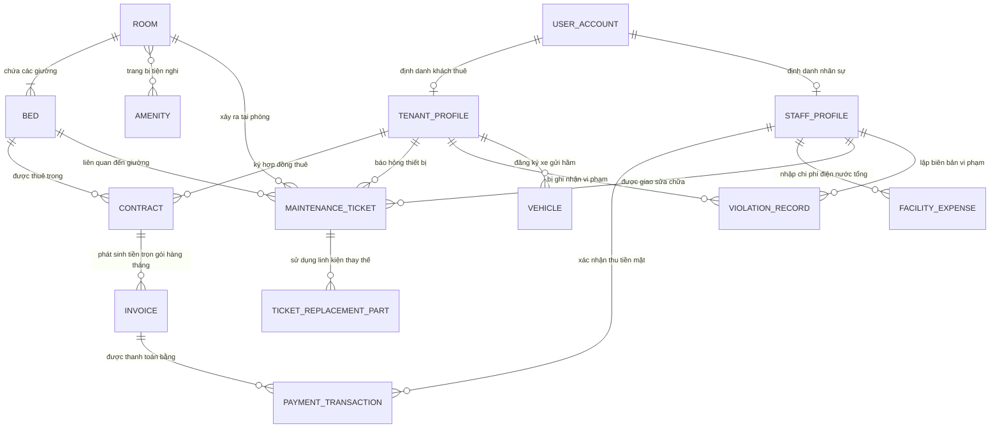

# TÀI LIỆU THIẾT KẾ MÔ HÌNH DỮ LIỆU MỨC KHÁI NIỆM (CONCEPTUAL ERD)
## DỰ ÁN: HỆ THỐNG QUẢN LÝ KÝ TÚC XÁ TƯ NHÂN (KTX HUB / PDMS)

---

| Thông tin tài liệu | Chi tiết |
|:---|:---|
| **Dự án** | Private Dormitory Management System (PDMS / KTX Hub) |
| **Phiên bản (Version)** | 3.1 (Rà soát toàn diện & Đối soát 100% Ma trận Bản số với Sơ đồ Thực thể) |
| **Trạng thái (Status)** | Đã phê duyệt (Approved for Implementation) |
| **Tác giả / Biên soạn** | Ban Kỹ thuật & Quản trị Dữ liệu KTX Hub |
| **Phạm vi lưu trữ** | Thư mục `docs/Conceptual_ERD.md` |

---

## 1. TỔNG QUAN VÀ BỐI CẢNH NGHIỆP VỤ (DOMAIN CONTEXT)

Mô hình dữ liệu KTX Hub được thiết kế dựa trên thực tế vận hành chính xác của ứng dụng Prototype:

1. **Quản lý duy nhất 01 Tòa nhà theo Tầng (Single-facility Architecture):**
   - Không có khái niệm nhiều tòa nhà hay chi nhánh. Toàn bộ cơ sở lưu trú là **01 Tòa nhà duy nhất**, được phân cấp quản lý theo **Tầng** linh hoạt (`floor: 1, 2, 3...`).
2. **Quản lý theo vị trí giường riêng biệt (Bed-level Tracking):**
   - Đơn vị cho thuê và quản lý là từng vị trí giường tiêu chuẩn (`G01, G02, ...`), áp dụng giá thuê đồng nhất theo phòng và khách thuê riêng biệt trong từng phòng.
   - Khóa vị trí giường duy nhất: `RoomCode-BedCode` (Ví dụ: `P.302-G02`).
3. **Quy tắc cách ly giới tính nghiêm ngặt 100% (Gender Isolation Policy):**
   - Mỗi phòng gắn cố định chính sách giới tính (`Nam` hoặc `Nữ`). Hệ thống tuyệt đối ngăn chặn việc xếp khách khác giới tính vào cùng phòng.
4. **Mô hình Khách thuê đa đối tượng (Multi-demographic Tenants):**
   - Khách thuê mở rộng cho mọi đối tượng: Người đi làm, freelancer, sinh viên. **Không quản lý các trường học vị** như trường đại học, khoa, mã số sinh viên (MSSV) hay diện ưu tiên chính sách.
5. **Tiếp nhận & Cấp tài khoản trực tiếp (Direct Onboarding):**
   - Khách thuê không tự tạo tài khoản trước. Ban quản lý trực tiếp tạo hồ sơ người thuê và gán ngay một vị trí giường trống trên hệ thống sau khi khách xem phòng trực tiếp bên ngoài.
6. **Giá thuê trọn gói & Quản lý Hóa đơn tiện ích tổng để tính Lợi nhuận ròng:**
   - **Không đo công tơ điện nước từng phòng và không chia tiền lẻ từng ngày** (loại bỏ hoàn toàn công tơ phụ và bảng chia lẻ). Khách đóng tiền phòng trọn gói hàng tháng (all-inclusive).
   - Chủ cơ sở nhập các hóa đơn chi phí tiện ích tổng của cơ sở (Hóa đơn tiền điện EVN, hóa đơn nước, cước Internet).
   - Công thức tính: `Lợi nhuận ròng = Doanh thu thực thu - Chi phí sửa chữa hoàn thành - Tiền điện tổng - Tiền nước tổng - Cước Internet`.
7. **Thứ tự ưu tiên xử lý sự cố kỹ thuật (Maintenance Prioritization):**
   - Phiếu sự cố phân 3 cấp độ: `Khẩn cấp` (Rank 0) > `Cao` (Rank 1) > `Bình thường` (Rank 2). Kỹ thuật viên thao tác trên di động, công việc tự động sắp xếp việc khẩn cấp xử lý trước.
8. **Hồ sơ vi phạm nội quy (Violations):**
   - Ghi nhận vi phạm gắn trực tiếp với cá nhân người thuê: Người thuê, Loại vi phạm, Mức độ xử lý (Nhắc nhở / Cảnh cáo / Phạt tiền), Tiền phạt và Ghi chú. **Không gắn với phòng (`room_id`)**.
9. **Quản lý phương tiện hầm xe trọn gói (Vehicles):**
   - Phí gửi xe **được bao trọn gói 100% trong tiền thuê phòng, tuyệt đối không thu bất kỳ khoản tiền nào của khách**.
   - Thực thể `VEHICLE` chỉ phục vụ mục đích quản lý trật tự an ninh hầm xe, lưu trữ thông tin xe (biển số, loại xe, màu sơn, ảnh cà vẹt xe) và kiểm soát cấp phát / thu hồi thẻ từ ra vào.

---

## 2. DANH MỤC THỰC THỂ KHÁI NIỆM (CORE BUSINESS ENTITIES)

Hệ thống được tổ chức thành 4 phân vùng nghiệp vụ chính với 14 thực thể cốt lõi:

| STT | Tên thực thể | Tên tiếng Anh | Vai trò và Ý nghĩa nghiệp vụ |
|:---:|:---|:---|:---|
| **I** | **Không gian lưu trú (01 Tòa nhà duy nhất)** | | |
| 1 | **Phòng** | `ROOM` | Đơn vị phòng ở, thuộc tầng cụ thể (`floor`), có sức chứa, loại phòng, chính sách giới tính cố định (`Nam`/`Nữ`) và đơn giá cơ bản. |
| 2 | **Giường / Vị trí nằm** | `BED` | Vị trí giường cá nhân tiêu chuẩn (G01, G02...), có giá thuê đồng nhất theo phòng và trạng thái độc lập (`AVAILABLE`, `OCCUPIED`, `MAINTENANCE`). Chỉ được bảo trì khi không có người ở. |
| 3 | **Tiện nghi phòng** | `AMENITY` | Danh mục trang thiết bị phòng (Điều hòa, Nóng lạnh, Tủ lạnh, Tủ cá nhân, Bàn học...). |
| **II** | **Người dùng & Nhân sự** | | |
| 4 | **Tài khoản người dùng** | `USER_ACCOUNT` | Danh tính đăng nhập hệ thống (Quản lý - Manager, Kỹ thuật viên - Technician, Khách thuê - Tenant). |
| 5 | **Hồ sơ Khách thuê** | `TENANT_PROFILE` | Hồ sơ cá nhân của người thuê: CCCD 12 số, họ tên, giới tính, SĐT, email, địa chỉ thường trú, trạng thái cư trú. |
| 6 | **Hồ sơ Nhân sự** | `STAFF_PROFILE` | Hồ sơ cán bộ quản lý ("Thu Lan") và kỹ thuật viên bảo trì ("Võ Văn Thịnh", "Lâm Quốc Huy"). |
| **III**| **Hợp đồng & Tài chính** | | |
| 7 | **Hợp đồng thuê** | `CONTRACT` | Hợp đồng thuê giường (Thời hạn 1 năm, Đơn giá trọn gói, Tiền cọc, File ảnh/scan tài liệu hợp đồng giấy đính kèm). |
| 8 | **Hóa đơn** | `INVOICE` | Yêu cầu đóng tiền phòng trọn gói hàng tháng (all-inclusive). Trạng thái: `Đã thu`, `Chờ xác nhận`, `Nợ`. |
| 9 | **Giao dịch thanh toán** | `PAYMENT_TRANSACTION` | Giao dịch thu tiền thực tế qua mã VietQR Napas247 động hoặc Tiền mặt có Quản lý xác nhận. |
| 10| **Chi phí vận hành cơ sở**| `FACILITY_EXPENSE` | Hóa đơn tiền điện tổng EVN, tiền nước tổng, cước Internet hàng tháng để tính **Lợi nhuận ròng**. |
| **IV** | **Vận hành: Kỹ thuật, Kỷ luật & Xe cộ** | | |
| 11| **Phiếu báo hỏng vật tư**| `MAINTENANCE_TICKET` | Phiếu sự cố kỹ thuật có cấp độ ưu tiên (`Khẩn cấp`, `Cao`, `Bình thường`), mô tả hiện trường, thợ xử lý và trạng thái. |
| 12| **Linh kiện thay thế** | `TICKET_REPLACEMENT_PART`| Chi tiết vật tư, phụ tùng thay thế được xuất dùng cho phiếu sửa chữa kèm đơn giá và số lượng. |
| 13| **Hồ sơ vi phạm nội quy**| `VIOLATION_RECORD` | Ghi nhận vi phạm gắn với cá nhân: Người thuê, Loại vi phạm, Mức độ (Nhắc nhở, Cảnh cáo, Phạt tiền thu trực tiếp ngoài đời), Tiền phạt. |
| 14| **Phương tiện gửi xe** | `VEHICLE` | Xe máy, xe điện gửi hầm kèm biển số, mã thẻ từ gửi xe và ảnh chụp cà vẹt xe. |

---

## 3. SƠ ĐỒ MÔ HÌNH THỰC THỂ KHÁI NIỆM (MERMAID ER DIAGRAM)



---

## 4. CHI TIẾT CÁC MỐI QUAN HỆ KHÁI NIỆM & BẢN SỐ (CARDINALITY MATRIX)

Bảng dưới đây thống kê **đầy đủ 100% toàn bộ 18 mối quan hệ** giữa 14 thực thể khái niệm trong hệ thống:

| STT | Thực thể nguồn | Mối quan hệ | Thực thể đích | Bản số | Ý nghĩa và Ràng buộc nghiệp vụ |
|:---:|:---|:---:|:---|:---:|:---|
| 1 | `ROOM` | chứa | `BED` | **1 : 1..N** | Một phòng bắt buộc chứa ít nhất 1 giường (chuẩn 4, 6, 8 giường); mỗi vị trí giường thuộc đúng một phòng xác định. |
| 2 | `ROOM` | trang bị | `AMENITY` | **0..N : 0..M** | Một phòng có thể trang bị nhiều tiện nghi (Máy lạnh, Tủ lạnh, Bình nóng lạnh...); một tiện nghi có thể được trang bị cho nhiều phòng. |
| 3 | `USER_ACCOUNT` | định danh | `TENANT_PROFILE` | **1 : 0..1** | Một tài khoản người dùng có thể là khách thuê (khi role = `TENANT`); mỗi khách thuê liên kết với tối đa 1 tài khoản đăng nhập. |
| 4 | `USER_ACCOUNT` | định danh | `STAFF_PROFILE` | **1 : 0..1** | Một tài khoản người dùng có thể là nhân sự nội bộ (khi role = `MANAGER` hoặc `TECHNICIAN`). |
| 5 | `TENANT_PROFILE` | ký kết | `CONTRACT` | **1 : 0..N** | Một khách thuê có lịch sử nhiều hợp đồng qua các năm; nhưng tại một thời điểm chỉ có tối đa **1** hợp đồng có trạng thái `Hiệu lực`. |
| 6 | `BED` | được thuê | `CONTRACT` | **1 : 0..N** | Một giường có lịch sử nhiều hợp đồng thuê theo thời gian; tại một thời điểm chỉ có tối đa **1** hợp đồng `Hiệu lực` (không chồng lấn thời gian). |
| 7 | `CONTRACT` | phát sinh | `INVOICE` | **1 : 1..N** | Mỗi hợp đồng thuê định kỳ hàng tháng phát sinh các hóa đơn thu tiền phòng trọn gói. |
| 8 | `INVOICE` | thanh toán | `PAYMENT_TRANSACTION` | **1 : 0..N** | Một hóa đơn có thể được thanh toán qua một hoặc nhiều giao dịch (chuyển khoản VietQR hoặc nộp tiền mặt). |
| 9 | `STAFF_PROFILE` | xác nhận | `PAYMENT_TRANSACTION` | **1 : 0..N** | Cán bộ quản lý bấm xác nhận trên Popup Modal khi nhận tiền mặt trực tiếp từ khách thuê; liên kết khóa ngoại `confirmed_by_staff_id`. |
| 10 | `STAFF_PROFILE` | ghi nhận | `FACILITY_EXPENSE` | **1 : 0..N** | Cán bộ quản lý nhập các hóa đơn tiền điện EVN tổng, tiền nước tổng, cước mạng Internet hàng tháng để hệ thống hạch toán Lợi nhuận ròng. |
| 11 | `TENANT_PROFILE` | báo hỏng | `MAINTENANCE_TICKET` | **1 : 0..N** | Khách thuê có thể gửi nhiều phiếu báo hỏng thiết bị kèm hình ảnh hiện trường và mức độ ưu tiên (`Khẩn cấp`, `Cao`, `Bình thường`). |
| 12 | `ROOM` | xảy ra tại | `MAINTENANCE_TICKET` | **1 : 0..N** | Phiếu sự cố bắt buộc gắn với một phòng cụ thể nơi xảy ra hư hỏng. |
| 13 | `BED` | liên quan đến | `MAINTENANCE_TICKET` | **1 : 0..N** | Phiếu sự cố có thể gắn với một giường cụ thể (nếu hỏng hóc riêng tại giường như khóa tủ, rèm che); để trống nếu là hỏng hóc chung của phòng. |
| 14 | `STAFF_PROFILE` | sửa chữa | `MAINTENANCE_TICKET` | **1 : 0..N** | Kỹ thuật viên bảo trì được phân công tiếp nhận và xử lý nhiều phiếu sự cố theo thứ tự ưu tiên. |
| 15 | `MAINTENANCE_TICKET`| sử dụng | `TICKET_REPLACEMENT_PART` | **1 : 0..N** | Một phiếu sửa chữa có thể sử dụng nhiều linh kiện/phụ tùng thay thế (bóng đèn LED, vòi sen, tụ máy lạnh) kèm số lượng và đơn giá. |
| 16 | `TENANT_PROFILE` | bị ghi nhận | `VIOLATION_RECORD` | **1 : 0..N** | Khách thuê có thể có nhiều biên bản ghi nhận vi phạm nội quy trong suốt quá trình lưu trú. |
| 17 | `STAFF_PROFILE` | lập biên bản | `VIOLATION_RECORD` | **1 : 0..N** | Cán bộ quản lý lập hồ sơ vi phạm và quyết định mức độ xử lý (Nhắc nhở, Cảnh cáo, Phạt tiền). |
| 18 | `TENANT_PROFILE` | đăng ký | `VEHICLE` | **1 : 0..N** | Khách thuê có thể đăng ký gửi một hoặc nhiều phương tiện (xe máy, xe đạp điện) tại hầm KTX (miễn phí trọn gói). |

---

## 5. CÁC QUY TẮC NGHIỆP VỤ BẤT BIẾN (BUSINESS INVARIANTS)

1. **Kiểm soát Giới tính 100%:** Phòng `Nam` chỉ xếp khách nam; Phòng `Nữ` chỉ xếp khách nữ. Tuyệt đối không có phòng hỗn hợp.
2. **Không chồng lấn giường:** Hai hợp đồng có hiệu lực trên cùng một vị trí giường không được giao nhau về mặt thời gian.
3. **Mô hình Thuê trọn gói & Lợi nhuận ròng:** Khách đóng tiền phòng trọn gói; Chủ nhà nhập chi phí tiện ích tổng của cơ sở (`FACILITY_EXPENSE`) để hệ thống tính Lợi nhuận ròng:
```text
Lợi nhuận ròng = Doanh thu thực thu - Chi phí sửa chữa hoàn thành - Chi phí điện nước tổng cơ sở
```
4. **Thứ tự ưu tiên xử lý kỹ thuật:** Danh sách công việc của kỹ thuật viên tự động sắp xếp theo thứ tự: `Khẩn cấp -> Cao -> Bình thường`.
5. **Ký hợp đồng giấy & Lưu trữ minh chứng:** Hợp đồng được hai bên ký kết bằng văn bản giấy trực tiếp bên ngoài sau khi xem phòng; Quản lý chụp ảnh/scan tải lên hệ thống (`document_url`) làm căn cứ lưu trữ.
6. **Toàn vẹn dữ liệu:** Không xóa vật lý dữ liệu tài chính và hợp đồng (áp dụng Soft Delete).
7. **Phân rã Danh tính Độc quyền (Exclusive Identity Subtyping):** Mỗi tài khoản `USER_ACCOUNT` có thuộc tính `role` phân định ranh giới độc quyền:
   - Khi `role = 'TENANT'`: Sở hữu duy nhất 1 `TENANT_PROFILE` (chứa CCCD 12 số, địa chỉ, hợp đồng...), tuyệt đối KHÔNG có `STAFF_PROFILE`.
   - Khi `role IN ('MANAGER', 'TECHNICIAN')`: Sở hữu duy nhất 1 `STAFF_PROFILE` (chỉ chứa họ tên, số điện thoại, trạng thái hoạt động), tuyệt đối KHÔNG có `TENANT_PROFILE`. Vai trò quản lý hay kỹ thuật viên được xác định trực tiếp bởi trường `role`, không lưu các trường rườm rà (phòng ban, chức danh, kỹ năng).
8. **Quy trình Quản lý Phương tiện Hầm xe (Vehicle Workflow):**
   - *Bước 1 (Khai báo):* Khách thuê gửi thông tin xe trên mobile: Biển số, loại xe, hãng, màu sơn và tải 2 ảnh cà vẹt xe (mặt trước/mặt sau). Trạng thái ban đầu: `Chưa cấp thẻ`.
   - *Bước 2 (Kiểm tra & Cấp thẻ):* Quản lý kiểm tra thông tin đối chiếu ảnh cà vẹt xe, gán mã thẻ từ vật lý (`card_code`, VD: `THE-0187`) và chuyển trạng thái sang `Đã cấp thẻ`.
   - *Bước 3 (Miễn phí gửi xe trọn gói):* Phí gửi xe đã bao gồm trọn gói 100% trong tiền thuê phòng; hệ thống hoàn toàn **không thu thêm bất kỳ khoản tiền nào của khách**, không tính phí và không cộng vào hóa đơn.
   - *Bước 4 (Thu hồi thẻ):* Khi khách thanh lý hợp đồng (checkout), Quản lý thu hồi thẻ từ vật lý và cập nhật trạng thái `Đã thu hồi`.
9. **Chuẩn hóa Loại vi phạm & Hình thức xử lý (Violation Standards):**
   - Loại vi phạm (`violation_type`) là danh mục có cấu trúc gồm 5 nhóm chuẩn trên UI: `'Về muộn'`, `'Gây ồn'`, `'Vệ sinh'`, `'Khách ngoài'`, `'Hút thuốc / cháy nổ'` (và `'Khác'`).
   - Hình thức xử lý (`level`): Gồm 3 mức: `'Nhắc nhở'`, `'Cảnh cáo'`, `'Phạt tiền'` (Tiền phạt được thu trực tiếp ngoài thực tế, không gộp vào hóa đơn trên web; chỉ lưu số tiền vào hồ sơ để theo dõi).
   - Cột `note` là văn bản tự do lưu trữ chi tiết thời gian, tình tiết cụ thể làm bằng chứng.
