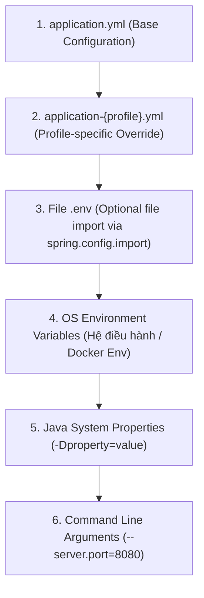
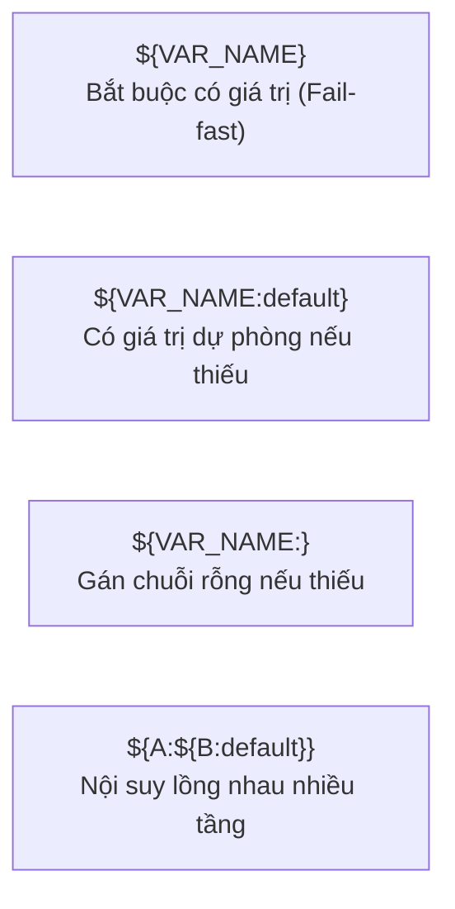
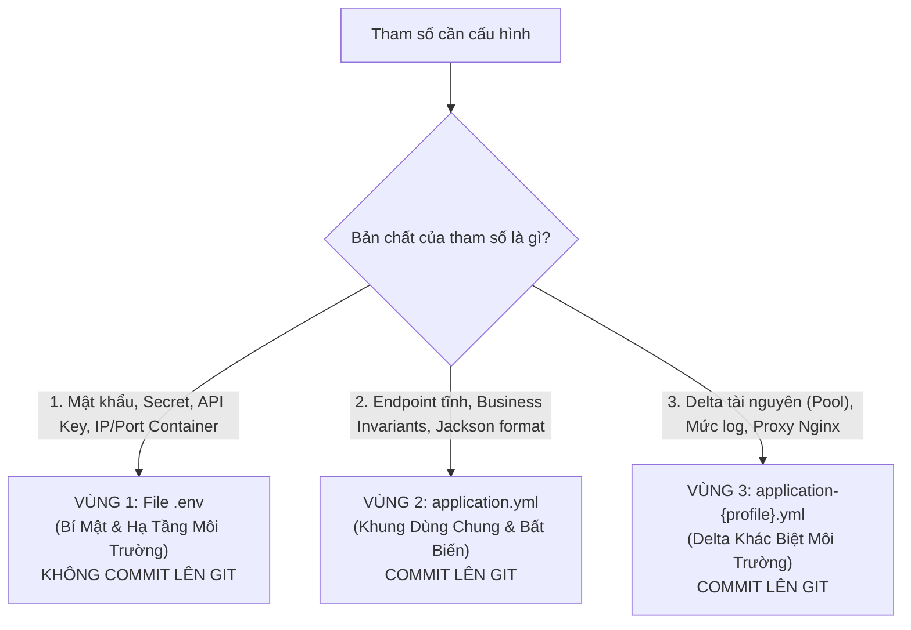

# Kiến Trúc Cấu Hình (Configuration Architecture) & Chiến Lược Đa Môi Trường Trong Spring Boot

> **Tài liệu tham chiếu & Tái sử dụng (Reusable Architecture Blueprint)**  
> Được đúc kết và chuẩn hóa từ hệ thống cấu hình của dự án **NinePaws-Backend**, sử dụng **Spring Boot 3.x / 4.x**, **Java 25**, **Docker**, **Nginx Reverse Proxy** và mô hình **12-Factor App**.

---

## 1. Triết Lý & Nguyên Tắc Cốt Lõi (Core Principles)

Kiến trúc cấu hình trong một hệ sinh thái Enterprise phải giải quyết được 4 bài toán: **Tính bảo mật (Security)**, **Trải nghiệm lập trình viên (Developer Experience - DX)**, **Tính nhất quán giữa các môi trường (Parity)** và **Khả năng quan sát/vận hành (Observability)**.

### Các nguyên tắc vàng:
1. **The 12-Factor App (Yếu tố III - Config)**:
   - Nghiêm cấm tuyệt đối việc hardcode thông tin kết nối (IP, Port, Database name), credentials (Password, Secret Key, API Key) trong source code.
   - Codebase chỉ chứa **khung cấu hình (Configuration Schema)**; toàn bộ giá trị thực tế phải được nạp thông qua **biến môi trường (Environment Variables)**.
2. **Phân tách trách nhiệm (Separation of Concerns)**:
   - **`application.yml`**: Chứa cấu hình dùng chung (Base/Common), cấu trúc tĩnh, không phụ thuộc môi trường.
   - **`application-dev.yml`**: Tối ưu hóa cho tốc độ debug, tự động hóa, có fallback mặc định để dev chạy ngay sau khi clone repo.
   - **`application-prod.yaml`**: Tối ưu hóa cho bảo mật, hiệu năng tải cao, giám sát (Actuator/Prometheus), và **Fail-fast** (không có fallback cho secrets).
3. **Nguyên tắc "Fail-Fast" ở Production**:
   - Ở Dev, biến môi trường có thể có fallback mặc định: `${DB_HOST:localhost}`.
   - Ở Prod, biến môi trường nhạy cảm **bắt buộc không có fallback**: `${POSTGRES_PASSWORD}`. Nếu người vận hành quên truyền biến, ứng dụng phải lập tức crash ngay lúc khởi động (Fail-fast), tuyệt đối không tự ý rơi về mật khẩu mặc định gây lỗ hổng bảo mật.
4. **DRY (Don't Repeat Yourself)**:
   - Các thuộc tính có cấu trúc giống hệt nhau trên mọi môi trường (ví dụ: `spring.application.name`, format ngày tháng Jackson, cấu hình `app.firebase.*`) chỉ được khai báo **duy nhất một lần** tại `application.yml`.

---

## 2. Thứ Tự Nạp Cấu Hình (Spring Boot Property Precedence)

Spring Boot áp dụng cơ chế ghi đè (Cascade Override) theo thứ tự ưu tiên từ thấp đến cao:



> **Quy tắc ghi đè**: Thuộc tính ở tầng cao hơn sẽ **ghi đè** thuộc tính cùng tên ở tầng thấp hơn. Cấu trúc lồng nhau (nested properties) được hợp nhất (deep merge).

---

## 3. Cẩm Nang Cú Pháp Chi Tiết Của File application-*.yml (YAML & Spring Boot Syntax)

Định dạng YAML (YAML Ain't Markup Language) được Spring Boot ưu tiên hơn file `.properties` truyền thống nhờ khả năng biểu diễn phân cấp trực quan và hỗ trợ danh sách tự nhiên. Tuy nhiên, YAML có các quy tắc cú pháp vô cùng nghiêm ngặt:

### 3.1. Các quy tắc cú pháp YAML thuần túy (Pure YAML Rules)

1. **Quy tắc thụt lề (Indentation) - Cấm dùng Tab**:
   - **Bắt buộc dùng phím cách (Space)** để thụt lề, chuẩn chuẩn mực là **2 khoảng trắng (2 spaces)** cho mỗi cấp bậc.
   - **Tuyệt đối không dùng phím Tab**: Trình phân tích cú pháp YAML (SnakeYAML trong Spring Boot) sẽ ném ngoại lệ `ScannerException: mapping values are not allowed here` hoặc `found character '\t' that cannot start any token` và ứng dụng sẽ dừng khởi động ngay lập tức.

2. **Cặp Khóa - Giá trị (Key-Value) và khoảng trắng sau dấu hai chấm**:
   - Cú pháp chuẩn: `key: value`.
   - **Bắt buộc phải có đúng ít nhất 1 dấu cách sau dấu `:`**.
   ```yaml
   # ĐÚNG:
   port: 8080

   # SAI (Lỗi cú pháp parser không nhận diện được):
   port:8080
   ```

3. **Cú pháp danh sách / Mảng (Lists & Arrays)**:
   - Có 2 cách khai báo:
     - **Dạng khối (Block form - khuyên dùng cho danh sách dài)**: Dùng dấu gạch ngang kèm dấu cách (`- `):
       ```yaml
       management:
         endpoints:
           web:
             exposure:
               include:
                 - health
                 - prometheus
                 - metrics
       ```
     - **Dạng dòng đơn (Inline / Flow form - khuyên dùng cho danh sách ngắn)**: Dùng cặp ngoặc vuông `[...]`:
       ```yaml
       management:
         endpoints:
           web:
             exposure:
               include: [health,prometheus]
       ```

4. **Quy tắc đặt dấu ngoặc kép / ngoặc đơn (Quoting Rules)**:
   - Hầu hết chuỗi ký tự trong YAML **không cần ngoặc kép**.
   - **Bắt buộc dùng ngoặc kép `""` trong các trường hợp sau**:
     - Giá trị chứa ký tự đặc biệt YAML: `:`, `{`, `}`, `[`, `]`, `,`, `&`, `*`, `#`, `?`, `|`, `-`, `<`, `>`, `=`, `!`, `%`, `@`, `\`.
     - Chuỗi có thể bị hiểu nhầm thành kiểu dữ liệu khác (như `true`, `false`, `yes`, `no`, `null`, số điện thoại bắt đầu bằng số `0`):
       ```yaml
       # Nếu không để ngoặc kép, YAML sẽ hiểu "NO" (mã quốc gia Na Uy) thành giá trị boolean FALSE:
       country: "NO"
       
       # Chứa ký tự wildcard * hoặc dấu hai chấm trong URL:
       cors:
         allowed-origin-patterns: "http://localhost:*,http://127.0.0.1:*"
       ```

---

### 3.2. Cú pháp nội suy biến môi trường của Spring Boot (Property Placeholders)

Spring Boot cung cấp cú pháp cực mạnh để gán biến động thông qua cặp ký tự `${...}`:



#### 1. Cú pháp bắt buộc (Strict Injection - Áp dụng ở Production):
- Cú pháp: `${VARIABLE_NAME}`
- Ví dụ:
  ```yaml
  spring:
    datasource:
      password: ${POSTGRES_PASSWORD}
  ```
- **Cơ chế**: Nếu biến `POSTGRES_PASSWORD` không được truyền trong môi trường (OS Env, Docker Env, `.env`), Spring Boot ném lỗi:
  `java.lang.IllegalArgumentException: Could not resolve placeholder 'POSTGRES_PASSWORD' in value "${POSTGRES_PASSWORD}"`.
- **Ý nghĩa kiến trúc**: Đảm bảo an toàn tuyệt đối, ngăn ngừa việc chạy ứng dụng khi thiếu các tham số tối quan trọng.

#### 2. Cú pháp có giá trị dự phòng (Fallback Default - Áp dụng ở Dev/Local):
- Cú pháp: `${VARIABLE_NAME:default_value}`
- Ví dụ:
  ```yaml
  server:
    port: ${DEV_PORT:8080}
  ```
- **Cơ chế**: Nếu `DEV_PORT` được khai báo $\rightarrow$ Lấy giá trị đó. Nếu `DEV_PORT` không được khai báo $\rightarrow$ Tự động gán `8080`.

#### 3. Cú pháp giá trị mặc định là chuỗi rỗng (Empty String Fallback):
- Cú pháp: `${VARIABLE_NAME:}` (Có dấu `:` nhưng để trống phía sau).
- Ví dụ:
  ```yaml
  app:
    firebase:
      config-json: ${FIREBASE_CONFIG_JSON:}
      config-path: ${FIREBASE_CONFIG_PATH:}
  ```
- **Cơ chế**: Nếu biến không tồn tại, Spring Boot gán chuỗi rỗng `""` thay vì ném ngoại lệ dừng ứng dụng. Thích hợp cho các module tùy chọn (Optional Modules).

#### 4. Cú pháp nội suy lồng nhau (Nested Placeholders):
- Cú pháp: `${VAR_1:${VAR_2:fallback}}`
- Ví dụ:
  ```yaml
  spring:
    datasource:
      url: jdbc:postgresql://${POSTGRES_HOST:${DB_HOST:localhost}}:${POSTGRES_PORT:5432}/${POSTGRES_DB:ninepaws_db}
  ```
- Ưu tiên tìm `POSTGRES_HOST`, nếu không có tìm `DB_HOST`, nếu vẫn không có thì lấy `localhost`.

---

### 3.3. Cơ chế Ánh Xạ Lỏng Lẻo (Relaxed Binding)

Spring Boot sử dụng cơ chế **Relaxed Binding** để chuyển đổi linh hoạt giữa tên thuộc tính trong YAML, Java Code và Biến môi trường hệ thống:

| Môi trường / Nơi sử dụng | Định dạng chuẩn | Ví dụ thuộc tính |
|---|---|---|
| **File YAML (`application*.yml`)** | `kebab-case` (chữ thường, dấu gạch ngang) | `maximum-pool-size: 30` |
| **Java Code (`@ConfigurationProperties`)** | `camelCase` (chuẩn Java Bean) | `private int maximumPoolSize;` |
| **Biến môi trường OS / Docker (.env)** | `SCREAMING_SNAKE_CASE` (In hoa, dấu gạch dưới) | `SPRING_DATASOURCE_HIKARI_MAXIMUM_POOL_SIZE=30` |

> **Quy tắc chuyển đổi từ YAML sang Env Var**:
> 1. Đổi dấu chấm (`.`) và dấu gạch ngang (`-`) thành dấu gạch dưới (`_`).
> 2. Chuyển toàn bộ ký tự thành chữ IN HOA.
> *Ví dụ*: `spring.data.redis.host` $\rightarrow$ `SPRING_DATA_REDIS_HOST`.

---

### 3.4. Cú pháp nạp file cấu hình mở rộng (`spring.config.import`)

Trong `application.yml` của NinePaws:
```yaml
spring:
  config:
    import: optional:file:.env[.properties]
```
- **`file:.env`**: Chỉ định Spring Boot tìm file có tên `.env` nằm ở thư mục gốc của ứng dụng (Working Directory).
- **`optional:`**: Khẳng định file này là **tùy chọn**. Nếu file `.env` không tồn tại (ví dụ khi chạy Unit Test trên CI/CD, hoặc trên Kubernetes nơi biến đã được inject vào Pod), Spring Boot sẽ bỏ qua êm thấm mà không ném lỗi `ConfigDataLocationNotFoundException`.
- **`[.properties]`**: Vì file `.env` không có đuôi chuẩn, cờ `[.properties]` thông báo cho Spring Boot Engine phân tích file theo cú pháp Java Properties tiêu chuẩn (`KEY=VALUE`).

---

## 4. Ma Trận Quyết Định: Cấu Hình Nào Đặt Ở Đâu? (The 3-Zone Architecture)

Để tránh tình trạng "ô nhiễm cấu hình" (Configuration Pollution) khi file `.env` bị nhồi nhét quá nhiều tham số không cần thiết, kiến trúc chuẩn hóa phân tách toàn bộ hệ thống cấu hình thành **3 Vùng độc lập**:



### 4.1. Bảng phân định chi tiết (Decision Matrix):

| Loại cấu hình | Vị trí đặt chuẩn | Ví dụ thực tế | Lý do kiến trúc & Rủi ro nếu đặt sai |
|---|---|---|---|
| **Bí mật & Credentials** | **`.env`** | `POSTGRES_PASSWORD`, `REDIS_PASSWORD`, `JWT_SECRET`, `EMAIL_PASSWORD` | **Bắt buộc**: Tuyệt đối không commit lên Git. Thay đổi theo từng môi trường triển khai thực tế. |
| **API Key & Client ID bên thứ 3** | **`.env`** | `SPRING_AI_GOOGLE_GENAI_API_KEY`, `GOOGLE_CLIENT_ID`, `CLOUDINARY_API_KEY` | Mỗi môi trường hoặc tài khoản phát triển có thể dùng key riêng; cần bảo mật. |
| **IP, Host & Port hạ tầng** | **`.env`** | `POSTGRES_HOST`, `POSTGRES_PORT`, `REDIS_HOST`, `REDIS_PORT`, `DEV_PORT` | Khác nhau giữa máy cá nhân (`localhost`), Docker Compose nội bộ (`postgres`), và VPS Production. |
| **Định danh ứng dụng** | **`application.yml`** | `spring.application.name: ninepaws-backend` | Tên service là bất biến qua mọi môi trường. |
| **Profile kích hoạt mặc định** | **`application.yml`** | `spring.profiles.active: ${SPRING_PROFILES_ACTIVE:dev}` | Đảm bảo khi chạy local không truyền tham số, app tự hiểu là môi trường `dev`. |
| **Cơ chế nạp file .env** | **`application.yml`** | `spring.config.import: optional:file:.env[.properties]` | Cho phép Spring Boot nạp `.env` ở cả dev và test mà không crash nếu thiếu. |
| **Tài liệu API (Scalar & OpenAPI)** | **`application.yml`** | `app.scalar.path: /docs`<br/>`app.scalar.url: /v3/api-docs`<br/>`app.scalar.enabled: true` | **Không đưa vào .env**: Đây là endpoint routing tĩnh của code. Đưa vào `.env` gây rác file và thừa thãi. |
| **Quy tắc nghiệp vụ cố định (OTP Invariants)** | **`application.yml`** | `app.otp.length: 6`<br/>`app.otp.ttl-minutes: 2`<br/>`app.otp.resend-cooldown-seconds: 60` | **Không đưa vào .env**: Mã 6 số gắn chặt với DTO validation regex `@Pattern(regexp = "^\\d{6}$")`. Nếu đổi trong `.env` sẽ làm hỏng validation của API. |
| **Khung dịch vụ thứ ba (Firebase)** | **`application.yml`** | `app.firebase.config-path: classpath:...`<br/>`app.firebase.config-json: ${FIREBASE_CONFIG_JSON:}` | Cấu trúc thuộc tính giống nhau, chỉ khác giá trị biến môi trường. |
| **Quy chuẩn hiển thị dữ liệu** | **`application.yml`** | Jackson format: `yyyy-MM-dd HH:mm:ss`, timezone `Asia/Ho_Chi_Minh` | Đảm bảo tính nhất quán dữ liệu trả về cho client trên mọi môi trường. |
| **Database Pool (HikariCP)** | **`application-{profile}.yml`** | Dev: `max-pool: 20`<br/>Prod: `max-pool: 30` | Dev cần ít connection để tiết kiệm RAM; Prod cần pool lớn để chịu tải đồng thời. |
| **Hibernate SQL & Logging** | **`application-{profile}.yml`** | Dev: `format_sql: true`, log `DEBUG`<br/>Prod: log `WARN/INFO`, `format_sql: false` | Dev cần xem chi tiết query để debug; Prod cần tắt để tránh nghẽn I/O log và lộ dữ liệu nhạy cảm. |
| **Reverse Proxy & Network** | **`application-prod.yml`** | `server.forward-headers-strategy: framework` | Ở Prod đứng sau Nginx/Cloudflare, cần đọc đúng Header `X-Forwarded-For`, `X-Forwarded-Proto`. Dev chạy trực tiếp không cần. |
| **Rate Limit Phân Tầng** | **`application-{profile}.yml`** | Dev: `reset-max-per-hour: 5`<br/>Prod: `reset-max-per-hour: 3` | Prod cần giới hạn chặt chẽ hơn để chống brute-force và DDoS. |
| **Giám sát (Actuator - Tùy chọn)** | **`application-prod.yml`** | `exposure.include: health,prometheus` | Chỉ cấu hình khi có hạ tầng Prometheus/Grafana. Nếu không dùng monitoring, bỏ hoàn toàn để giảm bề mặt tấn công. |

---

### 4.2. Cảnh báo Anti-Pattern: Ô nhiễm file .env (Configuration Pollution)

Một sai lầm rất phổ biến của nhiều nhóm phát triển là **"ném bất kỳ thuộc tính nào vào file .env"**. Điều này tạo ra các hệ lụy nghiêm trọng:
1. **Ảo tưởng về khả năng cấu hình (False Illusion of Configurability)**:
   - Khai báo `OTP_LENGTH=6` trong `.env` khiến người khác tưởng rằng có thể đổi thành `OTP_LENGTH=4`. Nhưng khi đổi, toàn bộ request gửi lên sẽ bị DTO Validation chặn đứng vì trong Java DTO đã gắn `@Pattern(regexp = "^\\d{6}$")`.
2. **Gia tăng gánh nặng Onboarding (Onboarding Friction)**:
   - Một file `.env.example` dài 50-70 dòng với hàng tá biến routing tĩnh (`SCALAR_PATH=/docs`, `SCALAR_URL=/v3/api-docs`) khiến thành viên mới hoang mang, mất nhiều thời gian để cấu hình mà không biết biến nào thật sự bắt buộc.
3. **Dễ lệch pha giá trị mặc định**:
   - Code Java định nghĩa OTP TTL là 120 giây (2 phút), nhưng file `.env.example` lại ghi `OTP_TTL_MINUTES=5`. Sự bất đồng bộ này tạo ra các lỗi ngầm rất khó debug khi test thực tế.

> **Quy tắc bỏ túi**: Nếu một thuộc tính không phải là **Secret**, không phải **API Key**, và **không phụ thuộc vào hạ tầng máy chủ cụ thể**, hãy đặt nó vào `application.yml` làm giá trị mặc định!
---

## 5. Tại Sao Cấu Hình Firebase Nằm Ở `application.yml`?

Trong `application.yml` của dự án NinePaws có đoạn cấu hình:
```yaml
app:
  firebase:
    config-json: ${FIREBASE_CONFIG_JSON:}
    config-path: ${FIREBASE_CONFIG_PATH:}
    app-name: ${FIREBASE_APP_NAME:ninepaws-backend}
```

### 3 lý do kiến trúc:
1. **DRY & Structural Uniformity (Tính đồng nhất cấu trúc)**:
   - Dù ở môi trường `dev`, `staging` hay `prod`, code Java (`FirebaseConfig.java` hoặc Firebase Service) đều cần inject đúng các thuộc tính này vào Bean.
   - Đặt ở `application.yml` giúp định nghĩa "schema" cấu hình 1 lần duy nhất.
2. **Hỗ trợ cơ chế xác thực kép linh hoạt (Dual Authentication Strategy)**:
   - **Môi trường Local Dev**: Lập trình viên tải file `firebase-adminsdk.json` đặt vào local và trỏ thông qua `FIREBASE_CONFIG_PATH=classpath:firebase/firebase-adminsdk.json`.
   - **Môi trường Docker / Production / CI-CD**: Không được commit file `.json` chứa private key vào Git hay Docker Image. Do đó, hệ thống hỗ trợ truyền toàn bộ nội dung file JSON qua biến môi trường `FIREBASE_CONFIG_JSON={"type":"service_account",...}`.
   - Cú pháp `${VAR:}` (có dấu hai chấm rỗng phía sau) biểu thị giá trị mặc định là chuỗi rỗng nếu biến không tồn tại, giúp app không bị lỗi khởi động nếu chưa dùng đến Firebase.
3. **Tính độc lập của module (Feature Decoupling)**:
   - Firebase là dịch vụ bên thứ ba dùng chung cho chức năng Push Notification hoặc Mobile Auth. Việc đặt ở gốc giúp bất kỳ profile nào được kích hoạt đều sẵn sàng sử dụng khi biến môi trường được cấp.

---

## 6. Bảng So Sánh Chi Tiết: `application-dev.yml` vs `application-prod.yml`

| Tiêu chí | Môi trường Development (`application-dev.yml`) | Môi trường Production (`application-prod.yml`) | Ý nghĩa & Tác động kiến trúc |
|---|---|---|---|
| **Định dạng file** | `.yml` | `.yml` | Đã chuẩn hóa toàn bộ dự án về `.yml` thay vì pha trộn `.yaml` và `.yml`. |
| **Biến Port** | `server.port: ${DEV_PORT:8080}` | `server.port: ${PORT:8080}` | Chuẩn hóa theo quy ước PaaS/Docker (`PORT` là biến tiêu chuẩn trên Docker, Heroku, Render, Kubernetes). |
| **Reverse Proxy** | Không kích hoạt | `server.forward-headers-strategy: framework` | **Rất quan trọng**: Ở Prod, app nhận request từ Nginx; cấu hình này giúp Spring Security nhận diện đúng HTTPS và IP thật của Client. |
| **Hikari Connection Pool** | `maximum-pool-size: 20` | `maximum-pool-size: 30` | Prod cấp nhiều connection hơn để xử lý đồng thời lượng truy cập lớn của người dùng. |
| **Hibernate SQL Formatting** | `properties.hibernate.format_sql: true`<br/>`default_batch_fetch_size: 50` | `properties.hibernate.format_sql: false` | Format SQL hỗ trợ đọc log dễ dàng ở Dev. Ở Prod tắt format để giảm tải xử lý chuỗi và dung lượng disk log. |
| **SMTP / Mail Credentials** | Có fallback test:<br/>`${MAIL_HOST:localhost}`<br/>`${EMAIL_USERNAME:dev}` | Không fallback:<br/>`${MAIL_HOST}`<br/>`${EMAIL_USERNAME}` | Áp dụng nguyên tắc **Fail-fast**: Prod thiếu biến SMTP là ứng dụng báo lỗi ngay khi deploy, tránh gửi mail "chui" vào hư không. |
| **JWT Secrets & Tokens** | Có secret mẫu 256-bit fallback sẵn để dev chạy ngay không cần gõ lệnh | Bắt buộc truyền qua `${JWT_SECRET}`. Không có fallback | Chống hoàn toàn nguy cơ rò rỉ secret mặc định lên môi trường thật. |
| **OTP Rate Limiting** | `reset-max-per-hour: 5` | `reset-max-per-hour: 3` | Giảm hạn mức ở Prod để gia tăng khả năng chống spam, brute-force OTP và tiết kiệm quota email. |
| **Cloudinary Storage** | Fallback về giá trị `demo` | Bắt buộc cấu hình đầy đủ qua env | Ngăn chặn việc đẩy dữ liệu người dùng thật vào tài khoản test. |
| **Flyway Migration** | Khai báo `baseline-version: 0` | Không khai báo `baseline-version` | Dev cần baseline mềm để dễ reset DB; Prod phải kiểm soát chặt chẽ từng version migration. |
| **Giám sát (Actuator)** | Mặc định (không cấu hình) | Không cấu hình (hoặc chỉ mở khi có Prometheus) | Nếu không dựng hệ sinh thái Prometheus/Grafana thì không cần khai báo block `management`, giúp giảm bề mặt tấn công. |
| **Mức độ Logging** | `root: INFO`<br/>`com.ninepaws.backend: DEBUG`<br/>`org.flywaydb: DEBUG`<br/>`org.hibernate.SQL: DEBUG` | `root: WARN`<br/>`com.ninepaws.backend: INFO`<br/>`org.flywaydb: INFO`<br/>`org.hibernate.SQL: WARN` | Dev tối đa hóa thông tin quan sát lỗi. Prod tối thiểu hóa I/O disk, chỉ ghi nhận lỗi và thông tin quan trọng. |

---

## 7. Quy Chuẩn Đặt Tên Properties (Naming Conventions)

Khi mở rộng hoặc tạo mới các cấu hình, bắt buộc tuân theo quy ước chuẩn:

### 1. Phân cấp tiền tố (Namespace Hierarchy):

Hệ thống namespace trong Spring Boot được chia làm **2 nhóm rõ rệt**:

#### Nhóm A: Namespace CHÍNH THỨC của Spring Boot (Framework Built-in - Bắt buộc dùng đúng tên)
Đây là các namespace đã được Spring Boot định nghĩa sẵn các lớp `@ConfigurationProperties`. Bạn **bắt buộc phải đặt đúng tên** thì framework mới nhận diện và tự động cấu hình các thành phần tương ứng:
- **`spring.*`**: Cấu hình các module lõi của Spring Framework & Spring Data (Datasource, JPA, Redis, Mail, Flyway, Jackson, Threads Virtual...).
- **`server.*`**: Cấu hình máy chủ nhúng Web Server như Tomcat/Jetty (Port, Address, SSL, Header Proxy).
- **`logging.*`**: Cấu hình hệ thống ghi log của Spring Boot / Logback (đặt mức log `logging.level.*`, file lưu log `logging.file.name`, pattern log...).
- **`management.*`**: Cấu hình hệ thống giám sát và vận hành (Spring Boot Actuator, Health probes, Prometheus metrics...).

#### Nhóm B: Namespace TỰ QUY ƯỚC của dự án (Custom Business Namespace - Tự do đặt tên)
- **`app.*`** (hoặc `ninepaws.*`, `custom.*`): Đây là **quy ước nội bộ do đội ngũ kiến trúc tự quy định**, Spring Boot không ép buộc phải là chữ `app`.
- **Lý do chuẩn hóa dùng tiền tố `app.*`**:
  1. **Tránh xung đột (Collision Prevention)**: Ngăn chặn việc khai báo các key trần ở root (như `jwt:`, `otp:`, `firebase:`) dễ gây va chạm với các thư viện bên thứ 3 trong tương lai.
  2. **Tách biệt ranh giới (Clear Separation)**: Nhìn vào file YAML, dev biết ngay: cái gì thuộc `spring.*`, `server.*`, `logging.*` là của Framework; cái gì thuộc `app.*` là logic nghiệp vụ do team mình viết.
  3. **Ánh xạ Type-Safe thuận tiện**: Dễ dàng gom cụm vào các class Java qua `@ConfigurationProperties(prefix = "app.jwt")`, `@ConfigurationProperties(prefix = "app.otp")`.

### 2. Định dạng chữ (Casing):
- Trong YAML: Luôn sử dụng **`kebab-case`** (chữ thường, ngăn cách bằng dấu gạch ngang):
  ```yaml
  # ĐÚNG
  app:
    jwt:
      access-token-expiration: 900000
      
  # SAI (Không dùng camelCase hoặc snake_case trong YAML)
  app:
    jwt:
      accessTokenExpiration: 900000
      access_token_expiration: 900000
  ```
- Tên biến môi trường (Environment Variable): Luôn sử dụng **`SCREAMING_SNAKE_CASE`**:
  ```properties
  JWT_ACCESS_EXPIRATION=900000
  POSTGRES_PASSWORD=my_strong_pass
  ```
- Trong Java `@ConfigurationProperties`: Tự động map từ kebab-case sang camelCase:
  ```java
  @ConfigurationProperties(prefix = "app.jwt")
  public record JwtProperties(
      String secret,
      long accessTokenExpiration,
      long refreshTokenExpiration
  ) {}
  ```

---

## 8. Bộ Template Chuẩn Sẵn Sàng Tái Sử Dụng (Production-Ready Templates)

Khi khởi tạo bất kỳ dự án Spring Boot mới nào, hãy copy bộ khung 4 file dưới đây vào thư mục `src/main/resources/`:

### 8.1. `application.yml` (Common Base Configuration)
```yaml
spring:
  application:
    name: myapp-backend
  profiles:
    active: ${SPRING_PROFILES_ACTIVE:dev}
  config:
    import: optional:file:.env[.properties]

  web:
    resources:
      add-mappings: true
      static-locations: classpath:/static/

  threads:
    virtual:
      enabled: true

  jackson:
    date-format: yyyy-MM-dd HH:mm:ss
    time-zone: Asia/Ho_Chi_Minh

  servlet:
    multipart:
      enabled: true
      max-file-size: 10MB
      max-request-size: 50MB

  datasource:
    url: jdbc:postgresql://${POSTGRES_HOST}:${POSTGRES_PORT}/${POSTGRES_DB}
    username: ${POSTGRES_USER}
    password: ${POSTGRES_PASSWORD}
    driver-class-name: org.postgresql.Driver
    hikari:
      connection-timeout: 5000

  jpa:
    hibernate:
      ddl-auto: validate
    show-sql: false
    open-in-view: false

  data:
    redis:
      host: ${REDIS_HOST}
      port: ${REDIS_PORT}
      password: ${REDIS_PASSWORD}

  mail:
    host: ${MAIL_HOST:localhost}
    port: ${MAIL_PORT:1025}
    username: ${EMAIL_USERNAME:dev}
    password: ${EMAIL_PASSWORD:dev}
    properties:
      mail:
        smtp:
          auth: true
          starttls:
            enable: true
            required: true
          connectiontimeout: 5000
          timeout: 5000
          writetimeout: 5000

  flyway:
    enabled: true
    locations: classpath:db/migration
    baseline-on-migrate: true
    connect-retries: 30
    connect-retries-interval: 5

server:
  address: 0.0.0.0

app:
  jwt:
    secret: ${JWT_SECRET:RGV2ZWxvcG1lbnRTZWNyZXRLZXlGb3JMYXRlc3RKd3RUb2tlbi5Mb25nRW5vdWdoIQ==}
    access-token-expiration: ${JWT_ACCESS_EXPIRATION:1800000}
    refresh-token-expiration: ${JWT_REFRESH_EXPIRATION:604800000}
  cors:
    allowed-origin-patterns: ${CORS_ALLOWED_ORIGIN_PATTERNS:http://localhost:*,http://127.0.0.1:*}
  otp:
    length: 6
    ttl-minutes: 2
    max-attempts: 3
    resend-cooldown-seconds: 60
    reset-max-per-hour: 3
  scalar:
    path: /docs
    url: /v3/api-docs
    enabled: true
  firebase:
    config-json: ${FIREBASE_CONFIG_JSON:}
    config-path: ${FIREBASE_CONFIG_PATH:classpath:firebase/firebase-adminsdk.json}
    app-name: ${FIREBASE_APP_NAME:myapp-backend}
```

### 8.2. `application-dev.yml` (Development Delta Only)
```yaml
server:
  port: ${DEV_PORT:8080}

spring:
  datasource:
    hikari:
      maximum-pool-size: 20
  jpa:
    properties:
      hibernate:
        format_sql: true
        default_batch_fetch_size: 50
  flyway:
    baseline-version: 0

app:
  otp:
    reset-max-per-hour: ${RESET_MAX_PER_HOUR:5}

logging:
  level:
    root: INFO
    com.myapp.backend: DEBUG
    org.flywaydb: DEBUG
    org.hibernate.SQL: DEBUG
```

### 8.3. `application-prod.yml` (Production Delta Only)
```yaml
server:
  port: ${PORT:8080}
  forward-headers-strategy: framework

spring:
  datasource:
    hikari:
      maximum-pool-size: 30
  jpa:
    properties:
      hibernate:
        format_sql: false

app:
  jwt:
    secret: ${JWT_SECRET} # Bắt buộc có biến môi trường ở Prod (Fail-Fast)

logging:
  level:
    root: WARN
    com.myapp.backend: INFO
    org.flywaydb: INFO
    org.hibernate.SQL: WARN
```

### 8.4. `.env.example` (Environment Variables Template)
```properties
# SERVER
DEV_PORT=8080
PORT=8080
SPRING_PROFILES_ACTIVE=dev

# POSTGRES
POSTGRES_HOST=localhost
POSTGRES_PORT=5432
POSTGRES_DB=myapp_db
POSTGRES_USER=postgres
POSTGRES_PASSWORD=postgres
POSTGRES_EXTERNAL_PORT=5432

# REDIS
REDIS_HOST=localhost
REDIS_PORT=6379
REDIS_PASSWORD=my_secure_redis_password
REDIS_EXTERNAL_PORT=6379

# SECURITY
JWT_SECRET=your_minimum_256_bit_secret_base64_encoded_here
JWT_ACCESS_EXPIRATION=1800000
JWT_REFRESH_EXPIRATION=604800000
CORS_ALLOWED_ORIGIN_PATTERNS=http://localhost:*,http://127.0.0.1:*

# FIREBASE (Optional)
FIREBASE_CONFIG_PATH=classpath:firebase/firebase-adminsdk.json
FIREBASE_CONFIG_JSON=
```

---

## 9. Checklist Nghiệm Thu Cấu Hình Trước Khi Deploy (Pre-flight Checklist)

Trước khi kích hoạt môi trường Production, thực hiện rà soát các tiêu chí an toàn:
- [ ] **Không sót Secret**: Không có bất kỳ password, secret key hoặc token nào được hardcode trực tiếp trong các file `application*.yml`.
- [ ] **Kích hoạt Fail-fast**: Toàn bộ biến nhạy cảm ở `application-prod.yml` đều ở dạng `${KEY}`, không có giá trị fallback `${KEY:default}`.
- [ ] **Proxy Header**: Có `server.forward-headers-strategy: framework` nếu chạy sau Nginx hoặc Cloudflare.
- [ ] **Hikari Connection Pool**: Đã tính toán `maximum-pool-size` phù hợp với thông số RAM của VPS và giới hạn kết nối của PostgreSQL (`max_connections`).
- [ ] **Actuator Lockdown**: Nếu không dùng monitoring, bỏ hoàn toàn block `management`. Nếu có dùng, tuyệt đối không mở các endpoint nguy hiểm như `env`, `heapdump`, `beans`.
- [ ] **File `.env` được bảo vệ**: File `.env` và `*.json` của Firebase đã được thêm vào `.gitignore` và `.dockerignore`. Phân quyền trên VPS là `chmod 600 .env`.
