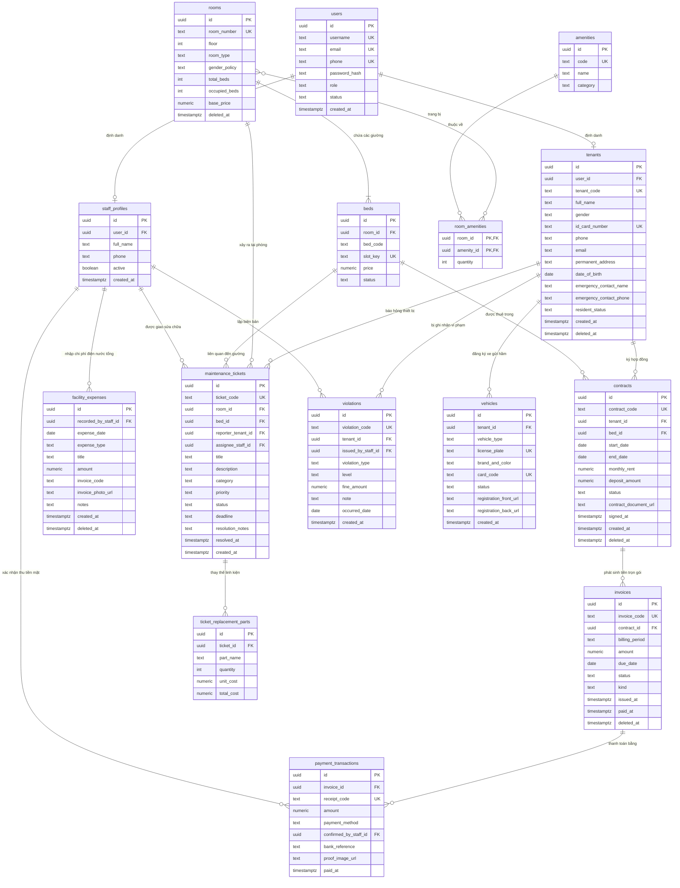

# TÀI LIỆU THIẾT KẾ MÔ HÌNH DỮ LIỆU MỨC LOGIC (LOGICAL ERD)
## DỰ ÁN: HỆ THỐNG QUẢN LÝ KÝ TÚC XÁ TƯ NHÂN (KTX HUB / PDMS)

---

| Thông tin tài liệu | Chi tiết |
|:---|:---|
| **Dự án** | Private Dormitory Management System (PDMS / KTX Hub) |
| **Phiên bản (Version)** | 3.0 (Chuẩn hóa tinh gọn khớp 100% UI Prototype: 01 Tòa nhà, Giá trọn gói, Hạch toán Lợi nhuận ròng) |
| **Hệ quản trị CSDL** | PostgreSQL 15+ LTS (Theo quy chuẩn `postgres-patterns`) |
| **Trạng thái (Status)** | Đã phê duyệt (Approved for Implementation & Database Migration) |
| **Tác giả / Biên soạn** | Ban Kỹ thuật & Quản trị Dữ liệu KTX Hub |
| **Phạm vi lưu trữ** | Thư mục `docs/Logical-ERD.md` |

---

## 1. TIÊU CHUẨN THIẾT KẾ VÀ NGUYÊN TẮC TINH GẢN

Lược đồ dữ liệu mức logic được thiết kế bám sát 100% các màn hình và cấu trúc dữ liệu thực tế của Prototype:
1. **Kiến trúc 01 Tòa nhà theo Tầng (Single-facility Architecture):** Loại bỏ bảng `buildings`. Toàn bộ hệ thống quản lý 01 tòa nhà duy nhất, chia theo các tầng linh hoạt (`floor: 1, 2, 3...`).
2. **Khách thuê đa đối tượng:** Bảng `tenants` loại bỏ hoàn toàn các trường học vị đại học (`university`, `faculty`, `student_code`, `priority_type`).
3. **Mô hình Thuê trọn gói (All-inclusive Rental):** Loại bỏ bảng công tơ phụ từng phòng (`meter_readings`) và bảng chia tiền lẻ (`proration_details`). Hóa đơn hàng tháng thu tiền phòng trọn gói.
4. **Hạch toán Lợi nhuận ròng thực tế:** Bổ sung bảng `facility_expenses` để Chủ cơ sở nhập hóa đơn tiền điện EVN, nước, internet tổng của cơ sở, tự động tính:
```text
Lợi nhuận ròng = Doanh thu thực thu - Chi phí sửa chữa hoàn thành - Chi phí điện nước tổng cơ sở
```
5. **Đồng bộ Thứ tự ưu tiên & Kỷ luật:**
   - Bảng `maintenance_tickets` có thuộc tính `priority` (`Khẩn cấp`, `Cao`, `Bình thường`) và chỉ mục tối ưu cho kỹ thuật viên.
   - Bảng `violations` chuẩn hóa đúng các trường ghi nhận vi phạm trên UI: Người thuê, Phòng, Loại vi phạm, Mức độ (`Nhắc nhở`, `Cảnh cáo`, `Phạt tiền`), Tiền phạt, Ghi chú.
6. **Phương tiện hầm xe:** Bảng `vehicles` liên kết trực tiếp với `tenants`, lưu biển số, thẻ từ và ảnh cà vẹt xe.

---

## 2. SƠ ĐỒ LƯỢC ĐỒ QUAN HỆ (MERMAID LOGICAL ER DIAGRAM)



---

## 3. DANH MỤC CHI TIẾT CÁC BẢNG DỮ LIỆU (DATA DICTIONARY)

### 3.1. Phân hệ Phòng, Giường & Tiện nghi (01 Tòa nhà duy nhất)

#### Bảng: `rooms` (Phòng ở KTX)
| Cột | Kiểu dữ liệu | Null | Khóa | Mặc định | Ràng buộc / Mô tả |
|:---|:---|:---:|:---:|:---|:---|
| `id` | `uuid` | No | PK | `gen_random_uuid()` | Khóa chính UUID v4 bảo mật |
| `room_number` | `text` | No | UK | | Số phòng duy nhất trong tòa nhà (VD: "P.102", "P.201", "P.302", "P.401") |
| `floor` | `int` | No | | | Số tầng: `CHECK (floor >= 1 AND floor <= 10)` |
| `room_type` | `text` | No | | | `CHECK (room_type IN ('4 giường', '6 giường', '8 giường'))` |
| `gender_policy` | `text` | No | | | `CHECK (gender_policy IN ('Nam', 'Nữ'))` (**Cách ly giới tính 100%**) |
| `total_beds` | `int` | No | | | Sức chứa tối đa của phòng: `CHECK (total_beds > 0 AND total_beds <= 16)` |
| `occupied_beds` | `int` | No | | `0` | Số giường đang có người ở: `CHECK (occupied_beds >= 0 AND occupied_beds <= total_beds)` |
| `base_price` | `numeric(12,2)`| No | | | Đơn giá thuê trọn gói hàng tháng đồng nhất cho các giường trong phòng (VNĐ) |
| `deleted_at` | `timestamptz` | Yes | | `NULL` | Soft delete |

#### Bảng: `beds` (Vị trí Giường / Slot riêng biệt)
| Cột | Kiểu dữ liệu | Null | Khóa | Mặc định | Ràng buộc / Mô tả |
|:---|:---|:---:|:---:|:---|:---|
| `id` | `uuid` | No | PK | `gen_random_uuid()` | Khóa chính UUID v4 bảo mật |
| `room_id` | `uuid` | No | FK | | Tham chiếu `rooms(id)` ON DELETE RESTRICT |
| `bed_code` | `text` | No | | | Mã giường (VD: "G01", "G02", "G03", "G04", "G05", "G06") |
| `slot_key` | `text` | No | UK | | Khóa vị trí duy nhất toàn tòa nhà: `RoomCode-BedCode` (VD: "P.302-G02") |
| `price` | `numeric(12,2)`| No | | | Đơn giá thuê vị trí giường (đồng nhất kế thừa từ `rooms.base_price`) |
| `status` | `text` | No | | `'Sẵn sàng'` | `CHECK (status IN ('Sẵn sàng', 'Đang thuê', 'Bảo trì'))` (**Chỉ được bảo trì khi không có khách ở**) |

#### Bảng: `amenities` (Danh mục Tiện nghi)
| Cột | Kiểu dữ liệu | Null | Khóa | Mặc định | Ràng buộc / Mô tả |
|:---|:---|:---:|:---:|:---|:---|
| `id` | `uuid` | No | PK | `gen_random_uuid()` | Khóa chính UUID v4 bảo mật |
| `code` | `text` | No | UK | | Mã tiện nghi (VD: "AC", "FRIDGE", "WATER_HEATER") |
| `name` | `text` | No | | | Tên tiện nghi (VD: "Điều hòa", "Tủ lạnh", "Bình nóng lạnh", "Bàn học") |
| `category` | `text` | No | | | Phân loại: "Điện máy", "Nội thất", "Vệ sinh" |

#### Bảng: `room_amenities` (Tiện nghi trang bị theo Phòng)
| Cột | Kiểu dữ liệu | Null | Khóa | Mặc định | Ràng buộc / Mô tả |
|:---|:---|:---:|:---:|:---|:---|
| `room_id` | `uuid` | No | PK,FK | | Tham chiếu `rooms(id)` ON DELETE CASCADE |
| `amenity_id` | `uuid` | No | PK,FK | | Tham chiếu `amenities(id)` ON DELETE CASCADE |
| `quantity` | `int` | No | | `1` | Số lượng: `CHECK (quantity > 0)` |

---

### 3.2. Phân hệ Tài khoản, Nhân sự & Khách thuê (Mô hình Phân rã Danh tính Độc quyền)

*Quy tắc phân rã danh tính độc quyền (Exclusive Subtyping):*
Thuộc tính `users.role` đóng vai trò phân định nhánh hồ sơ (Discriminator):
- Nếu `role = 'student'` (khách thuê): Tài khoản sở hữu 1 bản ghi tương ứng trong bảng `tenants`, KHÔNG có bản ghi trong `staff_profiles`.
- Nếu `role IN ('manager', 'technician')`: Tài khoản sở hữu 1 bản ghi tương ứng trong bảng `staff_profiles`, KHÔNG có bản ghi trong `tenants`. Vai trò quản lý hay kỹ thuật viên được định vị trực tiếp bằng `users.role`, không lưu các trường thừa (phòng ban, chức danh, kỹ năng).

#### Bảng: `users` (Tài khoản người dùng hệ thống)
| Cột | Kiểu dữ liệu | Null | Khóa | Mặc định | Ràng buộc / Mô tả |
|:---|:---|:---:|:---:|:---|:---|
| `id` | `uuid` | No | PK | `gen_random_uuid()` | Khóa chính UUID v4 bảo mật |
| `username` | `text` | No | UK | | Tên đăng nhập |
| `email` | `text` | No | UK | | Email liên hệ (VD: "manager@gmail.com", "student@gmail.com") |
| `phone` | `text` | No | UK | | Số điện thoại di động |
| `password_hash` | `text` | No | | | Chuỗi băm mật khẩu an toàn Argon2id / Bcrypt |
| `role` | `text` | No | | | `CHECK (role IN ('manager', 'technician', 'student'))` |
| `status` | `text` | No | | `'ACTIVE'` | Trạng thái tài khoản |
| `created_at` | `timestamptz` | No | | `now()` | Thời điểm tạo |

#### Bảng: `tenants` (Hồ sơ Khách thuê - Đã chuẩn hóa theo UI)
| Cột | Kiểu dữ liệu | Null | Khóa | Mặc định | Ràng buộc / Mô tả |
|:---|:---|:---:|:---:|:---|:---|
| `id` | `uuid` | No | PK | `gen_random_uuid()` | Khóa chính UUID v4 bảo mật |
| `user_id` | `uuid` | Yes | FK | `NULL` | Tham chiếu `users(id)` ON DELETE SET NULL |
| `tenant_code` | `text` | No | UK | | Mã người thuê (VD: `NT-0187`, `NT-0188`) |
| `full_name` | `text` | No | | | Họ và tên khách thuê |
| `gender` | `text` | No | | | `CHECK (gender IN ('Nam', 'Nữ'))` (**Cốt lõi cho cách ly giới tính**) |
| `id_card_number` | `text` | No | UK | | Số CCCD 12 số: `CHECK (id_card_number ~ '^[0-9]{12}$')` |
| `phone` | `text` | No | | | Số điện thoại di động |
| `email` | `text` | No | | | Địa chỉ email cá nhân |
| `permanent_address`| `text` | No | | | Địa chỉ thường trú (VD: "Quận Bình Thạnh, TP.HCM") |
| `date_of_birth` | `date` | Yes | | `NULL` | Ngày sinh |
| `emergency_contact_name` | `text` | Yes | | `NULL` | Người liên hệ khẩn cấp |
| `emergency_contact_phone`| `text` | Yes | | `NULL` | SĐT liên hệ khẩn cấp |
| `resident_status` | `text` | No | | `'Đang thuê'`| `CHECK (resident_status IN ('Đang thuê', 'Sắp hết HĐ', 'Đã trả phòng'))` |
| `created_at` | `timestamptz` | No | | `now()` | Thời điểm tạo hồ sơ |
| `deleted_at` | `timestamptz` | Yes | | `NULL` | Soft delete |

#### Bảng: `staff_profiles` (Hồ sơ Nhân viên nội bộ)
| Cột | Kiểu dữ liệu | Null | Khóa | Mặc định | Ràng buộc / Mô tả |
|:---|:---|:---:|:---:|:---|:---|
| `id` | `uuid` | No | PK | `gen_random_uuid()` | Khóa chính UUID v4 bảo mật |
| `user_id` | `uuid` | No | FK | | Tham chiếu `users(id)` ON DELETE RESTRICT |
| `full_name` | `text` | No | | | Họ và tên cán bộ (VD: "Thu Lan", "Võ Văn Thịnh", "Lâm Quốc Huy") |
| `phone` | `text` | No | | | Số điện thoại |
| `active` | `boolean` | No | | `true` | Còn làm việc hay không |

---

### 3.3. Phân hệ Hợp đồng & Tài chính (Giá trọn gói & Lợi nhuận ròng)

#### Bảng: `contracts` (Hợp đồng Thuê Giường)
| Cột | Kiểu dữ liệu | Null | Khóa | Mặc định | Ràng buộc / Mô tả |
|:---|:---|:---:|:---:|:---|:---|
| `id` | `uuid` | No | PK | `gen_random_uuid()` | Khóa chính UUID v4 bảo mật |
| `contract_code` | `text` | No | UK | | Mã hợp đồng (VD: `HD-2026-187`) |
| `tenant_id` | `uuid` | No | FK | | Tham chiếu `tenants(id)` ON DELETE RESTRICT |
| `bed_id` | `uuid` | No | FK | | Tham chiếu `beds(id)` ON DELETE RESTRICT |
| `start_date` | `date` | No | | | Ngày bắt đầu hiệu lực (VD: '01/09/2026') |
| `end_date` | `date` | No | | | Ngày hết hạn hợp đồng (Mặc định thời hạn 1 năm) |
| `monthly_rent` | `numeric(12,2)`| No | | | Tiền thuê trọn gói hàng tháng (VNĐ) |
| `deposit_amount`| `numeric(12,2)`| No | | | Tiền cọc giữ chỗ (chuẩn 1 tháng tiền phòng) |
| `status` | `text` | No | | `'Hiệu lực'`| `CHECK (status IN ('Hiệu lực', 'Sắp hết hạn', 'Đã thanh lý'))` |
| `contract_document_url`| `text`| Yes | | `NULL` | URL/Đường dẫn ảnh chụp hoặc file scan hợp đồng giấy đã ký |
| `signed_at` | `timestamptz` | Yes | | `NULL` | Thời điểm ký kết |
| `created_at` | `timestamptz` | No | | `now()` | Thời điểm tạo hợp đồng |
| `deleted_at` | `timestamptz` | Yes | | `NULL` | Soft delete |

#### Bảng: `invoices` (Hóa đơn Tiền phòng & Dịch vụ Trọn gói Hàng tháng)
| Cột              | Kiểu dữ liệu    | Null | Khóa | Mặc định       | Ràng buộc / Mô tả                                                                                                      |
| :---------------- | :--------------- | :----: | :----: | :-------------- | :---------------------------------------------------------------------------------------------------------------------- |
| `id` | `uuid` | No | PK | `gen_random_uuid()` | Khóa chính UUID v4 bảo mật |
| `invoice_code`   | `text`          | No   | UK   |                | Mã hóa đơn (VD: `HD-2610-0001`, `HD-2610-0004`)                                                                        |
| `contract_id` | `uuid` | No   | FK   |                | Tham chiếu `contracts(id)` ON DELETE RESTRICT                                                                          |
| `billing_period` | `text`          | No   |      |                | Tháng tính tiền phòng: `CHECK (billing_period ~ '^[0-9]{4}-[0-9]{2}$')` (VD: '2026-10')                               |
| `kind`           | `text`          | No   |      | `'Tiền phòng'` | Loại hóa đơn: `CHECK (kind IN ('Tiền phòng', 'Phụ phí phát sinh'))`                                                    |
| `amount`         | `numeric(12,2)` | No   |      |                | Số tiền phải nộp: `CHECK (amount >= 0)`                                                                                |
| `due_date`       | `date`          | No   |      |                | Hạn nộp tiền phòng (VD: Ngày 05 của tháng)                                                                             |
| `status`         | `text`          | No   |      | `'Nợ'`         | `CHECK (status IN ('Đã thu', 'Chờ xác nhận', 'Nợ'))` (**Bộ lọc hóa đơn trên UI**)                                      |
| `issued_at`      | `timestamptz`   | No   |      | `now()`        | Thời điểm phát hành                                                                                                    |
| `paid_at`        | `timestamptz`   | Yes  |      | `NULL`         | Thời điểm thanh toán                                                                                                   |
| `deleted_at`     | `timestamptz`   | Yes  |      | `NULL`         | Soft delete                                                                                                            |

#### Bảng: `payment_transactions` (Lịch sử Thu tiền Thực tế)
| Cột | Kiểu dữ liệu | Null | Khóa | Mặc định | Ràng buộc / Mô tả |
|:---|:---|:---:|:---:|:---|:---|
| `id` | `uuid` | No | PK | `gen_random_uuid()` | Khóa chính UUID v4 bảo mật |
| `invoice_id` | `uuid` | No | FK | | Tham chiếu `invoices(id)` ON DELETE RESTRICT |
| `receipt_code`   | `text`          | No   | UK   |                | Mã phiếu thu hệ thống tự sinh (VD: `PT-2610-0001`)                                                                     |
| `amount`         | `numeric(12,2)` | No   |      |                | Số tiền thực nhận: `CHECK (amount > 0)`                                                                                |
| `payment_method` | `text`          | No   |      |                | `CHECK (payment_method IN ('Trực tuyến', 'Tiền mặt'))`                                                                 |
| `confirmed_by_staff_id` | `uuid` | Yes  | FK   | `NULL`         | Cán bộ quản lý xác nhận thu tiền mặt: Tham chiếu `staff_profiles(id)` (NULL nếu thanh toán trực tuyến qua VietQR)     |
| `bank_reference` | `text` | Yes | | `NULL` | Mã giao dịch ngân hàng đối soát |
| `proof_image_url`| `text` | Yes | | `NULL` | Tên tệp ảnh biên lai chuyển khoản khách gửi |
| `paid_at` | `timestamptz` | No | | `now()` | Thời điểm thu tiền |

#### Bảng: `facility_expenses` (Hóa đơn Tiện ích Tổng Cơ sở của Chủ nhà - Hạch toán Lợi nhuận ròng)
*Chủ nhà nhập thông tin tiền điện, nước, internet tổng của cả cơ sở để trừ vào doanh thu trọn gói và tính Lợi nhuận ròng.*

| Cột | Kiểu dữ liệu | Null | Khóa | Mặc định | Ràng buộc / Mô tả |
|:---|:---|:---:|:---:|:---|:---|
| `id` | `uuid` | No | PK | `gen_random_uuid()` | Khóa chính UUID v4 bảo mật |
| `recorded_by_staff_id` | `uuid` | No| FK | | Quản lý nhập hóa đơn: Tham chiếu `staff_profiles(id)` |
| `expense_date` | `date` | No | | | Ngày phát sinh / thanh toán hóa đơn (dùng trích xuất tháng tính lợi nhuận) |
| `expense_type` | `text` | No | | | `CHECK (expense_type IN ('ELECTRICITY', 'WATER', 'INTERNET', 'OTHER'))` |
| `title` | `text` | No | | | Tên khoản chi (VD: "Hóa đơn điện lực EVN tháng 10", "Tiền nước Sawaco") |
| `amount` | `numeric(12,2)`| No | | | Số tiền hóa đơn: `CHECK (amount >= 0)` |
| `invoice_code` | `text` | Yes | | `NULL` | Mã số hóa đơn từ nhà cung cấp |
| `invoice_photo_url` | `text` | Yes | | `NULL` | URL ảnh chụp hóa đơn để đối soát |
| `notes` | `text` | Yes | | `NULL` | Ghi chú thêm |
| `created_at` | `timestamptz` | No | | `now()` | Thời điểm ghi nhận |
| `deleted_at` | `timestamptz` | Yes | | `NULL` | Soft delete |

---

### 3.4. Phân hệ Vận hành: Sự cố, Kỷ luật & Xe cộ

#### Bảng: `maintenance_tickets` (Phiếu Báo Hỏng Vật Tư & Sắp xếp Thứ tự Ưu tiên)
| Cột | Kiểu dữ liệu | Null | Khóa | Mặc định | Ràng buộc / Mô tả |
|:---|:---|:---:|:---:|:---|:---|
| `id` | `uuid` | No | PK | `gen_random_uuid()` | Khóa chính UUID v4 bảo mật |
| `ticket_code` | `text` | No | UK | | Mã phiếu sự cố (VD: `SC-1049`, `SC-1047`) |
| `room_id` | `uuid` | No | FK | | Tham chiếu `rooms(id)` ON DELETE RESTRICT |
| `bed_id` | `uuid` | Yes | FK | `NULL` | Vị trí giường liên quan (nếu hỏng tại giường, VD G02) |
| `reporter_tenant_id` | `uuid` | No | FK | | Khách thuê báo hỏng: Tham chiếu `tenants(id)` |
| `assignee_staff_id` | `uuid` | Yes | FK | `NULL` | Kỹ thuật viên phụ trách: Tham chiếu `staff_profiles(id)` ("Võ Văn Thịnh") |
| `title` | `text` | No | | | Tiêu đề: "Rò rỉ nước dưới bồn rửa", "Điều hòa không lạnh" |
| `description` | `text` | No | | | Mô tả chi tiết hiện tượng hư hỏng |
| `category` | `text` | No | | | `CHECK (category IN ('Điện nước', 'Điều hòa', 'Điện', 'Nội thất', 'Khác'))` |
| `priority` | `text` | No | | `'Bình thường'`| `CHECK (priority IN ('Khẩn cấp', 'Cao', 'Bình thường'))` (**Thứ tự ưu tiên xử lý**) |
| `status` | `text` | No | | `'Mới giao'` | `CHECK (status IN ('Mới giao', 'Đang xử lý', 'Hoàn thành'))` |
| `deadline` | `text` | Yes | | `NULL` | Hạn xử lý (VD: "Trước 12:00 hôm nay", "Trước 26/10") |
| `resolution_notes`| `text` | Yes | | `NULL` | Giải pháp đã xử lý của thợ |
| `resolved_at` | `timestamptz` | Yes | | `NULL` | Thời điểm thợ bấm hoàn thành |
| `created_at` | `timestamptz` | No | | `now()` | Thời điểm tạo phiếu |

#### Bảng: `ticket_replacement_parts` (Chi tiết Linh kiện Vật tư Thay thế)
| Cột | Kiểu dữ liệu | Null | Khóa | Mặc định | Ràng buộc / Mô tả |
|:---|:---|:---:|:---:|:---|:---|
| `id` | `uuid` | No | PK | `gen_random_uuid()` | Khóa chính UUID v4 bảo mật |
| `ticket_id` | `uuid` | No | FK | | Tham chiếu `maintenance_tickets(id)` ON DELETE CASCADE |
| `part_name` | `text` | No | | | Tên linh kiện thay thế (VD: "Bóng LED 12W", "Vòi xịt Inox") |
| `quantity` | `int` | No | | `1` | Số lượng: `CHECK (quantity > 0)` |
| `unit_cost` | `numeric(12,2)`| No | | | Đơn giá linh kiện |
| `total_cost` | `numeric(12,2)`| No | | | `quantity * unit_cost` |

#### Bảng: `violations` (Hồ sơ Vi phạm Nội quy KTX)
*Khớp chính xác với cấu trúc dữ liệu `Violation` trong màn hình `IncidentsPage`.*

| Cột | Kiểu dữ liệu | Null | Khóa | Mặc định | Ràng buộc / Mô tả |
|:---|:---|:---:|:---:|:---|:---|
| `id` | `uuid` | No | PK | `gen_random_uuid()` | Khóa chính UUID v4 bảo mật |
| `violation_code` | `text` | No | UK | | Mã biên bản (VD: `KL-0231`, `KL-0232`) |
| `tenant_id` | `uuid` | No | FK | | Khách vi phạm: Tham chiếu `tenants(id)` |
| `issued_by_staff_id` | `uuid` | No | FK | | Quản lý lập biên bản: Tham chiếu `staff_profiles(id)` |
| `violation_type` | `text` | No | | | Loại vi phạm: `CHECK (violation_type IN ('Về muộn', 'Gây ồn', 'Vệ sinh', 'Khách ngoài', 'Hút thuốc / cháy nổ', 'Khác'))` |
| `level` | `text` | No | | `'Nhắc nhở'` | Hình thức xử lý trên UI: `CHECK (level IN ('Nhắc nhở', 'Cảnh cáo', 'Phạt tiền'))` |
| `fine_amount` | `numeric(12,2)`| No | | `0` | Tiền phạt thu trực tiếp ngoài đời (khi level = 'Phạt tiền'); không kết chuyển vào hóa đơn web |
| `note` | `text` | Yes | | `NULL` | Chi tiết tình tiết vi phạm (VD: "Về lúc 00:40, quá giờ đóng cổng 23:30 lần 3") |
| `occurred_date` | `date` | No | | | Ngày xảy ra vi phạm |
| `created_at` | `timestamptz` | No | | `now()` | Thời điểm lập hồ sơ |

#### Bảng: `vehicles` (Quản lý Phương tiện Khách thuê Gửi Hầm)
*Khớp chính xác với cấu trúc dữ liệu `Vehicle` trong màn hình `VehiclesPage`.*

| Cột | Kiểu dữ liệu | Null | Khóa | Mặc định | Ràng buộc / Mô tả |
|:---|:---|:---:|:---:|:---|:---|
| `id` | `uuid` | No | PK | `gen_random_uuid()` | Khóa chính UUID v4 bảo mật |
| `tenant_id` | `uuid` | No | FK | | Chủ xe: Tham chiếu `tenants(id)` ON DELETE RESTRICT |
| `vehicle_type` | `text` | No | | `'Xe máy'` | `CHECK (vehicle_type IN ('Xe máy', 'Xe điện', 'Xe đạp'))` |
| `license_plate` | `text` | No | UK | | Biển số xe (VD: `59-X1 889.12`, `59-P2 901.44`) |
| `brand_and_color`| `text` | No | | | Hãng và màu xe (VD: "Honda Vision Trắng", "Yamaha Grande Xanh") |
| `card_code` | `text` | Yes | UK | `NULL` | Mã thẻ từ gửi xe cấp phát (gán khi duyệt) |
| `status` | `text` | No | | `'Chưa cấp thẻ'`| `CHECK (status IN ('Đã cấp thẻ', 'Chưa cấp thẻ', 'Đã thu hồi'))` |
| `registration_front_url`| `text`| Yes | | `NULL` | Ảnh mặt trước Giấy đăng ký xe (Cà vẹt xe) |
| `registration_back_url` | `text`| Yes | | `NULL` | Ảnh mặt sau Giấy đăng ký xe (Cà vẹt xe) |
| `created_at` | `timestamptz` | No | | `now()` | Thời điểm đăng ký |

---

## 4. VIEW BÁO CÁO TÀI CHÍNH & HẠCH TOÁN LỢI NHUẬN RÒNG (FINANCIAL VIEW)

View SQL này tự động hợp nhất doanh thu thực nhận từ tiền phòng trọn gói, chi phí sửa chữa và các hóa đơn tiền điện nước tổng của tòa nhà để ra **Lợi nhuận ròng** chuẩn xác:

```sql
CREATE OR REPLACE VIEW v_financial_profit_summary AS
WITH monthly_revenue AS (
    SELECT 
        i.billing_period,
        COALESCE(SUM(pt.amount), 0) AS collected_revenue
    FROM invoices i
    LEFT JOIN payment_transactions pt ON pt.invoice_id = i.id
    WHERE i.status = 'Đã thu'
    GROUP BY i.billing_period
),
monthly_repairs AS (
    SELECT 
        to_char(t.resolved_at, 'YYYY-MM') AS billing_period,
        COALESCE(SUM(p.total_cost), 0) AS repair_expenses
    FROM maintenance_tickets t
    LEFT JOIN ticket_replacement_parts p ON p.ticket_id = t.id
    WHERE t.status = 'Hoàn thành'
    GROUP BY to_char(t.resolved_at, 'YYYY-MM')
),
monthly_facility_utilities AS (
    SELECT 
        to_char(fe.expense_date, 'YYYY-MM') AS billing_period,
        COALESCE(SUM(CASE WHEN fe.expense_type = 'ELECTRICITY' THEN fe.amount ELSE 0 END), 0) AS electricity_bill,
        COALESCE(SUM(CASE WHEN fe.expense_type = 'WATER' THEN fe.amount ELSE 0 END), 0) AS water_bill,
        COALESCE(SUM(CASE WHEN fe.expense_type = 'INTERNET' THEN fe.amount ELSE 0 END), 0) AS internet_bill,
        COALESCE(SUM(fe.amount), 0) AS total_facility_utilities
    FROM facility_expenses fe
    WHERE fe.deleted_at IS NULL
    GROUP BY to_char(fe.expense_date, 'YYYY-MM')
)
SELECT 
    p.billing_period,
    COALESCE(rev.collected_revenue, 0) AS total_revenue,
    COALESCE(rep.repair_expenses, 0) AS repair_costs,
    COALESCE(fac.electricity_bill, 0) AS electricity_expenses,
    COALESCE(fac.water_bill, 0) AS water_expenses,
    COALESCE(fac.internet_bill, 0) AS internet_expenses,
    COALESCE(fac.total_facility_utilities, 0) AS total_utility_overhead,
    -- Công thức tính Lợi nhuận ròng thực tế
    (COALESCE(rev.collected_revenue, 0) 
     - COALESCE(rep.repair_expenses, 0) 
     - COALESCE(fac.total_facility_utilities, 0)) AS net_profit
FROM (
    SELECT DISTINCT billing_period FROM invoices
    UNION 
    SELECT DISTINCT to_char(expense_date, 'YYYY-MM') FROM facility_expenses
) p
LEFT JOIN monthly_revenue rev ON rev.billing_period = p.billing_period
LEFT JOIN monthly_repairs rep ON rep.billing_period = p.billing_period
LEFT JOIN monthly_facility_utilities fac ON fac.billing_period = p.billing_period;
```

---

## 5. CHIẾN LƯỢC LẬP CHỈ MỤC & HIỆU NĂNG TRUY VẤN (INDEXING STRATEGY)

Theo khuyến nghị của `postgres-patterns`, để đảm bảo thời gian phản hồi truy vấn dưới 1.2 giây và tránh khóa bảng khi kiểm tra khóa ngoại UUID:

### 5.1. Chỉ mục B-tree cho toàn bộ Khóa ngoại UUID
```sql
CREATE INDEX idx_beds_room_id ON beds (room_id);
CREATE INDEX idx_contracts_tenant_id ON contracts (tenant_id);
CREATE INDEX idx_contracts_bed_id ON contracts (bed_id);
CREATE INDEX idx_invoices_contract_id ON invoices (contract_id);
CREATE INDEX idx_payment_transactions_invoice_id ON payment_transactions (invoice_id);
CREATE INDEX idx_payment_transactions_confirmed_by ON payment_transactions (confirmed_by_staff_id);
CREATE INDEX idx_facility_expenses_recorded_by ON facility_expenses (recorded_by_staff_id);
CREATE INDEX idx_facility_expenses_date ON facility_expenses (expense_date);
CREATE INDEX idx_maintenance_tickets_room_id ON maintenance_tickets (room_id);
CREATE INDEX idx_maintenance_tickets_bed_id ON maintenance_tickets (bed_id);
CREATE INDEX idx_maintenance_tickets_reporter ON maintenance_tickets (reporter_tenant_id);
CREATE INDEX idx_maintenance_tickets_assignee ON maintenance_tickets (assignee_staff_id);
CREATE INDEX idx_ticket_parts_ticket_id ON ticket_replacement_parts (ticket_id);
CREATE INDEX idx_violations_tenant_id ON violations (tenant_id);
CREATE INDEX idx_violations_issued_by ON violations (issued_by_staff_id);
CREATE INDEX idx_vehicles_tenant_id ON vehicles (tenant_id);
```

### 5.2. Chỉ mục Composite tối ưu hóa bộ lọc giao diện
```sql
-- Tối ưu màn hình Hóa đơn: Lọc danh sách nợ và ngày đến hạn
CREATE INDEX idx_invoices_status_due ON invoices (status, due_date);

-- Tối ưu màn hình Kỹ thuật viên: Lọc việc chưa xong và xếp ưu tiên Khẩn cấp -> Cao -> Bình thường
CREATE INDEX idx_tickets_priority_workflow ON maintenance_tickets (status, priority, created_at);

-- Tối ưu tra cứu phương tiện theo biển số xe
CREATE INDEX idx_vehicles_plate_lookup ON vehicles (license_plate);
```

---

## 6. RÀNG BUỘC TOÀN VẸN NGHIỆP VỤ NÂNG CAO (ADVANCED BUSINESS CONSTRAINTS)

### 6.1. Ngăn chặn Chồng lấn Lịch thuê trên cùng một Giường (Overlapping Bookings Exclusion)
```sql
CREATE EXTENSION IF NOT EXISTS btree_gist;

ALTER TABLE contracts
ADD CONSTRAINT no_overlapping_bed_contracts
EXCLUDE USING gist (
    bed_id WITH =,
    daterange(start_date, end_date, '[]') WITH &&
)
WHERE (status IN ('Hiệu lực', 'Sắp hết hạn') AND deleted_at IS NULL);
```

### 6.2. Ràng buộc Cách ly Giới tính Khi Ký Hợp đồng (Trigger Validation)
```sql
CREATE OR REPLACE FUNCTION validate_gender_isolation()
RETURNS TRIGGER AS $$
DECLARE
    v_tenant_gender text;
    v_room_gender_policy text;
BEGIN
    SELECT gender INTO v_tenant_gender FROM tenants WHERE id = NEW.tenant_id;
    SELECT r.gender_policy INTO v_room_gender_policy 
    FROM beds b 
    JOIN rooms r ON b.room_id = r.id 
    WHERE b.id = NEW.bed_id;
    
    IF v_tenant_gender != v_room_gender_policy THEN
        RAISE EXCEPTION 'VI PHAM NGUYEN TAC CACH LY GIOI TINH: Khach thue gioi tinh % khong the xep vao phong %', 
            v_tenant_gender, v_room_gender_policy;
    END IF;
    
    RETURN NEW;
END;
$$ LANGUAGE plpgsql;

CREATE TRIGGER trg_check_gender_isolation
BEFORE INSERT OR UPDATE ON contracts
FOR EACH ROW
EXECUTE FUNCTION validate_gender_isolation();
```

### 6.3. Ràng buộc Bảo trì Giường Độc lập (Bed Maintenance Invariant Trigger)
```sql
CREATE OR REPLACE FUNCTION validate_bed_maintenance()
RETURNS TRIGGER AS $$
BEGIN
    IF NEW.status = 'Bảo trì' THEN
        IF OLD.status = 'Đang thuê' THEN
            RAISE EXCEPTION 'VI PHAM NGUYEN TAC BAO TRI GIUONG (BR-01): Khong the chuyen giuong dang co nguoi o sang trang thai bao tri';
        END IF;
        
        IF EXISTS (
            SELECT 1 FROM contracts 
            WHERE bed_id = NEW.id 
              AND status IN ('Hiệu lực', 'Sắp hết hạn') 
              AND deleted_at IS NULL
        ) THEN
            RAISE EXCEPTION 'VI PHAM NGUYEN TAC BAO TRI GIUONG (BR-01): Khong the chuyen giuong dang co hop dong hieu luc sang trang thai bao tri';
        END IF;
    END IF;
    
    RETURN NEW;
END;
$$ LANGUAGE plpgsql;

CREATE TRIGGER trg_check_bed_maintenance
BEFORE UPDATE OF status ON beds
FOR EACH ROW
EXECUTE FUNCTION validate_bed_maintenance();
```

---

*Tài liệu Mô hình Dữ liệu Mức Logic (Logical ERD) phiên bản 3.0 đã hoàn chỉnh, tinh giản 100% bám sát mã nguồn và nghiệp vụ vận hành thực tế.*
