# THIẾT KẾ MÔ HÌNH DỮ LIỆU MỨC LOGIC (LOGICAL ERD)

## KTX HUB — PRIVATE DORMITORY MANAGEMENT SYSTEM (PDMS)

| Thông tin                | Nội dung                                                                                                   |
| ------------------------ | ---------------------------------------------------------------------------------------------------------- |
| Tài liệu                 | Logical Entity–Relationship Diagram &amp; Data Dictionary                                                  |
| Phiên bản                | **v3.6 — FINAL (đồng bộ SRS v3.4.1)**                                                                      |
| Ngày cập nhật            | 13/11/2026                                                                                                 |
| Nguồn yêu cầu            | `docs/SRS.md` — **v3.4.1 FINAL** và `KTX_Hub_Conceptual_ERD_v3.5_SRS_v3.4.1.md`                            |
| Tham khảo                | `KTX_Hub_Logical_ERD_v3.5_Final.md` (bản trước, dựa trên SRS v3.2; không dùng để đảo ngược quyết định mới) |
| Hệ quản trị dữ liệu đích | PostgreSQL                                                                                                 |
| Trạng thái triển khai    | **Thiết kế dữ liệu FINAL; chưa reset Flyway/DB hay sửa Backend**                                           |

> **Trạng thái đồng bộ:** Bản Markdown này cập nhật thiết kế lý thuyết; **chưa sửa hoặc kiểm chứng schema PostgreSQL, Flyway, API hay Backend**. Quyết định 5 tab Tenant và chuông Notification của SRS v3.4.1 không sinh bảng mới. Mã `card_code` chỉ duy nhất giữa xe `ISSUED`; `SALARY` là tổng lương do Manager nhập, không xây payroll.

> **Nguyên tắc ưu tiên:** `docs/SRS.md` **v3.4.1 FINAL** → Conceptual ERD **v3.5** → Logical ERD **v3.6**. Các chi tiết SQL dưới đây là **đề xuất thiết kế logic/kiểm soát toàn vẹn**, không phải cam kết rằng schema đang chạy đã có các cột đó. Tài liệu chỉ đặc tả phạm vi Phase 1; FR-11 (chuyển phòng) thuộc Phase 2.

---

## 1. PHẠM VI VÀ QUY ƯỚC

### 1.1. Ranh giới mô hình

- **18 thực thể nghiệp vụ** theo Conceptual ERD v3.5, gồm `VEHICLE_CHANGE_REQUEST`.
- **2 bảng hỗ trợ logic**: `room_amenities` (M:N có số lượng), `room_code_registry` (giữ/giải phóng mã phòng theo lịch sử). Tổng cộng **20 bảng PostgreSQL** (18 nghiệp vụ + 2 hỗ trợ). JWT Access/Refresh, revoke/blacklist và OTP khôi phục được quản lý bằng **Redis**, **không** tạo `auth_sessions` hay `auth_otps` trong PostgreSQL.
- Một cơ sở, nhiều tầng (tầng là thuộc tính Room), một Tenant tối đa một hợp đồng chiếm chỗ hiện hành, một xe `PENDING_CARD`/`ISSUED` và một yêu cầu đổi xe `PENDING`.
- Không có `BUILDING`, `FLOOR`, `SLEEPBOX`, `RESERVATION`, `PARKING_CARD`, `PAYROLL`, bảng dữ liệu biểu đồ minh họa, bảng giao dịch ngân hàng, `PAYMENT_PROOF_HISTORY`, quản lý phiên bản tài liệu hay lịch sử phân công kỹ thuật.

### 1.2. Chuẩn đặt tên và dữ liệu

| Quy ước            | Thiết kế                                                                                                                                                    |
| ------------------ | ----------------------------------------------------------------------------------------------------------------------------------------------------------- |
| Primary key        | `id uuid` (`gen_random_uuid()` nếu cần sinh tại DB) ngoại trừ bảng nối và registry                                                                          |
| Foreign key        | Đuôi `_id` trỏ đến PK; mặc định **RESTRICT/NO ACTION** đối với dữ liệu nghiệp vụ cần giữ                                                                    |
| Tiền VND           | `numeric(14,0)` — không sử dụng `float`/`double` cho số tiền                                                                                                |
| Ngày hợp đồng/kỳ   | `date`; `billing_period` lưu **ngày 01 của tháng** thay vì chuỗi `YYYY-MM`                                                                                  |
| Thời điểm thao tác | `timestamptz`, chuẩn lưu UTC và hiển thị/đối chiếu lịch theo `Asia/Ho_Chi_Minh`                                                                             |
| Trạng thái         | Hằng mã ổn định trong DB (`ACTIVE`, `PAID`...), FE hiển thị tiếng Việt theo bảng ánh xạ                                                                     |
| Tên cột            | `snake_case`; mã nghiệp vụ (`room_number`, `contract_code`, `invoice_code`) không làm PK                                                                    |
| Mật khẩu           | PostgreSQL chỉ giữ `users.password_hash` (Bcrypt/Argon2id); không có cột mật khẩu plaintext                                                                 |
| JWT/OTP            | Access/Refresh JWT, refresh/blacklist/token revocation và OTP khôi phục quản lý trong Redis; không thuộc 20 bảng quan hệ. **Change Password không có OTP**. |
| Tệp chứng từ       | `*_file_key` là **OCI private object key**, không lưu presigned URL. Backend kiểm tra JWT/role/ownership trước khi cấp URL ký hiệu lực tối đa 15 phút       |
| Xóa dữ liệu        | Chỉ xóa vật lý dữ liệu cấu hình/tệp nhập nhầm khi an toàn; lịch sử hợp đồng, hóa đơn, phiếu thu, sự cố, vi phạm được giữ                                    |

**Giới hạn của `CHECK`/`FK`:** Một `CHECK` không thể so sánh dữ liệu của hai bảng hay kiểm tra trạng thái của nhiều hợp đồng cùng lúc. Những bất biến này cần **transaction**, `UNIQUE`/ràng buộc duy nhất có điều kiện và/hoặc trigger/logic Backend (nêu rõ ở §5–§6), không được mô tả sai là một `CHECK` đơn giản.

---

## 2. SƠ ĐỒ LOGICAL ERD (MERMAID)

### 2.1. Quan hệ giữa các bảng

> Sơ đồ biểu diễn FK và bội số của **20 bảng PostgreSQL**. Hai nguồn dữ liệu tạm Redis (JWT/OTP) không phải các bảng trong sơ đồ.

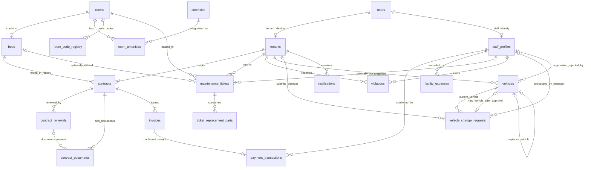

### 2.2. Sơ đồ thuộc tính rút gọn — lõi hợp đồng và thanh toán

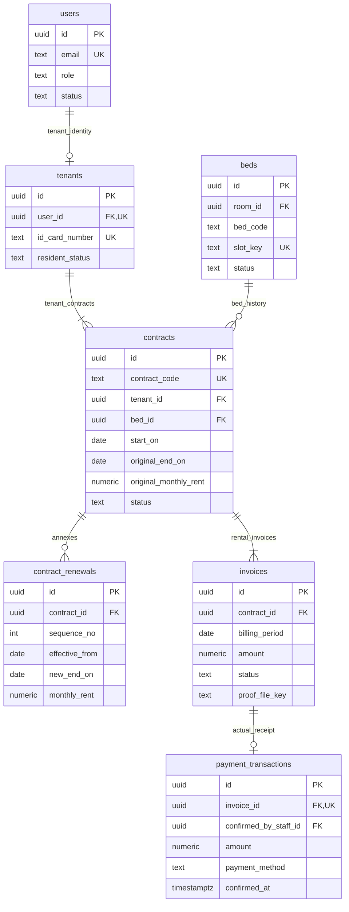

**Ghi chú về 1..N:** Tenant mới và Contract mới phải được tạo cùng Contract/Invoice đầu tiên theo onboarding. Ràng buộc **tồn tại ít nhất một con** không thể đảm bảo chỉ bằng FK từ bảng con; được đảm bảo bằng **giao dịch onboarding**. Không hiểu quan hệ này là cho phép tạo hồ sơ/hợp đồng trống rồi bổ sung sau.

---

## 3. DATA DICTIONARY — 20 BẢNG POSTGRESQL

### 3.1. Không gian lưu trú và danh mục phòng

#### 3.1.1. `rooms` — Phòng

| Cột             | PostgreSQL type | Null  | Khóa / ràng buộc        | Ý nghĩa                                          |
| --------------- | --------------- | :-----: | ----------------------- | ------------------------------------------------ |
| `id`            | `uuid`          | Không | PK                      | ID nội bộ bất biến                               |
| `room_number`   | `text`          | Không | Unique sau chuẩn hóa mã | Mã phòng nghiệp vụ, ví dụ `P.302`                |
| `floor`         | `integer`       | Không | `CHECK (floor >= 1)`    | Tầng; bất biến sau tạo                           |
| `total_beds`    | `smallint`      | Không | `IN (4,6,8)`            | Sức chứa vật lý; bất biến sau tạo                |
| `gender_policy` | `text`          | Không | `IN ('MALE','FEMALE')`  | Chính sách Nam/Nữ                                |
| `base_price`    | `numeric(14,0)` | Không | `> 0`                   | Giá tiêu chuẩn một giường/tháng, chung cả phòng  |
| `archived_at`   | `timestamptz`   | Có    | —                       | `NULL` = đang vận hành, khác `NULL` = đã Archive |
| `created_at`    | `timestamptz`   | Không | Default `now()`         | Thời điểm tạo phòng                              |
| `updated_at`    | `timestamptz`   | Không | —                       | Lần cập nhật gần nhất                            |

**Vòng đời Room (`archived_at`):**

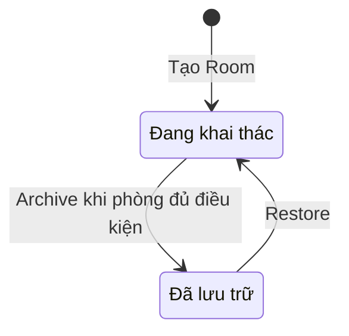

**Ràng buộc:** `room_number` không trùng với phòng khác, kể cả Archive; đồng thời phải kiểm tra `room_code_registry` để cấm sử dụng mã đã có lịch sử. Trường `archived_at` **khác** `deleted_at`: phòng Archive vẫn còn dữ liệu và có thể Restore. **Không có cột `rooms.occupied_beds`** trong schema đích; số giường có người **tính trực tiếp** bằng `COUNT(*)` trên Bed `OCCUPIED` của Room, không duy trì counter cộng/trừ.

#### 3.1.2. `beds` — Giường/vị trí nằm

| Cột          | Type          | Null  | Khóa / ràng buộc                       | Ý nghĩa                                 |
| ------------ | ------------- | :-----: | -------------------------------------- | --------------------------------------- |
| `id`         | `uuid`        | Không | PK                                     | ID giường bất biến                      |
| `room_id`    | `uuid`        | Không | FK → `rooms.id`                        | Phòng sở hữu                            |
| `bed_code`   | `text`        | Không | `UNIQUE (room_id, bed_code)`           | `G01`…`G04/G06/G08`                     |
| `slot_key`   | `text`        | Không | Unique chuẩn hóa                       | `RoomCode-BedCode` của vị trí hiện hành |
| `status`     | `text`        | Không | `AVAILABLE`, `OCCUPIED`, `MAINTENANCE` | Trạng thái giường                       |
| `created_at` | `timestamptz` | Không | Default `now()`                        | Ngày tạo                                |

**State machine (`beds.status`):**

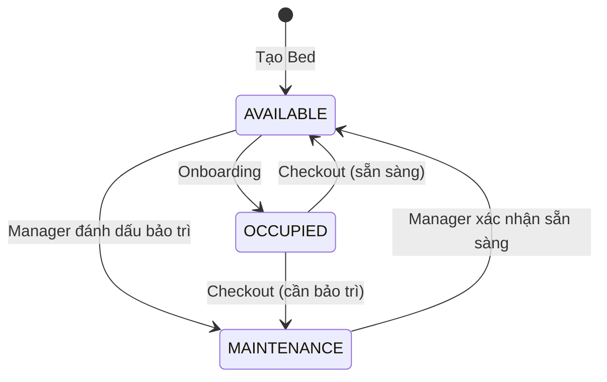

**Ràng buộc:** Room phải có chính xác `total_beds` Bed sau khi tạo; toàn bộ thao tác tạo Room–Bed atomic. Không cho Backend/UI tùy ý cập nhật `OCCUPIED`: chỉ qua onboarding/checkout. Không tạo cột `beds.price` độc lập: **giá niêm yết của Bed đọc từ `rooms.base_price`**, nên Manager đổi giá phòng sẽ hiển thị đúng trên tất cả Bed mà không có hai giá lệch nhau. Giá hợp đồng/hóa đơn lịch sử là snapshot riêng. Khi Room Code thay đổi, phải cập nhật **mọi `slot_key`** trong cùng transaction. Có thể tạo `UNIQUE (id, room_id)` để hỗ trợ FK phức hợp trên Ticket (§3.4.1).

#### 3.1.3. `amenities` — Danh mục tiện nghi

| Cột        | Type   | Null  | Khóa / ràng buộc | Ý nghĩa                    |
| ---------- | ------ | :-----: | ---------------- | -------------------------- |
| `id`       | `uuid` | Không | PK               | ID tiện nghi               |
| `code`     | `text` | Không | UK               | Mã loại tiện nghi          |
| `name`     | `text` | Không | —                | Tên tiện nghi              |

#### 3.1.4. `room_amenities` — Bảng nối Room–Amenity

| Cột          | Type      | Null  | Khóa / ràng buộc            | Ý nghĩa            |
| ------------ | --------- | :-----: | --------------------------- | ------------------ |
| `room_id`    | `uuid`    | Không | PK (1), FK → `rooms.id`     | Phòng              |
| `amenity_id` | `uuid`    | Không | PK (2), FK → `amenities.id` | Tiện nghi          |
| `quantity`   | `integer` | Không | `> 0`                       | Số lượng tại phòng |

**Khóa chính:** `(room_id, amenity_id)`. Có thể `ON DELETE CASCADE` từ Room **chỉ khi** xóa Room tạo nhầm đã vượt qua kiểm tra an toàn; không cascade từ bảng lịch sử hợp đồng. Khi xóa danh mục tiện nghi còn được sử dụng, ưu tiên `RESTRICT`.

#### 3.1.5. `room_code_registry` — Bảo vệ mã phòng lịch sử (bảng hỗ trợ)

| Cột                | Type          | Null  | Khóa / ràng buộc             | Ý nghĩa                                                 |
| ------------------ | ------------- | :-----: | ---------------------------- | ------------------------------------------------------- |
| `code`             | `text`        | Không | PK/Unique chuẩn hóa          | Một mã Room từng được cấp và **chưa giải phóng hợp lệ** |
| `room_id`          | `uuid`        | Không | FK → `rooms.id` (`RESTRICT`) | Room sở hữu mã (kể cả mã cũ đã bảo vệ)                  |
| `is_current`       | `boolean`     | Không | —                            | `true` nếu mã hiện tại của Room                         |
| `used_in_business` | `boolean`     | Không | Default `false`              | Đã gắn với Contract/Ticket/hồ sơ nghiệp vụ cần giữ      |
| `created_at`       | `timestamptz` | Không | Default `now()`              | Thời điểm cấp mã                                        |

**Bất biến registry:** Mỗi Room có **đúng một** mã `is_current=true` (ràng buộc duy nhất có điều kiện cho một mã hiện hành/Room). Mã cũ không còn hiện hành **chỉ được giữ** khi `used_in_business=true`; nếu mã chưa từng dùng trong nghiệp vụ thì **xóa hàng registry** để cho phép tái sử dụng. Không được chuyển `used_in_business` từ `true` về `false`. Mã đang dùng bởi Room còn tồn tại/Archive không được cấp cho Room khác. Khi xóa phòng tạo nhầm chưa có lịch sử, xóa registry chưa bảo vệ trước khi xóa Room; khi Archive giữ nguyên registry. `rooms.room_number` và bản ghi registry hiện hành phải đồng bộ trong cùng transaction.

**Ví dụ:** `P.302` vừa tạo và nhập sai tầng, chưa từng có Contract/Ticket → được Delete an toàn, xóa dòng registry `P.302` → có thể tạo lại `P.302`. Nếu `P.302` từng xuất hiện trong lịch sử rồi đổi thành `P.303` → giữ `P.302` với `used_in_business=true`, `is_current=false`; **cấm** cấp `P.302` cho Room khác.

### 3.2. Tài khoản, định danh và nhân sự

**Ánh xạ:** Thực thể Conceptual `USER_ACCOUNT` → bảng vật lý `users`; `TENANT_PROFILE` → `tenants`; `STAFF_PROFILE` → `staff_profiles`. **Giữ tên bảng hiện có trong Backend**, không đổi tên hàng loạt. Mỗi tài khoản có **một email duy nhất toàn hệ thống** ở `users.email`; hai bảng profile không lưu trùng email. Tenant vẫn đăng nhập bằng CCCD, không phải email. SĐT là thông tin liên hệ và không UNIQUE.

#### 3.2.1. `users` — Tài khoản và email liên kết duy nhất

| Cột             | Type          | Null  | Khóa / ràng buộc                           | Ý nghĩa                                                           |
| --------------- | ------------- | :-----: | ------------------------------------------ | ----------------------------------------------------------------- |
| `id`            | `uuid`        | Không | PK                                         | Định danh User bất biến                                           |
| `email`         | `text`        | Không | **UNIQUE chuẩn hóa `lower(btrim(email))`** | Email liên kết với **một** User, kênh OTP; nhân sự dùng đăng nhập |
| `password_hash` | `text`        | Không | —                                          | Chỉ lưu mật khẩu băm                                              |
| `role`          | `text`        | Không | `MANAGER`, `TENANT`, `TECHNICIAN`          | Vai trò cố định                                                   |
| `status`        | `text`        | Không | `ACTIVE`, `LOCKED`                         | Trạng thái tài khoản; khóa Technician ngăn truy cập               |
| `created_at`    | `timestamptz` | Không | Default `now()`                            | Tạo tài khoản                                                     |
| `updated_at`    | `timestamptz` | Không | Default `now()`                            | Cập nhật                                                          |

**State machine (`users.status`):**

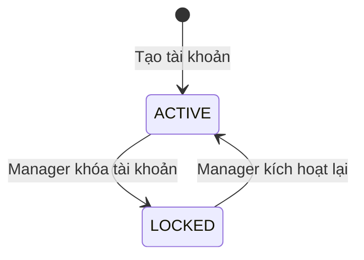

**Không có cột `username` và `phone` ở `users`** trong schema đích: Tenant đăng nhập bằng `tenants.id_card_number`, nhân sự qua `users.email` cùng điều kiện role `MANAGER`/`TECHNICIAN`. Không cho email của Tenant dùng để đăng nhập dù email là UNIQUE. Cập nhật email của Tenant hoặc Technician sau khi Manager xác minh phải kiểm tra trùng **toàn User**; email Manager cố định theo chức năng Phase 1. `LOCKED` bị từ chối dù JWT còn hạn; Redis kiểm soát thu hồi token/OTP và giới hạn đăng nhập tạm thời. User phải được tạo cùng profile đúng role; không cho tồn tại hai nhánh hồ sơ khi transaction hoàn tất.

#### 3.2.2. `tenants` — Hồ sơ khách thuê

| Cột                       | Type          | Null  | Khóa / ràng buộc        | Ý nghĩa                            |
| ------------------------- | ------------- | :-----: | ----------------------- | ---------------------------------- |
| `id`                      | `uuid`        | Không | PK                      | Tenant ID bất biến                 |
| `user_id`                 | `uuid`        | Không | UNIQUE, FK → `users.id` | Tài khoản Tenant, 1–1              |
| `tenant_code`             | `text`        | Không | UNIQUE                  | Mã hồ sơ                           |
| `id_card_number`          | `varchar(12)` | Không | UNIQUE, regex 12 chữ số | CCCD đăng nhập Tenant              |
| `full_name`               | `text`        | Không | —                       | Họ tên                             |
| `gender`                  | `text`        | Không | `MALE`, `FEMALE`        | Giới tính                          |
| `date_of_birth`           | `date`        | Có    | —                       | Ngày sinh                          |
| `phone`                   | `text`        | Không | **Không UNIQUE**        | Thông tin liên hệ, không đăng nhập |
| `permanent_address`       | `text`        | Không | —                       | Địa chỉ thường trú                 |
| `emergency_contact_name`  | `text`        | Có    | —                       | Người liên hệ khẩn cấp             |
| `emergency_contact_phone` | `text`        | Có    | —                       | SĐT liên hệ khẩn cấp               |
| `resident_status`         | `text`        | Không | `ACTIVE`, `CHECKED_OUT` | Cư trú hiện hành hoặc đã checkout  |
| `created_at`              | `timestamptz` | Không | Default `now()`         | Tạo hồ sơ                          |
| `updated_at`              | `timestamptz` | Không | Default `now()`         | Cập nhật                           |

**State machine (`tenants.resident_status`):**

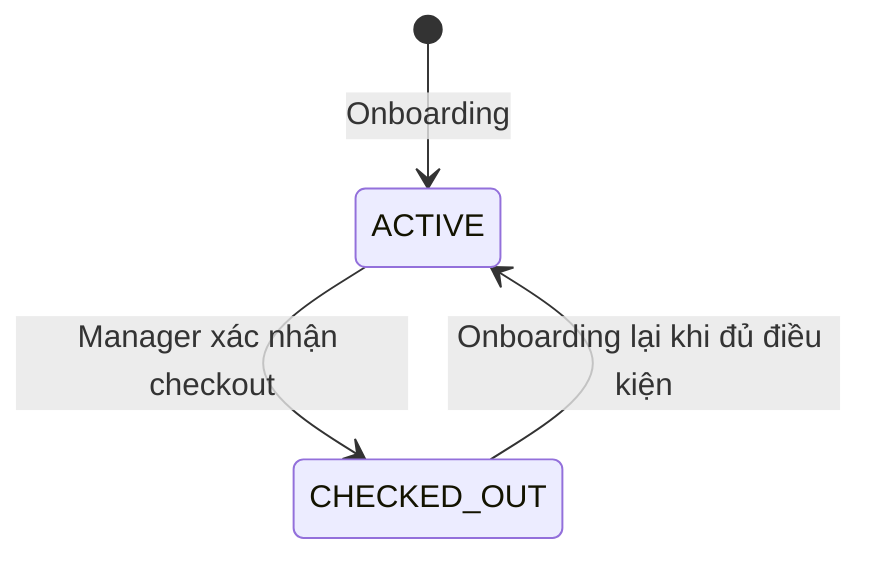

**Quy tắc:** Email Tenant lấy **duy nhất từ `users.email`**, không lưu thêm `tenants.email` để tránh lệch đồng bộ; khi trả DTO có thể JOIN qua `user_id`. CCCD 12 số là unique nghiệp vụ và để tìm khách cũ; không làm PK. Tenant chỉ tự cập nhật phone, permanent address, emergency contacts; Manager được hiệu chỉnh thông tin định danh và email sau xác minh. `ACTIVE`/`CHECKED_OUT` đi theo onboarding/checkout, không tự xóa User sau checkout. Không tạo Tenant riêng trước hợp đồng ngày 01.

#### 3.2.3. `staff_profiles` — Hồ sơ nhân sự Manager/Technician

| Cột          | Type          | Null  | Khóa / ràng buộc        | Ý nghĩa                      |
| ------------ | ------------- | :-----: | ----------------------- | ---------------------------- |
| `id`         | `uuid`        | Không | PK                      | Staff ID                     |
| `user_id`    | `uuid`        | Không | UNIQUE, FK → `users.id` | User tương ứng, role nhân sự |
| `full_name`  | `text`        | Không | —                       | Họ tên                       |
| `phone`      | `text`        | Không | **Không UNIQUE**        | Số điện thoại liên hệ        |
| `created_at` | `timestamptz` | Không | Default `now()`         | Tạo nhân sự                  |
| `updated_at` | `timestamptz` | Không | Default `now()`         | Cập nhật                     |

**Quy tắc:** Email đăng nhập nhân sự lấy từ `users.email` và được unique **trên toàn bộ users**. `staff_profiles` không cần trường email/active riêng. Role và trạng thái ở `users`; khóa Technician phải chặn request có Access Token cũ và thu hồi Refresh Token qua Redis. Manager có quyền cập nhật email của Technician, không có UI/API đổi email của chính Manager. Mọi thao tác đổi mật khẩu đã đăng nhập cần JWT hợp lệ + mật khẩu cũ, **không OTP**; Forgot Password dùng OTP email/Redis.

**Ranh giới ngoài PostgreSQL:** Access/Refresh JWT, refresh rotation/revocation/blacklist, OTP khôi phục 6 số (TTL 5 phút), reset token và giới hạn đăng nhập sai nằm trong **Redis**. `auth_sessions`, `auth_otps`, `failed_login_count`, `locked_until` **không phải cột/bảng trong Logical ERD này**.

---

## 3.3. Hợp đồng, phụ lục, hóa đơn và tài chính

#### 3.3.1. `contracts` — Hợp đồng gốc

| Cột                     | Type            | Null  | Khóa / ràng buộc               | Ý nghĩa                                                    |
| ----------------------- | --------------- | :-----: | ------------------------------ | ---------------------------------------------------------- |
| `id`                    | `uuid`          | Không | PK                             | ID Contract bất biến                                       |
| `contract_code`         | `text`          | Không | UK                             | Mã hợp đồng giấy/nghiệp vụ                                 |
| `tenant_id`             | `uuid`          | Không | FK → `tenants.id`              | Khách thuê                                                 |
| `bed_id`                | `uuid`          | Không | FK → `beds.id`                 | Giường gắn với hợp đồng, **không đổi trong Phase 1**       |
| `room_code_snapshot`    | `text`          | Không | —                              | Mã phòng ở thời điểm ký                                    |
| `bed_code_snapshot`     | `text`          | Không | —                              | Mã giường ở thời điểm ký                                   |
| `start_on`              | `date`          | Không | Ngày 01                        | Ngày bắt đầu cư trú của hợp đồng gốc                       |
| `original_end_on`       | `date`          | Không | Ngày cuối tháng, `>= start_on` | Ngày kết thúc ban đầu của hợp đồng                         |
| `original_monthly_rent` | `numeric(14,0)` | Không | `> 0`                          | Giá thuê trọn tháng lúc ký hợp đồng gốc                    |
| `deposit_amount`        | `numeric(14,0)` | Không | `>= 0`                         | Tiền cọc theo giấy tờ, **không phải thu nhập**             |
| `status`                | `text`          | Không | `ACTIVE`, `LIQUIDATED`         | Hợp đồng hiện còn chiếm chỗ hay đã checkout                |
| `checked_out_at`        | `timestamptz`   | Có    | —                              | Thời điểm Manager xác nhận checkout                        |
| `created_at`            | `timestamptz`   | Không | Default `now()`                | Thời điểm tạo                                              |

**State machine (`contracts.status`):**

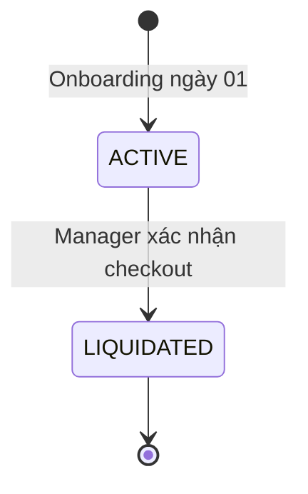

**Ràng buộc liên bảng:** Chỉ được tạo Contract qua onboarding ngày 01; người thuê và giường cùng đủ điều kiện; ngày kết thúc vào ngày cuối tháng; ngày **onboarding/tạo Contract mới** trùng ngày bắt đầu cư trú. `status='LIQUIDATED'` yêu cầu có `checked_out_at`; `ACTIVE` phải có `checked_out_at=NULL`. Khi checkout, Manager chọn trạng thái mới và cập nhật trực tiếp `beds.status`, không lưu trạng thái giường lúc bàn giao trong Contract. Sau khi checkout, lịch sử vẫn giữ và tài khoản Tenant vẫn đăng nhập được.

**Không lưu giá/`end_on` hiện hành bằng cách ghi đè dữ liệu gốc.** `current_end_on` được xác định bằng `new_end_on` của Renewal có `sequence_no` lớn nhất, nếu không có Renewal thì bằng `original_end_on`. Khi hiển thị, `slot_key` lịch sử được ghép từ `room_code_snapshot` và `bed_code_snapshot`. `ACTIVE` là quan hệ chiếm chỗ chưa checkout; **không tự chuyển thành `LIQUIDATED` chỉ vì đồng hồ đã qua ngày hết hạn**, tránh giải phóng giường sai khi Manager chưa xác nhận bàn giao.

**Chống chiếm chỗ đồng thời:** Một Tenant và một Bed có tối đa một Contract `ACTIVE`; phải bảo đảm **tính duy nhất có điều kiện** theo `(tenant_id)` và `(bed_id)` khi `status='ACTIVE'` (§5.2, §6). Không tạo Contract mới để gia hạn.

#### 3.3.2. `contract_renewals` — Phụ lục/lần gia hạn

| Cột               | Type            | Null  | Khóa / ràng buộc                       | Ý nghĩa                                           |
| ----------------- | --------------- | :-----: | -------------------------------------- | ------------------------------------------------- |
| `id`              | `uuid`          | Không | PK                                     | ID phụ lục                                        |
| `contract_id`     | `uuid`          | Không | FK → `contracts.id`                    | Hợp đồng gốc                                      |
| `sequence_no`     | `integer`       | Không | UK `(contract_id, sequence_no)`, `> 0` | Thứ tự gia hạn 1,2,3,...                          |
| `signed_on`       | `date`          | Không | —                                      | Ngày ký phụ lục giấy                              |
| `previous_end_on` | `date`          | Không | —                                      | Ngày kết thúc trước lần gia hạn này               |
| `effective_from`  | `date`          | Không | UK `(contract_id, effective_from)`     | **Ngày 01** của tháng tiếp theo `previous_end_on` |
| `new_end_on`      | `date`          | Không | Ngày cuối tháng, `>= effective_from`   | Ngày kết thúc mới                                 |
| `monthly_rent`    | `numeric(14,0)` | Không | `> 0`                                  | Giá cố định cho **toàn bộ kỳ gia hạn này**        |
| `created_at`      | `timestamptz`   | Không | Default `now()`                        | Thời điểm ghi vào DB                              |

**Ràng buộc:** Phụ lục phải được ký **trước ngày kết thúc hiện hành**, chỉ khi Contract `ACTIVE`, Tenant còn cư trú và không có hóa đơn `DEBT` hoặc `PENDING_CONFIRMATION`. `previous_end_on` phải bằng ngày kết thúc hiện hành trước lúc gia hạn; `effective_from = previous_end_on + 1 day` (ngày 01), `new_end_on` là ngày cuối tháng. Mỗi lần ký bổ sung một dòng **bất biến về giá/thời hạn** thay vì sửa dòng cũ. Giá lấy từ `rooms.base_price` tại thời điểm **ký phụ lục**, không tự thay đổi nếu Manager tăng giá phòng sau đó.

**Cách chọn giá hóa đơn tháng M:** Tìm Renewal mới nhất của Contract có `effective_from <= M` và `M <= new_end_on`; nếu có, dùng `renewals.monthly_rent`; nếu không và tháng thuộc hạn gốc, dùng `contracts.original_monthly_rent`. Không được dùng `rooms.base_price` để phát hành hóa đơn cho hợp đồng đã ký. Mỗi phụ lục không tạo thêm Contract mới hoặc làm tăng số người đang ở.

#### 3.3.3. `contract_documents` — Tệp hợp đồng/phụ lục/bàn giao

| Cột                 | Type          | Null  | Khóa / ràng buộc                                                   | Ý nghĩa                               |
| ------------------- | ------------- | :-----: | ------------------------------------------------------------------ | ------------------------------------- |
| `id`                | `uuid`        | Không | PK                                                                 | ID tệp                                |
| `contract_id`       | `uuid`        | Không | FK → `contracts.id`                                                | Hợp đồng sở hữu tệp                   |
| `renewal_id`        | `uuid`        | Có    | FK → `contract_renewals.id`                                        | Phụ lục nếu loại `RENEWAL_ANNEX`      |
| `document_type`     | `text`        | Không | `ORIGINAL_CONTRACT`, `RENEWAL_ANNEX`, `CHECKOUT_HANDOVER`, `OTHER` | Loại văn bản                          |
| `original_filename` | `text`        | Không | —                                                                  | Tên gốc                               |
| `mime_type`         | `text`        | Không | Whitelist 6 MIME theo SRS                                           | MIME đã kiểm tra                      |
| `storage_file_key`  | `text`        | Không | UK                                                                 | Vị trí lưu trong storage bảo vệ quyền |
| `uploaded_at`       | `timestamptz` | Không | Default `now()`                                                    | Ngày upload                           |

**Ràng buộc MIME:** Chỉ chấp nhận `.jpg`/`.jpeg` → `image/jpeg`, `.png` → `image/png`, `.webp` → `image/webp`, `.pdf` → `application/pdf`, `.doc` → `application/msword`, `.docx` → `application/vnd.openxmlformats-officedocument.wordprocessingml.document`. Backend xác minh cả phần mở rộng, MIME và nội dung tệp thực tế; **giới hạn tối đa 10 MB/tệp khi upload** theo FR-10, nhưng không lưu `size_bytes` trong DB.

**Bảo vệ tệp:** `storage_file_key` là khóa object **private** của OCI; không lưu đường dẫn public/presigned URL. Sau khi xác minh quyền Manager hoặc Tenant sở hữu Contract, Backend cấp URL có chữ ký **tối đa 15 phút** để xem/tải tệp. Credential OCI chỉ đặt ở cấu hình secrets ngoài repository.

**Ràng buộc:** `RENEWAL_ANNEX` phải trỏ đúng Renewal; mọi Document phải thuộc cùng `contract_id` với Renewal được chỉ định. Để cưỡng chế cả hai FK bằng DB, tạo `UNIQUE (id, contract_id)` ở `contract_renewals`, sau đó tạo **composite FK** `(renewal_id, contract_id)` → `contract_renewals(id, contract_id)` (khi `renewal_id IS NULL` quan hệ phụ lục không áp dụng). File có thể upload **sau** onboarding/gia hạn; không dùng `NOT NULL` đối với tệp trong Contract/Renewal. Cho Manager xóa file upload nhầm và upload lại; **không có bảng `document_versions`**. Việc xóa file không kéo theo xóa Contract/Renewal.

#### 3.3.4. `invoices` — Hóa đơn tiền thuê theo kỳ

| Cột                  | Type            | Null  | Khóa / ràng buộc                            | Ý nghĩa                                              |
| -------------------- | --------------- | :-----: | ------------------------------------------- | ---------------------------------------------------- |
| `id`                 | `uuid`          | Không | PK                                          | ID hóa đơn                                           |
| `invoice_code`       | `text`          | Không | UK                                          | Mã hóa đơn duy nhất                                  |
| `contract_id`        | `uuid`          | Không | FK → `contracts.id`                         | Hợp đồng phát sinh                                   |
| `billing_period`     | `date`          | Không | UK `(contract_id, billing_period)`; ngày 01 | Kỳ thuê theo tháng                                   |
| `amount`             | `numeric(14,0)` | Không | `> 0`                                       | **Snapshot** tiền thuê kỳ đó                         |
| `due_on`             | `date`          | Không | —                                           | Ngày 05 thuộc chính kỳ thuê                          |
| `status`             | `text`          | Không | `DEBT`, `PENDING_CONFIRMATION`, `PAID`      | Ba trạng thái thanh toán                             |
| `proof_file_key`     | `text`          | Có    | —                                           | Ảnh minh chứng Tenant gửi **trước khi** có phiếu thu |
| `proof_submitted_at` | `timestamptz`   | Có    | —                                           | Lúc gửi minh chứng hiện tại                          |
| `issued_at`          | `timestamptz`   | Không | Default `now()`                             | Ngày tạo hóa đơn                                     |

**State machine (`invoices.status`):**

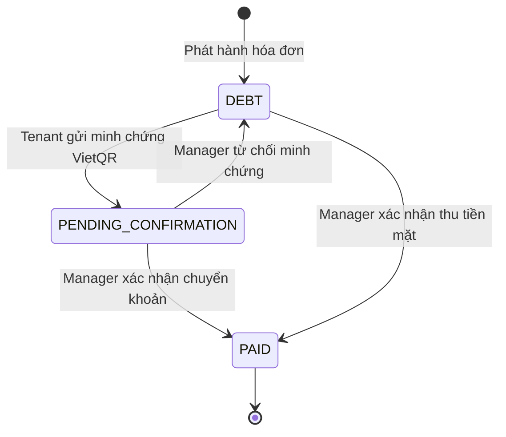

**Ánh xạ UI:** `DEBT` = `Nợ`; `PENDING_CONFIRMATION` = `Chờ xác nhận`; `PAID` = `Đã thu`. `Overdue` không phải enum: tính `status='DEBT' AND due_on < current_local_date`. `PENDING_CONFIRMATION` **không** tính vào công nợ quá hạn. `proof_file_key` được lưu trực tiếp tại Invoice để tồn tại ngay khi khách gửi ảnh; **không gắn vào `payment_transactions` vốn chưa được tạo**. Khi Manager từ chối minh chứng: chuyển `PENDING_CONFIRMATION→DEBT`, cho phép bỏ/thay thế ảnh minh chứng hiện tại; không cần lưu lịch sử phiên bản ảnh trong Phase 1.

Chỉ có **một loại hóa đơn tiền thuê** trong phạm vi Phase 1; không có loại hóa đơn điện/nước/phạt. Hóa đơn tháng đầu tạo trong giao dịch onboarding ngày 01, các kỳ tiếp theo do batch ngày 25 phát hành và có thể chạy lại idempotent. Không phát hành cho tháng ngoài hạn gốc/phụ lục hoặc Contract đã `LIQUIDATED`.

#### 3.3.5. `payment_transactions` — Phiếu thu đã xác nhận

| Cột                     | Type            | Null  | Khóa / ràng buộc          | Ý nghĩa                                                         |
| ----------------------- | --------------- | :-----: | ------------------------- | --------------------------------------------------------------- |
| `id`                    | `uuid`          | Không | PK                        | ID phiếu thu                                                    |
| `receipt_code`          | `text`          | Không | UK                        | Mã chứng nhận thu tiền                                          |
| `invoice_id`            | `uuid`          | Không | UK, FK → `invoices.id`    | **Tối đa 1 phiếu thu hoàn tất/Invoice**                         |
| `amount`                | `numeric(14,0)` | Không | `> 0`                     | Số tiền thực thu đầy đủ                                         |
| `payment_method`        | `text`          | Không | `CASH`, `VIETQR_TRANSFER` | Tiền mặt / Chuyển khoản VietQR                                  |
| `confirmed_by_staff_id` | `uuid`          | Không | FK → `staff_profiles.id`  | Manager xác nhận, **cho cả hai phương thức**                    |
| `confirmed_at`          | `timestamptz`   | Không | Default `now()`           | Lúc Manager xác nhận đã nhận tiền                               |

**Ý nghĩa rất quan trọng:** Đây **không phải** lệnh hoặc bản ghi sao kê giao dịch của ngân hàng. Phiếu thu chỉ được thêm khi Manager xác nhận KTX đã nhận đủ tiền. `payment_transactions.amount` phải bằng `invoices.amount` (Backend/trigger kiểm tra liên bảng); insert phiếu thu và update Invoice sang `PAID` phải **atomic**. Không tạo phiếu thu khi Tenant mới upload ảnh. Không xử lý trả từng phần, trả dư, hoàn tiền. Không tạo phiếu thu thứ hai cho Invoice `PAID`.

**Ví dụ:** Khách đóng 1.500.000đ **tiền mặt** → Manager xác nhận → Invoice `PAID`, Payment `method=CASH`, `amount=1500000`. Khách **chuyển khoản** và gửi ảnh → Invoice `PENDING_CONFIRMATION`, chưa có Payment; sau Manager đối soát → Payment `method=VIETQR_TRANSFER` được tạo.

#### 3.3.6. `facility_expenses` — Chi phí vận hành đã ghi nhận (gồm tổng lương thủ công)

| Cột                    | Type            | Null  | Khóa / ràng buộc                                          | Ý nghĩa                                                                                   |
| ---------------------- | --------------- | :-----: | --------------------------------------------------------- | ----------------------------------------------------------------------------------------- |
| `id`                   | `uuid`          | Không | PK                                                        | ID khoản chi                                                                              |
| `recorded_by_staff_id` | `uuid`          | Không | FK → `staff_profiles.id`                                  | Manager ghi nhận                                                                          |
| `expense_date`         | `date`          | Không | —                                                         | Ngày chi phí được quy về kỳ báo cáo                                                       |
| `expense_type`         | `text`          | Không | `ELECTRICITY`, `WATER`, `INTERNET`, **`SALARY`**, `OTHER` | Loại chi phí vận hành; `SALARY` là **tổng lương tháng** do Manager tự tính ngoài hệ thống |
| `title`                | `text`          | Không | —                                                         | Tiêu đề khoản chi                                                                         |
| `amount`               | `numeric(14,0)` | Không | `> 0`                                                     | Tổng tiền khoản chi đã ghi nhận, VND nguyên; sửa/xóa nếu nhập nhầm                        |
| `invoice_code`         | `text`          | Có    | —                                                         | Mã chứng từ nhà cung cấp nếu có                                                           |
| `invoice_file_key`     | `text`          | Có    | —                                                         | File ảnh chứng từ nếu có                                                                  |
| `notes`                | `text`          | Có    | —                                                         | Ghi chú                                                                                   |
| `created_at`           | `timestamptz`   | Không | Default `now()`                                           | Lúc tạo                                                                                   |
| `updated_at`           | `timestamptz`   | Không | —                                                         | Lúc sửa                                                                                   |

**Ràng buộc BR-03/FR-14:** `SALARY` đại diện **một khoản tổng lương mỗi tháng dương lịch** theo `expense_date`, **không** lưu lương từng Technician hoặc bảng payroll. Yêu cầu **duy nhất một khoản `SALARY`/năm/tháng** theo `expense_date` (§5.2); khi sửa ngày/kỳ phải kiểm tra trùng. Manager được **sửa/xóa** khoản nhập nhầm; nếu có soft-delete thì phải loại bản ghi đã xóa khỏi chỉ số và uniqueness thích hợp. Vật tư Ticket `COMPLETED` chỉ tính qua `ticket_replacement_parts`, **không nhập trùng** ở Facility Expense. Chỉ số từ khoản thu/chi đã ghi nhận phải có nhãn **“Lợi nhuận ròng (ước tính)”** cùng lời giải thích giới hạn; không phải kế toán đầy đủ.

---

## 3.4. Vận hành: Sự cố, vi phạm, phương tiện và thông báo

#### 3.4.1. `maintenance_tickets` — Phiếu báo hỏng

| Cột                         | Type          | Null  | Khóa / ràng buộc                                                 | Ý nghĩa                                                        |
| --------------------------- | ------------- | :-----: | ---------------------------------------------------------------- | -------------------------------------------------------------- |
| `id`                        | `uuid`        | Không | PK                                                               | ID phiếu                                                       |
| `ticket_code`               | `text`        | Không | UK                                                               | Mã ticket                                                      |
| `reporter_tenant_id`        | `uuid`        | Không | FK → `tenants.id`                                                | Tenant đang cư trú khi tạo                                     |
| `room_id`                   | `uuid`        | Không | FK → `rooms.id`                                                  | Phòng xảy ra sự cố                                             |
| `bed_id`                    | `uuid`        | Có    | FK → `beds.id`; composite FK nếu gắn Bed                         | Giường liên quan **không bắt buộc**                            |
| `assignee_staff_id`         | `uuid`        | Có    | FK → `staff_profiles.id`                                         | Technician hiện tại; **NULL khi chưa phân công**               |
| `title`                     | `text`        | Không | —                                                                | Tiêu đề                                                        |
| `description`               | `text`        | Không | —                                                                | Mô tả hiện trường                                              |
| `category`                  | `text`        | Không | `ELECTRIC`, `WATER`, `INTERNET`, `FURNITURE`, `AMENITY`, `OTHER` | Nhóm sự cố                                                     |
| `priority`                  | `text`        | Không | `URGENT`, `HIGH`, `NORMAL`                                       | Mức ưu tiên hiện tại                                           |
| `status`                    | `text`        | Không | `UNASSIGNED`, `ASSIGNED`, `IN_PROGRESS`, `COMPLETED`             | Trạng thái xử lý                                               |
| `report_image_file_key`     | `text`        | Có    | —                                                                | Ảnh hiện trường; việc bắt buộc ảnh xác minh tại tầng nghiệp vụ |
| `deadline_at`               | `timestamptz` | Có    | —                                                                | Hạn hoàn thành Manager đặt                                     |
| `resolution_notes`          | `text`        | Có    | —                                                                | Kết quả xử lý                                                  |
| `resolution_image_file_key` | `text`        | Có    | —                                                                | Ảnh nghiệm thu khi hoàn thành                                  |
| `resolved_at`               | `timestamptz` | Có    | —                                                                | Ngày Technician hoàn thành                                     |
| `created_at`                | `timestamptz` | Không | Default `now()`                                                  | Ngày báo hỏng                                                  |

**State machine (`maintenance_tickets.status`):**

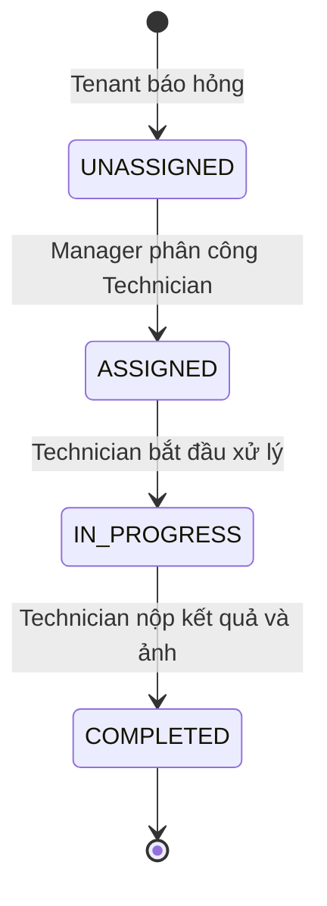

**Danh mục `category`:** `ELECTRIC`, `WATER`, `INTERNET`, `FURNITURE`, `AMENITY`, `OTHER`, tương ứng `Điện`, `Nước`, `Internet`, `Nội thất`, `Tiện ích`, `Khác`.

**Vòng đời:** `UNASSIGNED` (`Chưa phân công`) → `ASSIGNED` (`Mới giao`) → `IN_PROGRESS` (`Đang xử lý`) → `COMPLETED` (`Hoàn thành`). Khi `UNASSIGNED`, `assignee_staff_id=NULL`; khi đã được giao, phải có Technician tương ứng; khi `COMPLETED`, yêu cầu kết quả, ảnh nghiệm thu và `resolved_at`. Không có trạng thái mở lại/duyệt thêm. Manager được thay `assignee_staff_id` khi chưa `COMPLETED`, không tạo bảng lịch sử phân công. Technician chỉ sửa ticket hiện được giao cho mình.

**Toàn vẹn vị trí:** Nếu `bed_id` khác `NULL`, Bed phải thuộc đúng `room_id` của ticket. Có thể dùng FK phức hợp `(bed_id,room_id)` → `beds(id,room_id)` (cần unique cặp `(id,room_id)` ở Beds). Ticket phòng chung chỉ có `room_id` và để `bed_id=NULL`.

#### 3.4.2. `ticket_replacement_parts` — Linh kiện thực dùng cho Ticket

| Cột          | Type            | Null  | Khóa / ràng buộc                  | Ý nghĩa                |
| ------------ | --------------- | :-----: | --------------------------------- | ---------------------- |
| `id`         | `uuid`          | Không | PK                                | Dòng vật tư            |
| `ticket_id`  | `uuid`          | Không | FK → `maintenance_tickets.id`     | Phiếu sửa chữa         |
| `part_name`  | `text`          | Không | —                                 | Tên linh kiện          |
| `quantity`   | `integer`       | Không | `> 0`                             | Số lượng               |
| `unit_cost`  | `numeric(14,0)` | Không | `>= 0`                            | Đơn giá VND            |

**Tổng chi phí Ticket** = `COALESCE(SUM(parts.quantity * parts.unit_cost),0)`; chỉ tính vào báo cáo FR-14 nếu ticket `COMPLETED`, theo tháng `resolved_at` tại `Asia/Ho_Chi_Minh`. Không lưu `total_cost` trong Part hoặc Ticket, không nhập tiền công; nếu không dùng vật tư thì không có dòng Part và tổng = 0. Thành tiền được tính từ `quantity × unit_cost` khi truy vấn.

#### 3.4.3. `violations` — Biên bản vi phạm

| Cột                  | Type            | Null  | Khóa / ràng buộc                                                       | Ý nghĩa                         |
| -------------------- | --------------- | :-----: | ---------------------------------------------------------------------- | ------------------------------- |
| `id`                 | `uuid`          | Không | PK                                                                     | ID vi phạm                      |
| `violation_code`     | `text`          | Không | UK                                                                     | Mã biên bản                     |
| `tenant_id`          | `uuid`          | Không | FK → `tenants.id`                                                      | Khách vi phạm                   |
| `issued_by_staff_id` | `uuid`          | Không | FK → `staff_profiles.id`                                               | Manager lập                     |
| `occurred_on`        | `date`          | Không | —                                                                      | Ngày xảy ra                     |
| `violation_type`     | `text`          | Không | `LATE_RETURN`, `NOISE`, `HYGIENE`, `OUTSIDER`, `SMOKING_FIRE`, `OTHER` | Loại vi phạm                    |
| `level`              | `text`          | Không | `REMINDER`, `WARNING`, `FINE`                                          | Nhắc nhở / Cảnh cáo / Phạt tiền |
| `fine_amount`        | `numeric(14,0)` | Không | `>= 0`, default `0`                                                    | Chỉ có giá trị dương khi `FINE` |
| `note`               | `text`          | Có    | —                                                                      | Diễn biến, nội dung biên bản    |
| `created_at`         | `timestamptz`   | Không | Default `now()`                                                        | Ngày lập                        |

**`violation_type`:** `LATE_RETURN`, `NOISE`, `HYGIENE`, `OUTSIDER`, `SMOKING_FIRE`, `OTHER` → `Về muộn`, `Gây ồn`, `Vệ sinh`, `Khách ngoài`, `Hút thuốc / cháy nổ`, `Khác`. `level != FINE` thì `fine_amount=0`; `FINE` thì `fine_amount>0`. Người được lập biên bản phải đang cư trú tại thời điểm lập; không bắt buộc `room_id`. Tiền phạt **không có FK đến Invoice/Payment**, không đưa vào doanh thu tiền thuê.

#### 3.4.4. `vehicles` — Phương tiện, mã thẻ vật lý và lịch sử thay xe

| Cột                           | Type          | Null  | Khóa / ràng buộc                                                                    | Ý nghĩa                                                     |
| ----------------------------- | ------------- | :-----: | ----------------------------------------------------------------------------------- | ----------------------------------------------------------- |
| `id`                          | `uuid`        | Không | PK                                                                                  | ID bất biến của từng hồ sơ xe                               |
| `tenant_id`                   | `uuid`        | Không | FK → `tenants.id`                                                                   | Người đăng ký/được quyền sử dụng xe                         |
| `vehicle_type`                | `text`        | Không | `SCOOTER`, `MANUAL_MOTORCYCLE`, `ELECTRIC_MOTORBIKE`, `ELECTRIC_BICYCLE`, `BICYCLE` | Loại xe                                                     |
| `license_plate`               | `text`        | Có    | Conditional required                                                                | Biển số; NULL với loại không có đăng ký                     |
| `brand`                       | `text`        | Không | Không rỗng                                                                          | Hãng/dòng xe                                                |
| `color`                       | `text`        | Không | Không rỗng                                                                          | Màu xe                                                      |
| `registration_front_file_key` | `text`        | Có    | Conditional required                                                                | OCI private key ảnh cà vẹt mặt trước                        |
| `registration_back_file_key`  | `text`        | Có    | Conditional required                                                                | OCI private key ảnh mặt sau                                 |
| `card_code`                   | `text`        | Có    | Unique canonical **chỉ khi status = ISSUED**                                        | Mã thẻ vật lý; giữ trên xe lịch sử `REPLACED`/`REVOKED`     |
| `status`                      | `text`        | Không | `PENDING_CARD`, `ISSUED`, `REJECTED`, `REVOKED`, `REPLACED`, `CANCELLED`            | Sáu trạng thái hồ sơ xe, **khác** trạng thái yêu cầu đổi xe |
| `created_at`                  | `timestamptz` | Không | Default `now()`                                                                     | Thời điểm tạo đăng ký; giữ tương thích cột cũ               |
| `issued_at`                   | `timestamptz` | Có    | —                                                                                   | Manager bàn giao thẻ vật lý lần đầu                         |
| `rejected_by_staff_id`        | `uuid`        | Có    | FK → `staff_profiles.id`                                                            | Manager từ chối hồ sơ đăng ký lần đầu                       |
| `rejection_reason`            | `text`        | Có    | Bắt buộc nếu `REJECTED`                                                             | Lý do từ chối bằng văn bản; không có file minh chứng        |
| `rejected_at`                 | `timestamptz` | Có    | —                                                                                   | Thời điểm từ chối hồ sơ đăng ký                             |
| `revoked_at`                  | `timestamptz` | Có    | —                                                                                   | Thời điểm nhận lại/thu hồi thẻ vật lý                       |
| `cancelled_at`                | `timestamptz` | Có    | —                                                                                   | Đăng ký chưa cấp thẻ bị hủy, ví dụ checkout                 |
| `replaced_at`                 | `timestamptz` | Có    | —                                                                                   | Thời điểm hồ sơ cũ được thay thế sau khi Manager duyệt      |
| `replaced_by_vehicle_id`      | `uuid`        | Có    | FK self → `vehicles.id`                                                             | Xe mới đã thay thế hồ sơ cũ (`REPLACED`)                    |
| `replaced_vehicle_id`         | `uuid`        | Có    | FK self → `vehicles.id`                                                             | Xe cũ mà hồ sơ mới kế thừa mã thẻ (`ISSUED`)                |

**State machine (`vehicles.status`):**

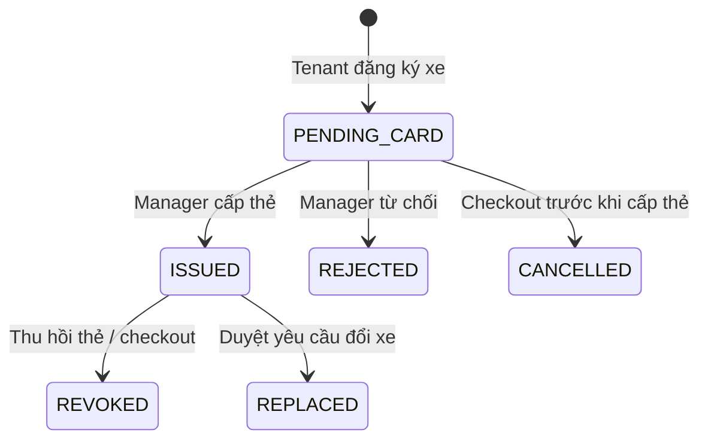

**Loại xe:** `SCOOTER`, `MANUAL_MOTORCYCLE`, `ELECTRIC_MOTORBIKE`, `ELECTRIC_BICYCLE`, `BICYCLE`. Xe tay ga, xe số, xe máy điện có đăng ký **phải** có biển và hai OCI key của ảnh giấy đăng ký; xe đạp và xe đạp điện không có đăng ký có thể để `NULL`. Validate ở Backend và khi thích hợp bằng `CHECK` cùng hàng, không chỉ UI.

**Bất biến theo BR-10/FR-08:**

- **Một xe đang chiếm hạn mức/Tenant:** tính `status IN ('PENDING_CARD', 'ISSUED')`. `REJECTED`, `REVOKED`, `REPLACED`, `CANCELLED` là lịch sử, không chiếm hạn mức.
- `PENDING_CARD`: chưa có `card_code`. Cấp thẻ mới → `ISSUED` với mã và bàn giao vật lý; từ chối → `REJECTED` có `rejection_reason`, `rejected_by_staff_id`, `rejected_at` và notification.
- `REPLACED`: xe cũ **không bị thu hồi thẻ vật lý**; sau duyệt đổi xe tạo xe mới ID khác trạng thái `ISSUED`, **kế thừa đúng** `card_code` cũ. Xe cũ giữ mã thẻ lịch sử; không được coi `REPLACED` là `REVOKED`.
- `REVOKED`: chỉ sau khi nhận lại thẻ đã cấp. `CANCELLED`: đăng ký chưa cấp thẻ bị hủy, **không** ghi hành vi nhận lại thẻ. Checkout phải phân biệt hai trạng thái này.
- **Uniqueness thẻ vật lý:** chỉ các xe `ISSUED` có mã duy nhất **sau chuẩn hóa `upper(btrim(card_code))`**. Các xe `REPLACED`/`REVOKED` giữ mã trùng để lưu lịch sử. Đây không phải uniqueness toàn bộ bảng.
- `replaced_by_vehicle_id` và `replaced_vehicle_id` cần nhất quán hai chiều khi được lưu; không tạo vòng thay thế. Quy tắc hai chiều/đúng Tenant và tính nhất quán qua hai dòng cần transaction/logic/trigger, không phải `CHECK` một dòng.
- Mỗi lần duyệt/từ chối phải kiểm tra trạng thái hiện tại và quyền `MANAGER`; không làm một nửa update. Không có bảng `parking_cards` hay luồng mất thẻ.

#### 3.4.5. `vehicle_change_requests` — Yêu cầu đổi xe giữ nguyên thẻ vật lý (MỚI)

| Cột                                    | Type          | Null  | Khóa / ràng buộc                                                  | Ý nghĩa                                                               |
| -------------------------------------- | ------------- | :-----: | ----------------------------------------------------------------- | --------------------------------------------------------------------- |
| `id`                                   | `uuid`        | Không | PK                                                                | ID yêu cầu đổi xe riêng biệt                                          |
| `tenant_id`                            | `uuid`        | Không | FK → `tenants.id`                                                 | Người yêu cầu, đang cư trú tại lúc gửi                                |
| `current_vehicle_id`                   | `uuid`        | Không | FK → `vehicles.id`                                                | Xe đang `ISSUED` của cùng Tenant tại thời điểm gửi                    |
| `proposed_vehicle_type`                | `text`        | Không | 5 loại xe như `vehicles`                                          | Loại xe mới dự kiến                                                   |
| `proposed_license_plate`               | `text`        | Có    | Conditional required                                              | Biển số mới (nếu cần)                                                 |
| `proposed_brand`                       | `text`        | Không | Không rỗng                                                        | Hãng/dòng xe mới                                                      |
| `proposed_color`                       | `text`        | Không | Không rỗng                                                        | Màu xe mới                                                            |
| `proposed_registration_front_file_key` | `text`        | Có    | Conditional required                                              | Ảnh giấy đăng ký xe mới mặt trước, private OCI                        |
| `proposed_registration_back_file_key`  | `text`        | Có    | Conditional required                                              | Ảnh mặt sau, private OCI                                              |
| `status`                               | `text`        | Không | `PENDING`, `APPROVED`, `REJECTED`, `CANCELLED`; default `PENDING` | Vòng đời **yêu cầu**, độc lập `vehicles.status`                       |
| `rejection_reason`                     | `text`        | Có    | NOT blank khi `REJECTED`                                          | Lý do Manager từ chối yêu cầu; không cần ảnh minh chứng               |
| `processed_by_staff_id`                | `uuid`        | Có    | FK → `staff_profiles.id`                                          | Manager duyệt/từ chối; NULL khi đang chờ hoặc hủy do checkout tự động |
| `processed_at`                         | `timestamptz` | Có    | —                                                                 | Thời điểm duyệt/từ chối/hủy                                           |
| `new_vehicle_id`                       | `uuid`        | Có    | FK → `vehicles.id`, UNIQUE khi khác NULL                          | ID hồ sơ xe mới **chỉ sau khi APPROVED**                              |
| `created_at`                           | `timestamptz` | Không | Default `now()`                                                   | Thời điểm Tenant gửi yêu cầu                                          |

**State machine (`vehicle_change_requests.status`):**

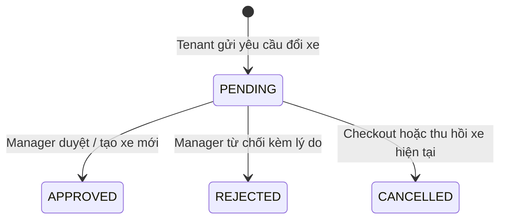

**Trạng thái và tính hợp lệ:**

1. Khi Tenant tạo yêu cầu, phải xác thực **Tenant là chủ xe `current_vehicle_id`**, còn cư trú và xe đó ở `ISSUED`; yêu cầu là `PENDING`, **không tạo hồ sơ xe mới**. Một Tenant có tối đa **một** `PENDING` Request; phải bảo đảm ràng buộc duy nhất có điều kiện theo `tenant_id`.
2. Kiểm tra proposed fields và hai ảnh theo loại xe. Các giá trị trong yêu cầu là **snapshot đề nghị**, không cập nhật `vehicles` khi pending.
3. Khi `APPROVED`: `new_vehicle_id` **bắt buộc**, `processed_by_staff_id` và `processed_at` bắt buộc; xe cũ → `REPLACED`, xe mới → `ISSUED`, giữ **đúng mã thẻ cũ** trong một transaction. Liên kết ID hai xe và Request; notification một lần.
4. Khi `REJECTED`: Manager, thời điểm và lý do bắt buộc; `new_vehicle_id=NULL`; xe hiện tại vẫn `ISSUED`, thẻ vật lý không thay đổi; thông báo kèm lý do.
5. Khi `CANCELLED`: không có xe mới; có `processed_at` (ví dụ checkout). Khi checkout xe `ISSUED → REVOKED` hoặc khi thu hồi thẻ hợp lệ làm yêu cầu không còn được đáp ứng, Request đang chờ phải hủy; giữ lịch sử.
6. Backend khóa/cảnh báo cập nhật đồng thời hoặc yêu cầu lặp, kiểm tra nguyên tử tất cả các trạng thái và mã thẻ trước khi duyệt. Không dựa vào `CHECK` để xác minh `current_vehicle_id.tenant_id`, vì cần tham chiếu liên bảng; có thể dùng FK tổng hợp với unique `(id, tenant_id)` trên Vehicle hoặc kiểm tra bằng transaction/trigger.

#### 3.4.6. `notifications` — Hộp thư thông báo tự động

| Cột                   | Type          | Null  | Khóa / ràng buộc  | Ý nghĩa                                    |
| --------------------- | ------------- | :-----: | ----------------- | ------------------------------------------ |
| `id`                  | `uuid`        | Không | PK                | ID thông báo                               |
| `tenant_id`           | `uuid`        | Không | FK → `tenants.id` | Người nhận                                 |
| `event_type`          | `text`        | Không | Tập mã tại §5.3   | Loại sự kiện tự sinh                       |
| `title`               | `text`        | Không | —                 | Tiêu đề hiển thị                           |
| `body`                | `text`        | Không | —                 | Nội dung hiển thị                          |
| `dedupe_key`          | `text`        | Có    | Unique nếu có     | Tránh tạo trùng khi task chạy lại          |
| `read_at`             | `timestamptz` | Có    | —                 | Đã đọc nếu khác `NULL`                     |
| `created_at`          | `timestamptz` | Không | Default `now()`   | Ngày sinh                                  |

**Trạng thái đọc (`notifications.read_at`):**

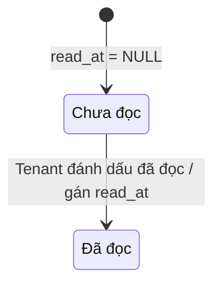

**Nguồn tạo:** Chỉ các sự kiện nghiệp vụ: ví dụ `INVOICE_ISSUED`, `INVOICE_DUE`, `INVOICE_OVERDUE`, `PAYMENT_CONFIRMED`, `PAYMENT_PROOF_REJECTED`, `VIOLATION_CREATED`, **`VEHICLE_REGISTRATION_REJECTED`, `VEHICLE_CHANGE_APPROVED`, `VEHICLE_CHANGE_REJECTED`**. Khi một workflow đã xử lý xong, không phát thông báo trùng; cân nhắc `dedupe_key` gắn mã yêu cầu + sự kiện. **Không có `created_by_manager`, `broadcast_message`, mẫu thông báo hoặc API Manager soạn và gửi thông báo chung.** Tenant chỉ đọc thông báo của mình qua **chuông header**; lịch sử vi phạm xem ở **tab Vi phạm riêng**, không tăng bảng. Sau checkout, hệ thống có thể tiếp tục tạo thông báo về nợ cũ nhưng không tạo thông báo sinh hoạt mới; dữ liệu thông báo lịch sử vẫn được xem.

---

## 4. DANH MỤC KHÓA NGOẠI VÀ CHÍNH SÁCH XÓA

Các bảng nghiệp vụ có quan hệ lịch sử phải tránh cascade deletion làm mất bằng chứng. Bảng dưới đây là định hướng **mặc định**; những ngoại lệ an toàn được nêu riêng.

| Bảng con / FK                                   | Bảng cha              | Chính sách                | Ghi chú                                                  |
| ----------------------------------------------- | --------------------- | ------------------------- | -------------------------------------------------------- |
| `beds.room_id`                                  | `rooms`               | `RESTRICT`                | Khi Delete Room tạo nhầm, xóa các Bed chưa sử dụng trước |
| `room_amenities.room_id`                        | `rooms`               | `CASCADE` có kiểm soát    | Chỉ thực sự cascade khi Room được phép xóa vật lý        |
| `room_amenities.amenity_id`                     | `amenities`           | `RESTRICT`                | Không xóa danh mục còn được phòng sử dụng                |
| `room_code_registry.room_id`                    | `rooms`               | `RESTRICT`                | Xóa registry chưa có nghiệp vụ trước khi xóa Room        |
| `tenants.user_id`                               | `users`               | `RESTRICT`                | Không xóa User chỉ vì checkout                           |
| `staff_profiles.user_id`                        | `users`               | `RESTRICT`                | Khóa tài khoản thay vì xóa nhân sự có lịch sử            |
| `contracts.tenant_id`                           | `tenants`             | `RESTRICT`                | Bảo toàn lịch sử cư trú                                  |
| `contracts.bed_id`                              | `beds`                | `RESTRICT`                | Bed từng có Contract không được xóa                      |
| `contract_renewals.contract_id`                 | `contracts`           | `RESTRICT`                | Bảo toàn phụ lục                                         |
| `contract_documents.contract_id`                | `contracts`           | `RESTRICT`                | Xóa riêng tệp upload nhầm, không cascade Contract        |
| `contract_documents.renewal_id`                 | `contract_renewals`   | `RESTRICT`                | Tham chiếu phụ lục tùy chọn                              |
| `invoices.contract_id`                          | `contracts`           | `RESTRICT`                | Hóa đơn không bị xóa theo checkout                       |
| `payment_transactions.invoice_id`               | `invoices`            | `RESTRICT`                | Phiếu thu đã xác nhận không bị xóa                       |
| `payment_transactions.confirmed_by_staff_id`    | `staff_profiles`      | `RESTRICT`                | Nhân sự cũ vẫn là người đã xác nhận                      |
| `facility_expenses.recorded_by_staff_id`        | `staff_profiles`      | `RESTRICT`                | Bảo toàn người lập (trừ dòng chi nhập nhầm được xóa)     |
| `maintenance_tickets.reporter_tenant_id`        | `tenants`             | `RESTRICT`                | Giữ phiếu báo hỏng                                       |
| `maintenance_tickets.room_id`                   | `rooms`               | `RESTRICT`                | Room có sự cố không được xóa                             |
| `maintenance_tickets.bed_id`                    | `beds`                | `RESTRICT` nếu không NULL | Nếu gắn Bed thì giữ Bed lịch sử                          |
| `maintenance_tickets.assignee_staff_id`         | `staff_profiles`      | `RESTRICT` nếu không NULL | Không xóa nhân sự có phiếu được giao                     |
| `ticket_replacement_parts.ticket_id`            | `maintenance_tickets` | `RESTRICT`                | Không xóa phiếu/linh kiện lịch sử đã hoàn thành          |
| `violations.tenant_id`                          | `tenants`             | `RESTRICT`                | Lịch sử vi phạm                                          |
| `violations.issued_by_staff_id`                 | `staff_profiles`      | `RESTRICT`                | Giữ người lập                                            |
| `vehicles.tenant_id`                            | `tenants`             | `RESTRICT`                | Xe bị từ chối, thay thế, thu hồi/hủy vẫn giữ lịch sử     |
| `vehicles.rejected_by_staff_id`                 | `staff_profiles`      | `RESTRICT` nếu không NULL | Bảo toàn Manager từ chối đăng ký                         |
| `vehicles.replaced_by_vehicle_id`               | `vehicles`            | `RESTRICT` nếu không NULL | Liên kết hồ sơ xe mới, không xóa xe lịch sử              |
| `vehicles.replaced_vehicle_id`                  | `vehicles`            | `RESTRICT` nếu không NULL | Liên kết hồ sơ xe tiền nhiệm                             |
| `vehicle_change_requests.tenant_id`             | `tenants`             | `RESTRICT`                | Bảo toàn yêu cầu Tenant đã gửi                           |
| `vehicle_change_requests.current_vehicle_id`    | `vehicles`            | `RESTRICT`                | Xe hiện tại tại lúc gửi yêu cầu                          |
| `vehicle_change_requests.new_vehicle_id`        | `vehicles`            | `RESTRICT` nếu không NULL | Chỉ có khi đã duyệt, không xóa xe kết quả                |
| `vehicle_change_requests.processed_by_staff_id` | `staff_profiles`      | `RESTRICT` nếu không NULL | Manager quyết định chấp thuận/từ chối                    |
| `notifications.tenant_id`                       | `tenants`             | `RESTRICT`                | Giữ hộp thư cá nhân, không tự xóa khi checkout           |

**Kết luận:** Không sử dụng `ON DELETE CASCADE` hàng loạt với `contracts`, `invoices`, `payment_transactions`, `maintenance_tickets`, `violations`, `vehicles` hoặc `vehicle_change_requests`. Xóa Room nhập sai tầng là thao tác **có kiểm tra điều kiện**, chỉ thực hiện khi các khóa ngoại nghiệp vụ không có dữ liệu. Archive/Restore không xóa dữ liệu nên không đụng chính sách FK.

---

## 5. CARDINALITY, UNIQUENESS VÀ ENUM

### 5.1. Quan hệ nghiệp vụ chính (đúng với Conceptual ERD v3.5 / SRS v3.4.1)

| Quan hệ                              | Bội số theo lịch sử         | Lưu ở cột FK / bảng nối                                  | Ràng buộc phụ                                |
| ------------------------------------ | --------------------------- | -------------------------------------------------------- | -------------------------------------------- |
| Room–Bed                             | 1 ↔ đúng 4/6/8              | `beds.room_id`                                           | Transaction tạo đồng bộ                      |
| Room–Amenity                         | M:N                         | `room_amenities`                                         | Số lượng dương                               |
| User–Tenant                          | 1 ↔ 0..1                    | `tenants.user_id UNIQUE`                                 | Theo role TENANT                             |
| User–Staff                           | 1 ↔ 0..1                    | `staff_profiles.user_id UNIQUE`                          | Theo role MANAGER/TECHNICIAN                 |
| Tenant–Contract                      | 1 ↔ 1..N (khi đã tạo hồ sơ) | `contracts.tenant_id`                                    | ≤1 Contract ACTIVE/Tenant                    |
| Bed–Contract                         | 1 ↔ 0..N                    | `contracts.bed_id`                                       | ≤1 Contract ACTIVE/Bed                       |
| Contract–Renewal                     | 1 ↔ 0..N                    | `contract_renewals.contract_id`                          | Kỳ gia hạn tiếp nối                          |
| Contract–Document                    | 1 ↔ 0..N                    | `contract_documents.contract_id`                         | Upload sau được phép                         |
| Renewal–Document                     | 0..1 ↔ 0..N                 | `contract_documents.renewal_id`                          | Cùng Contract gốc                            |
| Contract–Invoice                     | 1 ↔ 1..N (đã onboarding)    | `invoices.contract_id`                                   | Một Invoice/Contract/kỳ                      |
| Invoice–Payment                      | 1 ↔ 0..1                    | `payment_transactions.invoice_id UNIQUE`                 | Chỉ tạo sau xác nhận đã thu                  |
| Staff–Payment                        | 1 ↔ 0..N                    | `payment_transactions.confirmed_by_staff_id`             | Staff phải là Manager                        |
| Staff–Expense                        | 1 ↔ 0..N                    | `facility_expenses.recorded_by_staff_id`                 | Manager ghi nhận                             |
| Tenant–Ticket                        | 1 ↔ 0..N                    | `maintenance_tickets.reporter_tenant_id`                 | Chỉ Tenant đang ở tạo mới                    |
| Room–Ticket                          | 1 ↔ 0..N                    | `maintenance_tickets.room_id`                            | Bắt buộc Room                                |
| Bed–Ticket                           | 0..1 ↔ 0..N                 | `maintenance_tickets.bed_id`                             | Có thể NULL, phải cùng Room                  |
| Technician–Ticket                    | 0..1 ↔ 0..N                 | `maintenance_tickets.assignee_staff_id`                  | NULL trước phân công                         |
| Ticket–Part                          | 1 ↔ 0..N                    | `ticket_replacement_parts.ticket_id`                     | Không dùng Part = 0 đồng                     |
| Tenant–Violation                     | 1 ↔ 0..N                    | `violations.tenant_id`                                   | Vi phạm gắn cá nhân                          |
| Staff–Violation                      | 1 ↔ 0..N                    | `violations.issued_by_staff_id`                          | Chỉ Manager lập                              |
| Tenant–Vehicle                       | 1 ↔ 0..N                    | `vehicles.tenant_id`                                     | ≤1 xe `PENDING_CARD`/`ISSUED`                |
| Tenant–VehicleChangeRequest          | 1 ↔ 0..N                    | `vehicle_change_requests.tenant_id`                      | ≤1 Request `PENDING`/Tenant                  |
| Current Vehicle–VehicleChangeRequest | 1 ↔ 0..N                    | `vehicle_change_requests.current_vehicle_id`             | Xe đang `ISSUED` của đúng Tenant tại lúc gửi |
| Created Vehicle–VehicleChangeRequest | 0..1 ↔ 0..1                 | `vehicle_change_requests.new_vehicle_id UNIQUE`          | Chỉ Request `APPROVED` mới có xe mới         |
| Staff–VehicleChangeRequest           | 0..1 ↔ 0..N                 | `vehicle_change_requests.processed_by_staff_id`          | Có Manager nếu `APPROVED/REJECTED`           |
| Staff–Vehicle rejection              | 0..1 ↔ 0..N                 | `vehicles.rejected_by_staff_id`                          | Manager khi xe `REJECTED`                    |
| Vehicle–Vehicle (replaces)           | 0..1 ↔ 0..1                 | `vehicles.replaced_by_vehicle_id`, `replaced_vehicle_id` | Liên kết xe tiền nhiệm/kế nhiệm nếu có       |
| Tenant–Notification                  | 1 ↔ 0..N                    | `notifications.tenant_id`                                | Chỉ do hệ thống sinh                         |

**28 quan hệ nghiệp vụ** theo Conceptual ERD v3.5; các quan hệ bảng nối/registry (Room–RoomAmenity, Room–Registry) là hỗ trợ kỹ thuật, không phát sinh use case mới. **JWT/OTP Redis không nằm trong ERD.**

### 5.2. Các ràng buộc duy nhất phải bảo toàn

Các quy tắc dưới đây là **yêu cầu toàn vẹn dữ liệu**, không phải đề xuất tối ưu truy vấn. Cách hiện thực cụ thể được quyết định khi triển khai PostgreSQL/Flyway; kiểm tra ở Backend phải an toàn trước các yêu cầu đồng thời.

| Bảng / Phạm vi | Quy tắc duy nhất |
| --- | --- |
| `contracts` | Mỗi Bed và mỗi Tenant có tối đa một Contract `ACTIVE` |
| `vehicles` | Mỗi Tenant có tối đa một xe thuộc `PENDING_CARD` hoặc `ISSUED` |
| `vehicles.card_code` | Chỉ duy nhất giữa các xe `ISSUED`, so sánh theo `upper(btrim(card_code))`; giữ mã lịch sử của `REPLACED`/`REVOKED` |
| `vehicle_change_requests` | Mỗi Tenant có tối đa một yêu cầu `PENDING`; một `new_vehicle_id` khác NULL không thuộc hai yêu cầu |
| `facility_expenses` | Mỗi năm/tháng có tối đa một khoản `SALARY` theo `expense_date`; các loại khác không bị giới hạn như vậy |
| `users.email`, `tenants.id_card_number` | Email duy nhất sau `lower(btrim(email))`; CCCD duy nhất toàn hệ thống |
| `rooms.room_number`, `room_code_registry.code` | Mã duy nhất sau chuẩn hóa; mã đã dùng trong lịch sử nghiệp vụ không được cấp lại |
| `room_code_registry` | Mỗi Room có đúng một mã `is_current=true` |
| `beds` | `(room_id, bed_code)` và `slot_key` chuẩn hóa không trùng |
| `invoices` | Mỗi `(contract_id, billing_period)` chỉ có một hóa đơn; `billing_period` là ngày 01 |
| `payment_transactions` | Mỗi `invoice_id` có tối đa một phiếu thu đã xác nhận |

**Ràng buộc trạng thái:** `vehicles` chỉ có `card_code` khi thuộc `ISSUED`/`REPLACED`/`REVOKED`; yêu cầu đổi xe chỉ có `new_vehicle_id` khi `APPROVED`, có Manager/ngày xử lý khi `APPROVED`/`REJECTED` và lý do bắt buộc khi `REJECTED`. Các điều kiện liên bảng phải kiểm tra trong transaction, không thay thế bằng `CHECK` trên một hàng.

### 5.3. Ràng buộc thuộc tính và các trạng thái

| Bảng / Trường                                   | Giá trị hợp lệ (DB)                                                                                                                                                                                           | Hiển thị/ý nghĩa                                                   |
| ----------------------------------------------- | ------------------------------------------------------------------------------------------------------------------------------------------------------------------------------------------------------------- | ------------------------------------------------------------------ |
| `rooms.total_beds`                              | `4`, `6`, `8`                                                                                                                                                                                                 | Sức chứa cố định của phòng                                         |
| `rooms.gender_policy`, `tenants.gender`         | `MALE`, `FEMALE`                                                                                                                                                                                              | Nam, Nữ                                                            |
| `beds.status`                                   | `AVAILABLE`, `OCCUPIED`, `MAINTENANCE`                                                                                                                                                                        | Sẵn sàng, Đang thuê, Bảo trì                                       |
| `users.role`                                    | `MANAGER`, `TENANT`, `TECHNICIAN`                                                                                                                                                                             | Ba role cố định                                                    |
| `users.status`                                  | `ACTIVE`, `LOCKED`                                                                                                                                                                                            | Hoạt động / Ngưng hoạt động / Bị khóa                              |
| `tenants.resident_status`                       | `ACTIVE`, `CHECKED_OUT`                                                                                                                                                                                       | Đang thuê / Đã trả phòng                                           |
| `contract_documents.document_type`              | `ORIGINAL_CONTRACT`, `RENEWAL_ANNEX`, `CHECKOUT_HANDOVER`, `OTHER`                                                                                                                                            | Hợp đồng gốc / Phụ lục / Bàn giao / Khác                           |
| `contract_documents.mime_type`                  | `image/jpeg`, `image/png`, `image/webp`, `application/pdf`, `application/msword`, `application/vnd.openxmlformats-officedocument.wordprocessingml.document`                                                   | Sáu MIME hợp lệ cho bảy phần mở rộng theo FR-10                    |
| `contracts.status`                              | `ACTIVE`, `LIQUIDATED`                                                                                                                                                                                        | Hiệu lực / Đã thanh lý                                             |
| `invoices.status`                               | `DEBT`, `PENDING_CONFIRMATION`, `PAID`                                                                                                                                                                        | Nợ / Chờ xác nhận / Đã thu                                         |
| `payment_transactions.payment_method`           | `CASH`, `VIETQR_TRANSFER`                                                                                                                                                                                     | Tiền mặt / Chuyển khoản VietQR                                     |
| `facility_expenses.expense_type`                | `ELECTRICITY`, `WATER`, `INTERNET`, **`SALARY`**, `OTHER`                                                                                                                                                     | Điện / Nước / Internet / **Tổng lương nhân viên/tháng** / Khác     |
| `maintenance_tickets.category`                  | `ELECTRIC`, `WATER`, `INTERNET`, `FURNITURE`, `AMENITY`, `OTHER`                                                                                                                                              | Điện / Nước / Internet / Nội thất / Tiện ích / Khác                |
| `maintenance_tickets.priority`                  | `URGENT`, `HIGH`, `NORMAL`                                                                                                                                                                                    | Khẩn cấp / Cao / Bình thường                                       |
| `maintenance_tickets.status`                    | `UNASSIGNED`, `ASSIGNED`, `IN_PROGRESS`, `COMPLETED`                                                                                                                                                          | Chưa phân công / Mới giao / Đang xử lý / Hoàn thành                |
| `violations.violation_type`                     | `LATE_RETURN`, `NOISE`, `HYGIENE`, `OUTSIDER`, `SMOKING_FIRE`, `OTHER`                                                                                                                                        | Về muộn / Ồn ào / Vệ sinh / Khách ngoài / Hút thuốc-cháy nổ / Khác |
| `vehicles.vehicle_type`                         | `SCOOTER`, `MANUAL_MOTORCYCLE`, `ELECTRIC_MOTORBIKE`, `ELECTRIC_BICYCLE`, `BICYCLE`                                                                                                                           | Xe tay ga / Xe số / Xe máy điện / Xe đạp điện / Xe đạp             |
| `vehicle_change_requests.proposed_vehicle_type` | Cùng tập với `vehicles.vehicle_type`                                                                                                                                                                          | Loại xe được đề nghị thay thế                                      |
| `vehicles.status`                               | `PENDING_CARD`, `ISSUED`, `REJECTED`, `REVOKED`, `REPLACED`, `CANCELLED`                                                                                                                                      | Chờ cấp / Đã cấp / Từ chối / Thu hồi / Thay thế / Đã hủy           |
| `vehicle_change_requests.status`                | `PENDING`, `APPROVED`, `REJECTED`, `CANCELLED`                                                                                                                                                                | Chờ duyệt / Đã duyệt / Từ chối / Hủy                               |
| `notifications.event_type`                      | `INVOICE_ISSUED`, `INVOICE_DUE`, `INVOICE_OVERDUE`, `PAYMENT_CONFIRMED`, `PAYMENT_PROOF_REJECTED`, `VIOLATION_CREATED`, `VEHICLE_REGISTRATION_REJECTED`, `VEHICLE_CHANGE_APPROVED`, `VEHICLE_CHANGE_REJECTED` | Nhóm sự kiện tự động theo FR-27                                    |
| `violations.level`                              | `REMINDER`, `WARNING`, `FINE`                                                                                                                                                                                 | Nhắc nhở / Cảnh cáo / Phạt tiền                                    |

---

## 6. CÁC BẤT BIẾN PHẢI THỰC THI THEO TRANSACTION

### T01 — Tạo Room và các Bed

- Validate Room Code chưa thuộc `rooms` và chưa bị khóa trong `room_code_registry`; khóa/chặn cạnh tranh khi cấp mã.
- Tạo Room, 4/6/8 Bed, quan hệ tiện nghi, bản ghi registry hiện hành (`used_in_business=false`).
- Commit đồng thời. Không có phòng chỉ được tạo một phần số Bed.

### T02 — Đổi mã Room / Xóa phòng tạo nhầm / Archive–Restore

- **Đổi Room Code:** Yêu cầu không có cư trú hoặc hợp đồng chiếm chỗ hiện hành trong Room; khóa Room và Bed, kiểm tra mã mới; cập nhật Room Code + tất cả Slot Key. Mã cũ từng gắn nghiệp vụ phải giữ registry với `used_in_business=true`, `is_current=false`; mã chưa từng gắn nghiệp vụ được xóa khỏi registry để tái sử dụng.
- **Xóa vật lý Room:** Chỉ khi Room/Bed không từng có Contract, Ticket, lịch sử hay nghiệp vụ cần giữ. Xóa cấu hình tiện nghi, registry chưa bảo vệ, Bed, rồi Room trong cùng transaction. Mã được giải phóng; không xóa Room có registry đã bảo vệ.
- **Archive/Restore:** Chỉ đổi `rooms.archived_at` sau kiểm tra điều kiện; mã Room vẫn được giữ, không tác động Bed status hoặc bản ghi hợp đồng cũ.
- **Bảo vệ mã:** Ngay khi phát sinh nghiệp vụ đầu tiên tham chiếu Room (ví dụ Contract/Ticket), đánh dấu mã **hiện hành lúc đó** `used_in_business=true` cùng transaction. Không đánh dấu mã cấu hình trống chưa phát sinh nghiệp vụ.

### T03 — Onboarding ngày 01 (FR-09 và FR-15)

1. Chỉ thực hiện khi **ngày địa phương tại KTX là ngày 01** và `start_on` bằng ngày đó. Khách mới chưa tồn tại Tenant/User; khách cũ phải dùng lại Tenant/User theo CCCD và không còn Invoice `DEBT`/`PENDING_CONFIRMATION`.
2. Khóa/kiểm tra Bed `AVAILABLE`, Room chưa Archive và chính sách giới tính phù hợp; không có Contract `ACTIVE` của Tenant hoặc Bed khác.
3. Tạo User/Tenant nếu mới, Contract, gán Bed `OCCUPIED`, cập nhật trạng thái cư trú và **phát hành Invoice của tháng đầu** (đúng giá snapshot, kỳ ngày 01, hạn ngày 05).
4. Đánh dấu mã phòng liên quan đã gắn nghiệp vụ trong Registry; chỉ báo thành công sau khi **toàn bộ dữ liệu chính** được commit. Với mật khẩu lần đầu, chỉ bàn giao plaintext **một lần** sau khi tạo thành công; DB chỉ có hash.

### T04 — Gia hạn và khóa giá theo phụ lục (FR-12)

- Kiểm tra Contract `ACTIVE`, còn hạn, chưa checkout, không có Invoice `DEBT`/`PENDING_CONFIRMATION`; lấy ngày kết thúc hiện tại từ phụ lục mới nhất hoặc hợp đồng gốc.
- Lấy giá tiêu chuẩn **chung của Room tại thời điểm ký**; tạo `contract_renewals` với `previous_end_on`, `effective_from` ngày 01 tháng sau, `new_end_on` cuối tháng và `monthly_rent` bất biến.
- Không tạo Contract thứ hai, không tự sửa hóa đơn phát hành trước đó, không tính lại giá kỳ cũ.

### T05 — Phát hành hóa đơn định kỳ (FR-15)

- Scheduler chạy lúc **00:00 ngày 25** `Asia/Ho_Chi_Minh` và chọn tháng tiếp theo; Manager có thể retry nếu batch lỗi.
- Chỉ chọn Contract `ACTIVE` có thời hạn gốc hoặc phụ lục **bao phủ tháng cần thu**, lấy mức giá đã khóa theo kỳ; không phát hành sau checkout/ngoài thời hạn.
- `UNIQUE (contract_id, billing_period)` là lớp bảo vệ cuối cùng, kết hợp insert-if-not-exists/idempotency khi retry.
- Trường hợp **ký phụ lục sau ngày 25 nhưng trước ngày hết hạn**, tháng tới vừa đủ điều kiện mà chưa được batch phát hành: tạo **Invoice bổ sung ngay trong/đúng sau luồng gia hạn**, dùng giá phụ lục và unique `(contract_id, billing_period)` để chống trùng. Nếu đã có hóa đơn thì không tạo lại. Đây là xử lý kỹ thuật tránh thiếu kỳ, không tạo thêm loại hóa đơn.

### T06 — Gửi minh chứng, xác nhận tiền mặt/chuyển khoản (FR-16)

- Tenant (kể cả sau checkout với hóa đơn cũ) chỉ được gửi ảnh vào Invoice `DEBT` của mình → lưu `proof_file_key`, `proof_submitted_at` và đổi `PENDING_CONFIRMATION`; **không** tạo Payment Transaction.
- Manager đối soát chuyển khoản: `PENDING_CONFIRMATION→PAID`, tạo một `payment_transactions` với `VIETQR_TRANSFER`, `amount=invoice.amount`, `confirmed_by_staff_id` và thời gian; hoặc từ chối → `DEBT` và cho gửi lại.
- Tiền mặt: chỉ từ `DEBT→PAID`, tạo một Payment Transaction với `CASH` sau khi thực nhận đủ. Khóa Invoice trong transaction; tránh hai người cùng xác nhận trùng.
- Invoice `PAID` phải có **đúng một** Payment Transaction; Invoice `DEBT`/`PENDING_CONFIRMATION` phải có **không** Payment Transaction. Đây là bất biến **liên bảng**, không thể chỉ dùng CHECK trên Invoice.

### T07 — Checkout (FR-13)

- Manager xác nhận bàn giao, chọn trạng thái giường `AVAILABLE` hoặc `MAINTENANCE` (không tự chọn mặc định), thu hồi phương tiện/thẻ theo quy trình thông thường.
- Cập nhật Contract `LIQUIDATED`, `checked_out_at`, Bed status và Tenant `CHECKED_OUT`; xe `ISSUED → REVOKED` sau thu hồi thẻ vật lý, xe `PENDING_CARD → CANCELLED` (không ghi nhận thẻ chưa cấp là đã thu hồi), Request `PENDING → CANCELLED` trong **cùng transaction**. Xe `REPLACED/REJECTED/REVOKED/CANCELLED` lịch sử giữ nguyên.
- Hóa đơn đang `DEBT`/`PENDING_CONFIRMATION` **giữ nguyên**; User/Tenant, Contract/Renewal, Invoice, phiếu thu, Ticket/Violation lịch sử vẫn tồn tại. Hóa đơn kỳ sau checkout không được phát hành.

### T08 — Maintenance và vật tư (FR-17/18)

- Tenant đang cư trú tạo Ticket `UNASSIGNED` với `assignee_staff_id=NULL`, có Room và tùy chọn Bed cùng phòng.
- Manager gán/chuyển Technician chưa hoàn thành; Technician phải thuộc role `TECHNICIAN`, tài khoản đang hoạt động và là người đang được giao khi bấm bắt đầu/kết thúc.
- Khi `COMPLETED`, lưu ảnh/kết quả, `resolved_at`, vật tư thực dùng; chỉ tổng hợp chi phí linh kiện của phiếu hoàn thành. Không cần Part nếu chi phí 0.

### T09 — Quản lý nhân sự, OTP và thông báo

- Tạo Technician với `users.role='TECHNICIAN'`, email unique **toàn User**; khóa Technician vô hiệu hóa token cũ qua Redis và chặn request theo `users.status`, không thêm bảng SQL session. Không cho Manager tự đổi email của chính mình.
- **Change Password:** kiểm tra JWT hợp lệ + mật khẩu cũ + mật khẩu mới, không OTP; vô hiệu hóa token cũ. **Forgot Password:** xác định một User bằng CCCD Tenant hoặc email Staff, gửi OTP 6 số/5 phút tới `users.email`, quản lý trong Redis. Manager được cập nhật email Tenant/Technician duy nhất toàn hệ thống sau xác minh trực tiếp; không làm nhật ký đổi email riêng.
- Notification chỉ được sinh bởi hành động sự kiện nghiệp vụ trong Backend, có `dedupe_key` khi phù hợp; gồm từ chối đăng ký xe, duyệt/từ chối đổi xe, hóa đơn và vi phạm; Tenant chỉ xem của mình qua chuông. Lịch sử Vi phạm thuộc tab riêng (không tạo bảng mới).

### T10 — Đăng ký, từ chối, yêu cầu đổi xe và duyệt đổi xe (BR-10 / FR-08)

- **Đăng ký mới:** Tenant đang cư trú có thể tạo xe `PENDING_CARD` nếu không có xe `PENDING_CARD`/`ISSUED`; file giấy đăng ký thuộc OCI private, kiểm tra điều kiện theo loại. Manager cấp thẻ chỉ khi xe `PENDING_CARD`, kiểm tra `card_code` hợp lệ/duy nhất giữa các xe `ISSUED`; từ chối với lý do bắt buộc, người/thời gian và notification cùng transaction.
- **Gửi yêu cầu:** khóa/kiểm tra xe cũ thuộc Tenant, `ISSUED`, Tenant còn ở, chưa có Request `PENDING`; insert Request với snapshot xe mới, **không tạo xe ISSUED thứ hai**. Partial unique Request `PENDING`/Tenant bảo vệ cạnh tranh.
- **Duyệt đổi xe:** lock Request và xe cũ (ví dụ `SELECT ... FOR UPDATE`); xác minh còn `PENDING`, xe cũ `ISSUED`, cùng Tenant, mã thẻ đã cấp hợp lệ và không xung đột. Trong **một transaction**: xe cũ `REPLACED` + `replaced_by_vehicle_id`, tạo xe mới `ISSUED` với **cùng card_code**, ID xe mới, liên kết tiền nhiệm; Request `APPROVED` + `new_vehicle_id` + Manager/thời gian; tạo notification có khóa dedupe. Không revoke rồi issue để giả lập đổi xe; không mất lịch sử khi retry.
- **Từ chối yêu cầu:** chỉ Manager hợp lệ, lý do bắt buộc, Request `PENDING → REJECTED`, không thay đổi xe cũ, lưu notification và thời điểm trong transaction. Các yêu cầu đã xử lý không được phê duyệt lần hai. Nếu xe hiện tại bị thu hồi hoặc checkout, hủy Request `PENDING` nhất quán.
- **Kiểm tra liên bảng:** xe hiện tại và xe mới phải thuộc cùng Tenant; `processed_by_staff_id` phải trỏ Manager hợp lệ; trạng thái/`card_code` xe cũ và mới không thể chỉ chứng minh bằng CHECK một dòng. Dùng transaction, ràng buộc duy nhất có điều kiện, kiểm tra điều kiện cập nhật và/hoặc trigger. Không dùng claim "atomic" cho chuỗi REST request tách rời.

---

---

## 7. ĐỐI CHIẾU VỚI LOGICAL ERD CŨ VÀ KẾ HOẠCH ĐỒNG BỘ

| Thành phần bản cũ                                                  | Thiết kế mới                                                                                                                                       | Lý do từ SRS/Conceptual                   |
| ------------------------------------------------------------------ | -------------------------------------------------------------------------------------------------------------------------------------------------- | ----------------------------------------- |
| `users.username` dùng cho mọi role                                 | **Loại cột username trong schema đích**; Tenant tra CCCD, Staff tra `users.email`                                                                  | FR-06, FR-21, FR-23                       |
| `users.email`, `users.phone` unique toàn User                      | **Giữ `users.email` unique toàn User** (kể cả Tenant); bỏ `users.phone`, số liên hệ nằm ở profile và không UNIQUE; không lưu email trùng ở profile | FR-06, FR-24 và quyết định cuối           |
| Role chuẩn `MANAGER`, `TENANT`, `TECHNICIAN` đã triển khai         | **Giữ ba role hiện hành**                                                                                                                          | BR-11                                     |
| `contracts.monthly_rent` bị ghi đè khi gia hạn                     | `contracts.original_monthly_rent` + `contract_renewals.monthly_rent` theo kỳ                                                                       | FR-12, giá đã khóa                        |
| Thiếu bảng gia hạn                                                 | Thêm `contract_renewals`                                                                                                                           | Conceptual ERD v3.4 Final                 |
| `rooms.deleted_at` dùng để ẩn mọi phòng                            | `rooms.archived_at`, xóa vật lý có điều kiện; `room_code_registry`                                                                                 | FR-04, phương án B mã phòng               |
| `beds.price` riêng lẻ                                              | Giá niêm yết kế thừa trực tiếp từ Room                                                                                                             | Giá chung toàn bộ Bed, tránh lệch         |
| Invoice kỳ `YYYY-MM` dạng text                                     | `billing_period date` tại ngày 01                                                                                                                  | Dễ ràng buộc đúng kỳ và kiểm tra thời hạn |
| `invoices.kind` hỗ trợ phụ phí                                     | Chỉ Invoice tiền thuê trong Phase 1                                                                                                                | Không tạo hóa đơn phạt/điện/nước          |
| `payment_transactions.confirmed_by_staff_id` NULL nếu VietQR       | **NOT NULL** cho cả CASH và VietQR                                                                                                                 | Đều do Manager xác nhận thủ công          |
| Proof chỉ trên Payment                                             | `invoices.proof_file_key` lưu trước khi có Payment                                                                                                 | `Chờ xác nhận` chưa phải thực thu         |
| Ticket mặc định `Mới giao` và yêu cầu assignee                     | `UNASSIGNED`, `assignee=NULL`                                                                                                                      | FR-17/18                                  |
| Danh mục Ticket cũ                                                 | Sáu nhóm Điện, Nước, Internet, Nội thất, Tiện ích, Khác                                                                                            | FR-17                                     |
| `vehicles.license_plate NOT NULL`, `card_code UNIQUE` toàn lịch sử | NULL có điều kiện, **card unique chỉ với xe `ISSUED`**, xe `REPLACED`/`REVOKED` vẫn giữ cùng mã trong lịch sử                                      | BR-10, FR-08                              |
| Vehicles chỉ `PENDING_CARD/ISSUED/REVOKED`                         | Thêm `REJECTED/REPLACED/CANCELLED`, lý do và người từ chối, liên kết xe được thay thế                                                              | BR-10/FR-08 v3.4                          |
| Thiếu yêu cầu đổi xe                                               | Bảng `vehicle_change_requests`, 4 trạng thái, snapshot xe mới, kiểm tra duyệt/từ chối atomic                                                       | BR-10/FR-08 v3.4                          |
| Thiếu loại chi phí lương                                           | Thêm `SALARY`, một khoản tổng lương/tháng; báo cáo **Lợi nhuận ròng (ước tính)** có chú thích                                                      | BR-03/FR-14 v3.3+                         |
| Thiếu Notification                                                 | Thêm `notifications` hệ thống tự sinh                                                                                                              | FR-27                                     |
| Báo cáo `net_profit`                                                  | Báo cáo **Lợi nhuận ròng (ước tính)** theo kỳ với chú thích giới hạn, **không** là số kế toán thực                                                 | BR-03, FR-14 v3.3+                        |

**Kế hoạch Flyway đã duyệt cho đồ án:** Dữ liệu hiện tại chỉ là **seed/demo**; khi được phép bắt đầu refactor Backend, **có thể xóa migrations V1–V7 cũ, tạo lại baseline `V1__init...sql` đầy đủ + migrations seed**, reset **chỉ database development/test được xác nhận có thể xóa**, rồi tạo mới. Không thực hiện xóa hay migration vào repo/DB ở bước viết tài liệu. **Không áp dụng** chiến lược reset cho môi trường có dữ liệu người dùng thật. Giữ Spring Boot + PostgreSQL + Flyway + JWT + Redis và phần code đã đúng nghiệp vụ; không đổi tên bảng hàng loạt.

---

## 8. TRUY VẾT LOGICAL ERD VỀ SRS

| Cụm FR / BR                                                                                | Bảng chính                                                                                                                                                                                                 |
| ------------------------------------------------------------------------------------------ | ---------------------------------------------------------------------------------------------------------------------------------------------------------------------------------------------------------- |
| BR-01/02, FR-01–05 — Phòng/giường, mã phòng                                                | `rooms`, `beds`, `amenities`, `room_amenities`, `room_code_registry`                                                                                                                                       |
| BR-08/09/11, FR-06/07/21–24 — Tài khoản/hồ sơ                                              | `users`, `tenants`, `staff_profiles` (**JWT/OTP Redis, không có bảng SQL auth**)                                                                                                                           |
| BR-10, FR-08 — Đăng ký/từ chối, đổi xe giữ thẻ và lịch sử                                  | `vehicles`, **`vehicle_change_requests`**, `tenants`, `staff_profiles`, `notifications`                                                                                                                    |
| BR-04/05/08, FR-09/10/12/13 — Onboarding/hợp đồng/checkout                                 | `contracts`, `contract_renewals`, `contract_documents`, `beds`, `tenants`, `invoices`                                                                                                                      |
| FR-11 — Chuyển phòng                                                                       | **Phase 2 — không thêm bảng hoặc workflow trong Phase 1**                                                                                                                                                  |
| BR-03/05, FR-14–16/20 — Tiền thuê, chi phí gồm tổng lương, lợi nhuận ước tính và Dashboard | `invoices`, `payment_transactions`, `facility_expenses` (`SALARY`), `maintenance_tickets`, `ticket_replacement_parts`, `contracts` (`checked_out_at`); **không có bảng dataset chart Prototype**           |
| BR-06, FR-17/18 — Sự cố                                                                    | `maintenance_tickets`, `ticket_replacement_parts`                                                                                                                                                          |
| BR-07, FR-19 — Biên bản vi phạm                                                            | `violations`                                                                                                                                                                                               |
| FR-25/26/27 — Portal Tenant (5 tab, chuông riêng)                                          | `tenants`, `contracts`, `contract_renewals`, `invoices`, `payment_transactions`, `violations`, `notifications`, `vehicles`, `vehicle_change_requests`; phân chia tab là **giao diện**, không tạo thêm bảng |

---

## 9. CÁC VẤN ĐỀ THUỘC PHẠM VI REVIEW KỸ THUẬT, KHÔNG TỰ SINH USE CASE

1. **Gia hạn ký sau batch ngày 25:** Nếu phụ lục được ký sau batch 25, kỳ tháng kế tiếp đủ điều kiện nhưng chưa có Invoice, Backend phải phát hành bổ sung hóa đơn ngay sau khi gia hạn thành công (cùng quy tắc giá và kỳ) hoặc qua cơ chế retry nghiệp vụ; `UNIQUE (contract_id,billing_period)` bảo đảm không tạo trùng. Đây là cách hoàn thiện đường phát hành thiếu đã được thảo luận, **không thêm loại hóa đơn hay use case mới**.
2. **Mã phòng đã có lịch sử:** Registry cần cập nhật nguyên tử với Contract/Ticket và các lần đổi mã; có thể bổ sung trigger để đảm bảo không bị bỏ sót khi có nhiều đường ghi dữ liệu. Không cho tái sử dụng mã chỉ vì một Room đã Archive hoặc đổi tên.
3. **Tính bắt buộc của Tenant–Contract và Contract–Invoice:** Dùng transaction onboarding; các quan hệ 1..N này không được đảm bảo bằng FK thuần.
4. **Phân nhánh User–Tenant/Staff:** Unique FK và kiểm tra role/phân nhánh trong cùng transaction hoặc trigger; không tạo User độc lập sau khi nghiệp vụ hoàn tất.
5. **JWT/Redis không thuộc ERD:** Backend đã có Access/Refresh JWT, Redis blacklist/refresh rotation, OTP. Không tạo `auth_sessions`, `auth_otps` SQL; Change Password không OTP, Forgot Password dùng OTP. Cần kiểm thử logout-all, khóa Technician và thu hồi token cũ sau đổi/reset mật khẩu.
6. **Mã vi phạm/phòng/hợp đồng:** Mã ví dụ dùng trong tài liệu là minh họa; không tự áp đặt quy tắc regex không có trong SRS. Mã canonical phải so khớp nhất quán không phân biệt hoa/thường khi kiểm tra trùng.

**Tiêu chí hoàn tất Logical ERD:** Đủ **20 bảng PostgreSQL** (18 thực thể + 2 hỗ trợ), PK/FK, bội số, unique email/CCCD, trạng thái theo nghiệp vụ, giá thuê theo kỳ, phiếu thu, phòng/giường, room registry và quyền truy cập tệp **nhất quán với SRS v3.4.1 và Conceptual ERD v3.5 Final**. Ngoài ra bắt buộc có `vehicle_change_requests`, 6 trạng thái Vehicle, 4 trạng thái Request, một mã thẻ/xe `ISSUED`, một Request `PENDING`/Tenant và `SALARY` một khoản/tháng. Đây là thiết kế FINAL; không tự đánh dấu Backend đã triển khai hay kiểm thử xong.

---

*Hết tài liệu Logical ERD — KTX Hub / PDMS, phiên bản 3.6 — FINAL (đề xuất để review, chưa chạy migration Backend).*